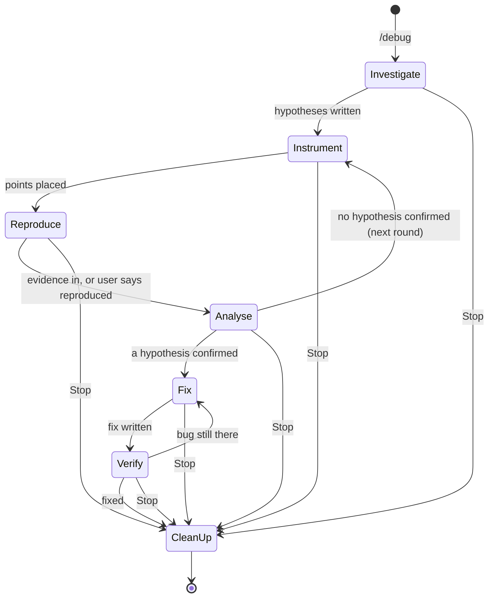
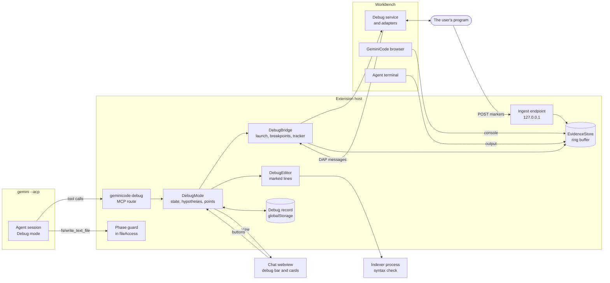

# Debug mode

Status: design, not built. This page is the functional, architectural and visual design of Debug mode, with the edge cases it is built around. When the work lands, the parts that describe what is built move to [ARCHITECTURE.md](ARCHITECTURE.md) and the user's side to the guide, as for Projects.

Related pages: [ARCHITECTURE.md](ARCHITECTURE.md) (the security model, permissions, the local MCP servers, the browser), [FINDINGS.md](FINDINGS.md) (the CLI's behaviour this relies on), [ROADMAP.md](ROADMAP.md).

## Contents

1. [The idea](#the-idea)
2. [Goals and non-goals](#goals-and-non-goals)
3. [Functional design](#functional-design)
4. [Architecture](#architecture)
5. [Security](#security)
6. [Performance and memory](#performance-and-memory)
7. [Edge cases](#edge-cases)
8. [Visual design](#visual-design)
9. [Testing](#testing)
10. [Delivery](#delivery)
11. [Spikes and open questions](#spikes-and-open-questions)
12. [Decisions](#decisions)

## The idea

An agent that fixes a bug from reading code alone guesses. Debug mode makes it collect evidence from the running program first, and fix only what the evidence shows:

1. **Investigate.** The agent reads the code and writes down two to five hypotheses, each with what would confirm or refute it.
2. **Instrument.** It places observation points for the hypotheses: logpoints and breakpoints in VS Code's debugger first, short marked log lines in the code only where the debugger can't reach.
3. **Reproduce.** The agent reproduces the bug itself (a failing test, a command, the GeminiCode browser), or asks the user to and waits.
4. **Analyse.** It reads the evidence, marks each hypothesis confirmed or refuted, and goes round again with new points if none is confirmed.
5. **Fix.** Once one hypothesis is confirmed by evidence, it makes the smallest fix, through the usual approvals.
6. **Verify.** The same reproduction runs again with the same points, and the evidence is compared with the first run.
7. **Clean up.** GeminiCode, not the model, removes every point and every marked line, and ends what it started.

GeminiCode owns the steps between the model's turns: the debugger, the evidence, the hypotheses' state, the cleanup. The model only reasons and calls tools. Nothing in the Gemini CLI changes.

Cursor's Debug mode (2.2) has the same loop with logging only: the agent writes log lines that post to a local server and has the user reproduce. Its users report two failures this design is built to avoid: the server that never receives anything, and log lines left in the code when the mode ends. GeminiCode's answer to both is the same: prefer the debugger, which needs no code change and no network, and make cleanup plain code that runs on every way out, crashes included.

## Goals and non-goals

Goals:

- **Evidence before fixes.** A fix is proposed only against a hypothesis that evidence confirmed, and the evidence is shown with it.
- **Nothing left behind.** No logpoint, breakpoint, marked line, debug session, server or grant survives the mode, a reload, a crash or a quit.
- **No new access.** Debug mode reads only what reaches GeminiCode: the debugger's messages, GeminiCode's own endpoint, the agent's terminals, the GeminiCode browser, and a file the user picks. It never widens the agent's file policy or folder trust.
- **Costs nothing when off.** No code loads, no listener runs and no tool is listed until a chat enters Debug mode.
- **Works without the model's memory.** The phase, the hypotheses and the points are GeminiCode's state, sent to the model each turn, so Compact, a context overflow or a rewind loses nothing.

Non-goals for the first version:

- Remote debugging (SSH, dev containers, Kubernetes). Attaching to a port on this Mac is in; anything else is a later stage.
- Debugging GeminiCode's own browser pages through a debugger. Browser code is observed through the browser's console (below).
- Performance profiling and memory leak hunting. The points give timings, which is enough for simple timing bugs; CPU and heap profiles are a later stage.
- Languages with no debug adapter and no instrumentation template. They get the agent's terminal and a picked log file only.

## Functional design

### Entry points

| Where | What it does |
| --- | --- |
| `/debug <what is wrong>` in any agent's composer | Enters Debug mode with the text as the bug report. Without text, the composer's placeholder asks for what was done, what was expected and what happened. |
| The composer's mode menu | A **Debug** entry beside Plan. Picking it enters Debug mode on the next message. |
| A failed test in the Testing view | **Debug with Gemini** on the item's context menu: the test's name, file, failure message and output become the bug report, and the test is the reproduction. |
| A problem in the editor | **Debug with Gemini** next to **Fix with Gemini** (`quickFix.ts`) for runtime problems only, such as an error a test or a debug session reported. |
| A debug session of the user's that stopped on an exception | **Ask Gemini Why** in the debug toolbar's overflow: the stopped thread's stack, the exception and the top frame's variables (read-only, the same caps as a snapshot) go to a new or current agent as the bug report. It sets no points in the user's session. |
| Terminal output sent to a chat | The existing Send to Gemini, then `/debug`. |
| A Jira bug | A ticket of type Bug opened in an agent offers **Debug This** beside Plan: the ticket's text is the bug report, wrapped as `<external>`. |

Debug mode is per agent. Any ordinary agent can enter it, an agent on its own branch included; a project thread can, a project's coordinator cannot (it has no code).

### Approval modes

Debug mode is a workflow, not one of the CLI's approval modes. It runs on top of Default or Auto Edit:

- **Default and Auto Edit.** Supported. The phase guard (below) refuses code edits outside the Fix phase in both, since every edit through the CLI's edit tools reaches GeminiCode as a file request.
- **YOLO.** Debug mode asks the user to leave YOLO first (Switch to Default, Switch to Auto Edit, Cancel). GeminiCode never changes the mode on the user's behalf. The reason: in YOLO the CLI's shell runs without a card, and a debug session can start a program, so the user would have no point at which to see what runs.
- **Plan.** Entering Debug mode from Plan asks which mode to continue in, as Approve Plan does.

### The phases



The phase moves only between turns, and only GeminiCode moves it:

| Phase | What the agent may do | What moves it on |
| --- | --- | --- |
| Investigate | Read code, run read-only commands (the usual approvals), use the index. No edits: the phase guard refuses them with a message the model can read. | The agent calls `debug_hypotheses` with at least one hypothesis. |
| Instrument | Add and remove points (`debug_logpoint`, `debug_breakpoint`, `debug_instrument`), start or attach the program (`debug_launch`, `debug_attach`). No other edits. | The agent calls `debug_reproduce`, or starts a reproduction itself. |
| Reproduce | Run the reproduction: a test, a command in its terminal, the GeminiCode browser. Or wait for the user. | Evidence arrives and the agent asks for it (`debug_evidence`), or the user presses **Reproduced** or **Didn't Happen**. |
| Analyse | Read evidence, inspect a held stop, update hypotheses. | `debug_hypotheses` marks one confirmed (with evidence references) and the agent calls `debug_fix`; or it places new points (back to Instrument). |
| Fix | Edit code through the CLI's tools and the usual approvals. Points stay. | The agent calls `debug_verify`. |
| Verify | Run the same reproduction again. | The evidence of the second run is shown beside the first; the agent or the user says fixed or not. |
| Clean up | Nothing: plain code runs. | Done, with a summary card. |

Rules that hold in every phase:

- **Rounds.** After four rounds of Instrument, Reproduce and Analyse with nothing confirmed, the next turn ends with a card that asks the user: Keep Going, Give a Hint (opens the composer), or Stop and Clean Up. A round with no evidence at all counts double, since it usually means the points are not where the code runs.
- **The user can always move it.** The debug bar's menu offers Skip to Fix (the user takes responsibility: the agent is told the user allowed edits without a confirmed hypothesis), Back to Investigate, and Stop.
- **The agent never edits instrumentation by hand.** A CLI edit inside a marked region is refused in every phase with a pointer to `debug_instrument` and `debug_remove`, so the record of what was inserted stays exact.

### Evidence sources

In order of preference. The agent is told the order and why; `debug_instrument` refuses the code route when a better one would reach the same line (it says which).

| Source | When | Needs | Reaches GeminiCode through |
| --- | --- | --- | --- |
| **Logpoints** | The program runs under VS Code's debugger: launched by Debug mode, or attached. | A debug adapter for the language: js-debug is built in; Python needs the debugpy extension. | The debug adapter's `output` events, seen by a `DebugAdapterTracker`. |
| **Breakpoints with a snapshot** | A value logpoints can't show well: an object's shape, the stack, many locals at once. | The same. | `stopped` events, then `stackTrace`, `scopes` and `variables` requests, then `continue`. |
| **Console markers** | Code the debugger doesn't run but whose console reaches GeminiCode: a page in the GeminiCode browser, a command in the agent's terminal, a process the debugger launched but can't break in (generated code with no source map). | Code edit (a marked line). | The browser's console capture (`browser_console`'s source), shell integration's output stream of the agent's terminal, or the debug adapter's `output` events. |
| **HTTP markers** | Code whose console GeminiCode can't see: the user's own Chrome, a process the user started elsewhere, a container. | Code edit, and the program can reach `127.0.0.1` on this Mac. | A POST to GeminiCode's debug endpoint (below). |
| **A picked log file** | Evidence the program already writes, outside what the agent may read. | The user picks the file. | GeminiCode tails the file from the moment of the pick. |

None of them reads a folder GeminiCode doesn't already serve. The program sends its evidence to GeminiCode; GeminiCode doesn't go looking for it.

### Points

A point is one place to observe, owned by one agent's Debug mode, tied to one hypothesis:

- **Logpoint** (`debug_logpoint`): a file, a line, a hypothesis, up to eight expressions. GeminiCode builds the message itself: `@@gc:<nonce>:<point>@@ {"expr":{value},...}` in the adapter's `{expression}` syntax, so every line it produces can be routed to its point.
- **Breakpoint** (`debug_breakpoint`): a file, a line, a hypothesis, an optional condition, an optional hit count, and `hold` (default off). Without `hold`, a hit takes a snapshot and continues at once. With `hold`, the thread stays stopped for up to 30 seconds so the agent can call `debug_inspect`, then continues by itself.
- **Marked line** (`debug_instrument`): a file, a line, a hypothesis, up to eight expressions, and a channel (`console` or `http`, chosen by GeminiCode unless the agent asks). GeminiCode writes the line from a template for the file's language (below); the agent never writes it.

A point that can't be placed says why, in the tool result:

- the line has no code, or the adapter reports the breakpoint as not bound (often a missing source map);
- the file is outside the agent's folder, git-ignored, generated, minified, or a format with no comments (JSON, lockfiles);
- another agent's point is on that line;
- the user already has a breakpoint on that line (it is left alone, and the agent is told its hits are the user's);
- a limit is reached (below).

Limits per debug session: 20 debugger points, 12 marked lines, in at most 8 files.

### Reproduction

The agent reproduces first when it can, so the user is asked only when nothing else works:

- **A test.** `debug_launch` with kind `test` runs a test command under the debugger: for Node, through js-debug's debug terminal; for Python, `debugpy` launching the test module. The test's exit and output are evidence too.
- **A command.** A command in the agent's terminal, under the usual shell approvals. Markers in its output are routed by shell integration.
- **A page.** The GeminiCode browser, driven by the browser tools. The agent's page's console is read for markers.

When it can't, `debug_reproduce` with steps for the user shows the **reproduce card** (see [Visual design](#visual-design)): the steps, a live count of evidence by point, and three buttons:

- **Reproduced** sends the next prompt (or queues it, if a turn runs) with the evidence summary.
- **Didn't Happen** sends a prompt saying the bug did not show this time, with whatever evidence came.
- **Stop** stops Debug mode and cleans up.

The card shows, from 20 seconds after it appears with no evidence, why that may be and what to do: the program wasn't restarted after a marked line was added (Restart Program, when Debug mode started it), the point is on a path the steps don't reach, or the HTTP endpoint can't be reached (the program's address, a page's Content-Security-Policy, a container). This answers the failure Cursor's users report, where the agent waits on evidence that can never come.

### Hypotheses

`debug_hypotheses` sets the whole list each time (two to five; more is refused). Each has an id (`h1`...), a one-line claim, what evidence would confirm it, what would refute it, a status (`open`, `confirmed`, `refuted`, `unclear`) and, for confirmed and refuted, the evidence references (`p3#12`: point 3, event 12) that support the status.

GeminiCode checks the references exist and belong to this debug session; a confirmed status without one is refused. The list is GeminiCode's: the chat draws it, and every phase prompt carries it back to the model.

### Fix and verify

- `debug_fix` names the confirmed hypothesis. The phase guard then lets edits through, with the usual approvals. The card shows the hypothesis and its evidence above the fix's diff.
- `debug_verify` runs the reproduction again: the same test or command, or the user's steps on a new reproduce card. Points stay where they are, so the second run's evidence lines up with the first.
- The verify card shows both runs per point: counts and the values that changed. The agent states whether the bug is fixed; the user's buttons are **Fixed**, **Still Broken** (back to Fix, or to Investigate from the menu) and **Stop**.
- A fixed bug offers **Add a Regression Test** when the reproduction was not already a test: the agent writes one in the Fix phase's rules, and it runs once before Clean up.

### Clean up

Clean up runs on every way out of Debug mode: Fixed, Stop, a closed chat, a removed agent, Fork, Try in Workspace, Merge Back, a window reload and the next start after a crash. It is plain code in this order, and each step is safe to repeat:

1. Remove the agent's logpoints and breakpoints.
2. Continue any thread GeminiCode holds stopped, then end every debug session Debug mode started (`stopDebugging`), and detach from attached ones without ending the program.
3. Remove every marked line (below for when one can't be removed exactly).
4. Close the agent's evidence route on the endpoint, and the endpoint itself once no agent uses it.
5. End the log file grant.
6. Drop the evidence from memory, and delete the debug record.
7. Sweep: search the agent's folder for the session's nonce (the app's ripgrep, the folder's ignore rules off for this one search). Any hit left is listed on the summary card with Open and Remove.

The summary card says what was removed, and what was left and why. Keep Changes, Commit, Merge Back, Try in Workspace and Open Merge Request are refused while the agent's debug record lists anything, with a Clean Up button on the refusal.

### Settings and policies

| Setting | Policy | Default | Scope |
| --- | --- | --- | --- |
| `gemini.debugMode.enabled` | `GeminiDebugMode` | on | application |
| `gemini.debugMode.instrumentCode` | `GeminiDebugInstrumentCode` | on (off: debugger points and picked files only) | machine |
| `gemini.debugMode.httpEvidence` | `GeminiDebugHttpEvidence` | on (off: no endpoint, console markers only) | machine |
| `gemini.debugMode.autoApproveSimple` | none | on: points and inspections whose expressions are plain property paths don't ask | machine |
| `gemini.debugMode.launch` | `GeminiDebugLaunch` | `ask` (`off`: attach only) | machine |

Machine scope keeps a repository's own settings from turning on what asks less. Turning `GeminiDebugMode` off removes the entry points and refuses `/debug`; a chat already in Debug mode cleans up.

### The agent's tools

All on one route of a new local MCP server, `geminicode-debug`, given only to a session in Debug mode (see [Tools in a running session](#tools-in-a-running-session)). Tool results are short text, never raw JSON. Evidence and anything the program printed is wrapped in `<external source="debug" ...>`.

| Tool | Arguments | What it does | Asks |
| --- | --- | --- | --- |
| `debug_hypotheses` | list of hypotheses | Sets the list (see above). | never |
| `debug_configs` | none | Lists the folder's launch configurations (name, type, request, program; never `env` values), running debug sessions it could attach to, and listening debug ports on 127.0.0.1. | never |
| `debug_launch` | a configuration's name, or a small config (`type`, `program` or `module`, `args`, `cwd`), kind `server`, `run` or `test` | Starts the program under the debugger. | always, unless the user allowed this exact configuration for the session |
| `debug_attach` | a port, or a process id of the user's | Attaches to a program the user started. | first time per program |
| `debug_logpoint` | file, line, hypothesis, expressions | Places a logpoint. | only when an expression is not a plain path |
| `debug_breakpoint` | file, line, hypothesis, condition, hit count, hold | Places a breakpoint. | only when the condition is not a plain comparison of plain paths |
| `debug_instrument` | file, line, hypothesis, expressions, channel | Inserts a marked line. | only when an expression is not a plain path |
| `debug_remove` | point ids, or `all` | Removes points. | never |
| `debug_reproduce` | steps for the user, or none when the agent runs it | Shows the reproduce card, or marks a run start for the agent's own run. | never |
| `debug_evidence` | point or hypothesis ids, `since` (a run), `limit` | The evidence, grouped by point (see [Evidence for the model](#evidence-for-the-model)). | never |
| `debug_inspect` | a held stop, a frame, expressions | Values at a stop held with `hold`. | only when an expression is not a plain path |
| `debug_request_log` | why | Asks the user to pick a log file (see [Picked log files](#picked-log-files)). | the user picks or declines |
| `debug_fix` | hypothesis id | Moves to Fix. | never (needs a confirmed hypothesis) |
| `debug_verify` | none | Moves to Verify and runs or asks for the same reproduction. | never |

"Asks" is a permission card from GeminiCode, in every approval mode, YOLO included: these are code that runs in the user's program.

## Architecture

### Where the code lives

Pure logic in `src/acp/debug/` (no `vscode` import, unit tested); the editor side in `src/host/debug/`, loaded from a bundle of its own; one webview chunk.

| File | What it holds |
| --- | --- |
| `src/acp/debug/debugState.ts` | The phases and their moves, the round count, which tools each phase allows. |
| `src/acp/debug/hypotheses.ts` | The list, its checks (count, ids, evidence references). |
| `src/acp/debug/points.ts` | Points, ids, limits, ownership, the logpoint message format and how output lines are matched back to points. |
| `src/acp/debug/expressions.ts` | Whether an expression is a plain path, per language, and how a condition is joined. |
| `src/acp/debug/templates.ts` | The marked-line templates per language and channel. |
| `src/acp/debug/regions.ts` | Inserted regions: the record of what went where, finding them again, the comparison that decides whether one can be removed exactly. |
| `src/acp/debug/evidenceStore.ts` | Events in a ring buffer with counts per point, runs, drops. |
| `src/acp/debug/evidenceFormat.ts` | The text the model gets, and the comparison of two runs. |
| `src/acp/debug/redact.ts` | Redaction of credential-looking keys and values. |
| `src/acp/debug/ingest.ts` | The HTTP endpoint's request handling (routes, tokens, limits, the Host check). |
| `src/acp/debug/logTail.ts` | Tailing a picked file: offsets, rotation, line caps. |
| `src/acp/debug/debugRecord.ts` | The record on disk for crash recovery. |
| `src/acp/debug/debugPrompts.ts` | The mode's instructions and the per-phase prompt. |
| `src/acp/debug/debugMcp.ts` | The `geminicode-debug` server's tools on `localMcpServer.ts`. |
| `src/host/debug/debugMode.ts` | One agent's Debug mode: wires the state to the chat, the server and the editor. |
| `src/host/debug/debugBridge.ts` | The VS Code debug API: launch, attach, breakpoints, the tracker, snapshots. |
| `src/host/debug/debugEditor.ts` | Inserting and removing marked lines through `WorkspaceEdit`, decorations and CodeLenses. |
| `src/host/debug/evidencePage.ts` | The Evidence page, a `PagePanel` in the agent's side group. |
| `src/host/debug/debugEntry.ts` | Entry points (Testing view, Ask Gemini Why), in the startup bundle: commands and menu contributions only, a few hundred bytes. |
| `webview-src/debugCard.ts` | The debug bar and cards, a chunk loaded with the first one. |
| `webview-src/evidence.ts` | The Evidence page. |

`src/host/debug/` except `debugEntry.ts` goes in a new `dist/debug.js` behind `LazyFeature`, like `dist/confluence.js`: `dist/extension.js` is a few KB under its 1.2 MB budget. The marked-line syntax check runs in the indexer process, which already has the tree-sitter grammars; the host never loads a parser.

### How the parts fit



### Tools in a running session

ACP gives a session its MCP servers when it opens (`session/new`) or reopens (`session/load`); a chat that enters Debug mode already has a session. Listing the debug tools in every session would cost every request about 1,500 tokens for a feature most chats never use, which goes against the team tools' rule that a user pays nothing for what they don't use.

So entering Debug mode reopens the chat's session with `geminicode-debug` added to its `mcpServers` (`session/load` takes them), in the same process. The history is the CLI's own, so nothing is lost; the replay is handled as on any reopen (`replayTracker.ts`, `keepSessionFolder`). Leaving Debug mode keeps the session as it is: the route answers every call with "Debug mode is off" until the chat next reopens, so a call after the end is harmless.

To confirm in a spike (below): that `session/load` applies new `mcpServers`, and what the replay costs on a long chat. If the CLI honours MCP's `notifications/tools/list_changed`, a route on every session that lists no tools until Debug mode starts would avoid the reload altogether; `localMcpServer.ts` would then need a way to send that notification, which its plain JSON replies don't have today.

### The phase guard

The guard sits where GeminiCode already serves the CLI's writes (`fileAccess.ts`, `fs/write_text_file`). That covers Default and Auto Edit alike, since in Auto Edit the CLI still writes through GeminiCode.

- Outside Fix: every write is refused with "Debug mode is in <phase>: edits wait until a hypothesis is confirmed (debug_fix). To observe, use debug_logpoint or debug_instrument."
- In every phase: a write that changes a marked region is refused (see above).
- A write to a file with marked lines, outside those lines, is allowed in Fix. The region record is updated by position after the write (`regions.ts` finds each region by its markers, not by line number).
- Shell commands are not guarded by phase: the usual approvals apply, and the mode's instructions ask for read-only commands outside Fix. A command that changes files in Investigate is a judgement for the user on the card, as it is outside Debug mode.

### The debugger bridge

`DebugBridge` is the one place that touches `vscode.debug`.

**Launch.**

- `startDebugging(folder, config, options)` with `suppressDebugView`, `suppressDebugToolbar` and `suppressSaveBeforeStart` set: the user's Run and Debug view stays as it was, and the debug bar's Stop Program button replaces the toolbar.
- The configuration is a copy, resolved by GeminiCode, never the user's object:
  - `${workspaceFolder}` and `${workspaceFolderBasename}` point at the agent's folder. For an agent in a worktree this is the worktree, which is not a workspace folder, so `folder` is passed as undefined and the variables are filled in first. Other variables (`${file}`, `${input:...}`, `${command:...}`) are refused: they depend on the editor's state or run commands.
  - `serverReadyAction` is removed (it opens the user's external browser); the agent uses the GeminiCode browser.
  - `preLaunchTask` and `postDebugTask` are kept and shown on the card, since the program may need them, and they run code.
  - `env` values never reach the model or the card, only names.
  - A marker `__geminiDebug: <nonce>` is added, so the tracker knows the session and its children.
- Compound configurations are refused in the first version: the agent is told to launch the parts one at a time.
- The launch card shows the configuration's name, type, program or module, arguments, working folder, `preLaunchTask`, and the names of `env` entries. **Allow Once**, **Allow This Configuration for the Session**, **Reject**.

**Attach.** By port on 127.0.0.1 or `::1` (Node's inspector, debugpy's listener, delve's server), or by process id through the adapter's own process picker arguments. An attach to an address other than loopback is refused. Detaching at Clean up never ends the program.

**Sessions and children.** js-debug runs a parent session with child sessions for each process and worker; output and stops arrive on the children. The tracker is created for any session whose configuration has the marker, or whose `parentSession` chain reaches one. Sessions the user started get no tracker, except **Ask Gemini Why**, which reads one stopped thread once through the session's own `customRequest` and keeps nothing.

**Breakpoints.**

- Points go through `vscode.debug.addBreakpoints` as `SourceBreakpoint`s. They are global to the window: they show in the user's Breakpoints view and apply to every debug session on those files.
- So, for sessions Debug mode launched, the condition gets a guard that is true only in the agent's program: Debug mode adds `GEMINI_DEBUG=<nonce>` to the launched program's environment, and the condition is `process.env.GEMINI_DEBUG === "<nonce>"` (Node) or `__import__("os").environ.get("GEMINI_DEBUG") == "<nonce>"` (Python), joined with the agent's own condition in the language's syntax (`expressions.ts`). The user's own debug sessions of the same files then never stop or log at the agent's points.
- Attach has no such guard (the program was not started with the variable): the card says the agent's points also apply to the user's debug sessions of those files while they exist.
- Each point's `Breakpoint` is kept, with its file, line, condition and message. `onDidChangeBreakpoints` tells Debug mode when the user removes or edits one: a removed point is marked removed, an edited one is no longer the agent's (it is left alone at Clean up and the agent is told).
- An agent's point in a worktree is on the worktree's path, so it never applies to the user's checkout.
- Whether a point is bound comes from `getDebugProtocolBreakpoint` and its `verified` flag, checked one second after the session starts or the point is placed.

**The tracker.** `registerDebugAdapterTrackerFactory('*', ...)` is registered when the first Debug mode starts and disposed when the last ends. Its `onDidSendMessage` runs for every DAP message of a tracked session, so it does almost nothing:

1. Only `event` messages are looked at; responses and requests are skipped by the first property read.
2. `output`: if the text holds `@@gc:`, the line is parsed and routed to its point; otherwise its category (`stdout`, `stderr`, `console`) and the text go to a per-session tail of 256 KB, for exceptions and context. Text arrives in pieces; lines are joined per category before matching, with a 16 KB cap on a line in progress.
3. `stopped`: handled as below.
4. `exited` and `terminated`: the run ends, with the exit code.

**Stops.** A `stopped` event with `hitBreakpointIds`:

- Ids are mapped back to points through `getDebugProtocolBreakpoint`. A stop at none of the agent's points (the user's breakpoint, an exception the user's filters catch, a pause the user pressed) is the user's: nothing is continued, and the agent is told the program is paused by the user.
- A stop at an agent's point takes a **snapshot**: `stackTrace` (3 frames), `scopes` of the top frame, `variables` of the locals (30 entries, two levels down, 20 children per level, 200 characters per value), each request with a 1.5-second timeout and the whole snapshot with 3 seconds. Then `continue` for that thread, unless the point holds.
- A held stop continues by itself after 30 seconds, when the agent's turn ends, or at Clean up, whichever comes first. A program never stays paused because a model stopped answering.
- While a point holds, `debug_inspect` evaluates with the `hover` context for plain paths, which some adapters evaluate without side effects (js-debug does), and `repl` for an approved expression.
- A breakpoint hit more than 50 times in a run stops snapshotting and only counts; the agent is told to use a logpoint or a hit count. A hit in a loop would otherwise pause the program 3 seconds at a time.

**Focus.** A stop makes the workbench reveal the stopped line, and `debug.openDebug` may open the Run and Debug view. With snapshot and continue the stop is short, but the reveal still moves the user's editor. See the spikes: the fallback is a `GEMINI-FORK` edit that skips the reveal for sessions with the marker, which is a registration-point change of the kind the design rules allow when the API can't do the job.

### Marked lines

`debug_instrument` never lets the model write code into the program. GeminiCode builds the line, checks it, inserts it, and records it.

**Templates.** One per language and channel, in `templates.ts`. Each is a region of three or four lines: a start marker, the statement, an end marker. The statement is wrapped so it can never throw, never awaits, and returns at once. JavaScript and TypeScript, console channel:

```js
// GEMINI-DEBUG-START gc7f3a p4
try { console.log("@@gc:gc7f3a:p4@@", JSON.stringify({ "cart.total": (() => { try { return cart.total; } catch (e) { return "<" + e + ">"; } })() }, (k, v) => typeof v === "bigint" ? String(v) : v)); } catch {}
// GEMINI-DEBUG-END gc7f3a p4
```

HTTP channel: the same, with `fetch("http://127.0.0.1:<port>/debug/<token>", { method: "POST", body: ..., keepalive: true }).catch(() => {})` in place of `console.log`. A string body makes it a simple request, so browsers send no preflight.

Python, console channel (stderr, flushed):

```python
# GEMINI-DEBUG-START gc7f3a p4
try: __import__("sys").stderr.write("@@gc:gc7f3a:p4@@ " + __import__("json").dumps({"order.total": order.total}, default=str)[:4000] + "\n"); __import__("sys").stderr.flush()
except Exception: pass
# GEMINI-DEBUG-END gc7f3a p4
```

Python's HTTP channel posts from a daemon thread with a 0.2-second timeout, so a slow or closed endpoint never holds the program.

Details:

- TypeScript gets a `// @ts-ignore` line before the statement, so a type error in an expression never breaks a type-checked build while the line is there.
- Indentation matches the line it is inserted before.
- Each expression is evaluated in its own `try`, so one failing expression still sends the others.
- The first version has templates for JavaScript, TypeScript (with JSX and TSX) and Python, and `<script>` blocks in Vue and Svelte files. Other languages get debugger points, terminal output and picked files.

**The channel.** GeminiCode picks it from what it knows of where the code runs:

- `console` when the program runs under a tracked debug session or in the agent's terminal, or the file is served to a page open in the GeminiCode browser;
- `http` otherwise, and only with `gemini.debugMode.httpEvidence` on.

The agent can ask for one; the tool result says which was used and why.

**Checks before inserting.**

1. The file is inside the agent's folder, not git-ignored, not a secret file (the agent's file policy, unchanged), not generated (a `// @generated` or `DO NOT EDIT` header, a minified file, a file under `dist`, `build` or `out` that the repository ignores), and not open with unsaved changes. A file with unsaved changes is refused rather than edited under the user's hands.
2. The line is a statement position: the indexer parses the file with the line inserted, and refuses when the parse has more errors than before. This catches a line inside a multi-line expression, an object literal or a JSX tree.
3. The expressions pass `expressions.ts`, or the user approves them on a card that shows the exact region.

**Inserting.** Through a `WorkspaceEdit`, then a save, as the agent's own writes are, so the editor's undo and the disk agree. A save may run the user's format-on-save. The record keeps the exact inserted text and a normalised form (whitespace removed), so a region a formatter rewrapped still counts as unchanged.

**Removing.** `regions.ts` finds each region by its start and end markers with the nonce and point id, wherever it moved in the file:

- **Normalised text equals what was inserted:** the region goes, markers included, through a `WorkspaceEdit`.
- **Changed, by the user or a tool:** it is not removed silently. The Clean up summary shows the region's diff against what was inserted, with Remove Anyway and Keep.
- **Markers gone, or the file deleted or renamed:** the region is gone from the record; the sweep by nonce catches a copy elsewhere.

**Restarts.** A marked line needs the code to load again. A program Debug mode launched with kind `server` is offered a restart (Restart Program on the reproduce card), unless a file watcher in the program reloads it (Vite, Next, `node --watch`, `nodemon`, `uvicorn --reload`, detected from the launch command). A logpoint needs no restart.

### The ingest endpoint

One small HTTP server for all agents, in the debug bundle, on `127.0.0.1` with a port the system picks, started when the first HTTP marker is inserted and closed when no agent has one.

- **Routes.** `POST /debug/<token>`, with a token of 128 random bits per debug session. A missing or unknown token answers 404 and is not logged.
- **Host check.** The `Host` header must be `127.0.0.1:<port>`, `localhost:<port>` or `[::1]:<port>`. Anything else answers 421. This stops DNS rebinding.
- **Body.** At most 16 KB per request, read with a 2-second deadline; a larger body answers 413 and counts as a drop. Text, one event per line (`@@gc:<nonce>:<point>@@ <json>`), so a batch is allowed. Lines whose nonce isn't the route's are dropped.
- **Rates.** A token bucket per route: 200 events a second with bursts of 400, and 50 a second per point. Excess is counted, never stored.
- **Answers.** 204 with `Access-Control-Allow-Origin: *` and no body. A wildcard is safe because the answer holds nothing, and it keeps a page's console free of CORS errors that would show up as evidence.
- **A page's Content-Security-Policy** may block the request (`connect-src`). Nothing reaches the endpoint, so the reproduce card's no-evidence hints name this, and the agent is told to use the console channel with the page in the GeminiCode browser instead.
- **Containers.** A program in a container reaches the Mac through `host.docker.internal`, whose `Host` header the check would refuse. The template takes the address the agent names (`127.0.0.1` by default, `host.docker.internal` when the file is in a folder with a Dockerfile or compose file and the agent says so), and the Host check accepts `host.docker.internal:<port>` only for routes created that way. Whether Docker Desktop forwards to a server that listens only on `127.0.0.1` is a spike.
- **Lifetime.** A route ends at Clean up. A marked line left in code after that (the user kept it) posts to a closed route: 404, or nothing listening, and the template's `catch` swallows it.

### Console and terminal evidence

- **The GeminiCode browser.** The console capture behind `browser_console` gets a listener for lines with `@@gc:` on the agent's own pages, the pages it opened or was handed. A page the user opened in the browser that runs the same code is the user's, and its console isn't read.
- **The agent's terminal.** Shell integration's output stream of commands the agent runs in its own terminal (`agentTerminals.ts`), already read for Run and terminal output, is scanned for `@@gc:` lines while Debug mode is on. The user's own terminals are never read; **Send to Gemini** stays the way to give their output.

### Picked log files

`debug_request_log` shows a card with the agent's reason and **Choose File...** and **Not Now**. The picker opens at the agent's folder, and the user can go anywhere.

- **Grant.** One file, read-only, for this debug session. Not a folder, and not the agent's file policy: the agent still can't `read_file` it. The grant is listed on the debug bar and ends at Clean up.
- **What is read.** Only what is added after the pick, from the file's size at that moment. Never what was already in it: that history was written before the user chose to share anything.
- **Following the file.** `fs.watch` plus a stat every two seconds as a backstop, since watchers miss events on some file systems. A file that shrinks was truncated: reading starts again at zero. A file replaced under the same path (rotation: a new inode) is reopened and read from its start. A file that is deleted ends the grant with a note.
- **Lines.** UTF-8, cut at 2 KB each; a file with NUL bytes in its first 4 KB is refused as binary. At most 1 MB read per run.
- **Filtering.** The agent can give up to five literal substrings (no regular expressions, so no catastrophic patterns); lines with `@@gc:` always pass. Other lines go to the evidence as context, with the same caps as terminal output.

### Evidence for the model

`EvidenceStore` keeps, per debug session:

- events in a ring buffer: at most 2,000, or 1 MB of text, whichever comes first; the oldest go first;
- per point, counts that never drop (hits, drops, redactions), the first and last value, and up to five distinct values with their counts;
- runs: each reproduction starts a run, so evidence can be read per run and two runs compared.

`debug_evidence` answers in at most 12,000 characters, about 3,000 tokens: well under the CLI's 40,000-character cap on one tool output, since a debug session can run for many turns. Per point it gives:

- hit count and drops;
- first and last values;
- distinct values with counts;
- the last few events, with times relative to the run's start.

Points are ordered by hypothesis. A timeline of the first 40 events across points follows, since ordering is often the evidence in timing bugs.

Every value is redacted (below) and cut at 500 characters. The whole answer is wrapped in `<external source="debug">`, because program output can carry anyone's text, user input included.

The reproduce card's live count and the Evidence page read the same store. The webview gets counts only, at most once a second, and the page asks for events a page at a time.

### Records and crash recovery

`debugRecord.ts` writes `<globalStorage>/debug/<agent>.json` when Debug mode starts and on every change to what exists in the world. It holds:

- the nonce;
- each point: kind, file, line, condition, message;
- each marked region: file, the exact inserted text, its normalised form, its markers;
- the debug sessions it started, by their marker;
- the grant's path;
- the route (no token).

It holds no evidence. Writes are batched to one per 500 ms, written to a temporary file and renamed.

On the next start, or a window reload, a record still there is a Debug mode that didn't end:

- Its breakpoints are removed by matching file, line, condition and message. VS Code keeps breakpoints across reloads, but their ids don't survive.
- Its sessions are already gone with the old extension host.
- Its marked regions are listed on Home under **Unfinished**: Debug code left in N files, with Clean Up and Open. They are removed by the same exact-text rule only when the user picks Clean Up. Removing them at startup unasked would edit files the user may have worked on since.

The chat, when reopened, shows that Debug mode ended with the window, and offers Clean Up or Resume. Resume starts a new Debug mode with the old hypotheses and new points; evidence doesn't survive.

### Interaction with the rest of GeminiCode

| Feature | In Debug mode |
| --- | --- |
| **Compact** | The summary is the model's. The hypotheses, points and phase are GeminiCode's, so the next prompt carries them again in full. |
| **Context overflow** | The new session (`continueAfterOverflow`) gets the `geminicode-debug` route and the mode's instructions, the phase and the hypotheses. |
| **Rewind** | Rewinding the conversation to before `/debug` runs Clean up first and leaves Debug mode. Rewinding within Debug mode keeps GeminiCode's state and points. Reverting code changes reverts the agent's edit-tool changes only, as today, so marked lines (not edit-tool changes) stay and stay recorded. |
| **Fork Agent** | The fork does not inherit Debug mode. A fork on its own branch gets the parent's working tree without the parent's regions (they are stripped in the fork's worktree by the exact-text rule). The fork is told Debug mode was on in the parent and the hypotheses so far. |
| **Try in Workspace, Merge Back, Open Merge Request, Keep Changes, Commit** | Refused while the record lists regions, with Clean Up on the refusal. Debugger points don't block them: they are not in the files. |
| **Changes panel** | Marked regions are not the agent's changes. They show in the Changes panel as a separate "Debug code" group with Remove, not with Keep, so they never get kept by Keep All. |
| **Prompt queue and steering** | Reproduce card buttons go through the queue when a turn runs. Steering stops at a safe point as today; a held stop is continued when the turn stops. |
| **Several agents** | Each agent's Debug mode has its own nonce, route, points and records. Points on the same file and line as another agent's are refused. At most two agents in Debug mode per window in the first version, so the debug view and the user's attention stay manageable. A third is told to wait. |
| **Projects** | A thread can debug in its worktree. Its card shows the phase. The coordinator's thread list includes it, and the coordinator can't start Debug mode itself. |
| **Agents and Editor layouts** | The Evidence page opens in the agent's side group (`agentColumn`), and its view type joins `sidePageViewTypes` in `geminiAgentGroups.ts`. |
| **The CLI's hooks** | `AfterTool` hooks such as a formatter run on the CLI's own edit tools. Marked lines are not those, so hooks don't run on them; the normalised comparison covers format-on-save. |
| **The CLI's checkpoints (Undo)** | Undo of an agent's edit inside a file with regions keeps the regions: GeminiCode's own undo works from the agent's recorded text, and the regions were added after, as user edits are (`rebaseOriginal`). |

## Security

Debug mode runs code in the user's program by design. The rules below keep each place where code runs visible to the user, and keep everything else as narrow as it is today.

| Risk | What stops it |
| --- | --- |
| The model runs arbitrary code through an expression (logpoint message, condition, inspect, marked line). An expression like `{deleteAll()}` runs in the program. | Only plain property paths pass without a card (`a.b[0].c`, `a?.b`, `a["k"]`), checked per language. Anything with a call, an assignment, an operator other than a comparison in a condition, a template string or a lambda shows the exact expression on a card. Residual: a property getter can run code even on a plain path; the card text and the docs say so. |
| The model writes arbitrary code as "instrumentation". | It can't: `debug_instrument` takes expressions, GeminiCode writes the statement from a fixed template, and a CLI write into a marked region is refused. |
| A launch runs repository-controlled code (`preLaunchTask`, the program itself, a config the model wrote). | Every launch shows a card with the configuration in full except `env` values. Launch is refused in a folder the CLI does not trust; attach to a program the user started is still offered, since the user ran it. Variables that run commands (`${command:...}`, `${input:...}`) are refused. `GeminiDebugLaunch` can turn launches off. |
| YOLO auto-approves the cards above. | Debug mode doesn't run in YOLO, and the debug tools' cards ask in every mode, as team writes do. |
| Secrets in evidence: a logpoint on a request object prints its headers. | Redaction before anything reaches the model or the page. **Keys**: values under keys that look like credentials (the `withoutSecrets` rule in `env.ts`: `TOKEN`, `SECRET`, `PASSWORD`, `_KEY`, `CREDENTIAL`, plus `authorization`, `cookie`, `set-cookie`, `session`). **Values** that look like one: JWTs, `Bearer ...`, private key blocks, `AKIA...`, `AIza...`, `ghp_`, `glpat-`, `xox?-`. The card counts redactions. A plain path into `process.env` or `os.environ` asks; the whole environment object is refused, as the environment commands are. |
| Prompt injection through program output (a log line that says "ignore your instructions"). | All evidence is wrapped in `<external source="debug">`, with inner tags escaped (`external` in `teamTools.ts`), and the mode's instructions say it is data. |
| Another local process or web page posts fake evidence. | A 128-bit token per debug session, the Host check against DNS rebinding, loopback only, closed at Clean up. Fake evidence would still only be data, never instructions. |
| The token is in a source file while the marked line exists. | It is scoped to one debug session's evidence route and dies at Clean up. Commits through GeminiCode are refused while regions exist; the sweep finds them by nonce. A commit from the user's own terminal is not blocked. The leftover posts to a closed port and fails quietly. |
| Debug code reaches production. | The same guards, plus the regions' markers make them easy to find (`GEMINI-DEBUG`). Clean up's summary lists anything left. |
| A held stop blocks a server, or a lot of breakpoint hits slows the program. | Snapshot and continue by default, a 30-second cap on holds, continue at turn end and at Clean up, snapshots off after 50 hits of one point. |
| The agent's points act in the user's own debug sessions. | The environment guard in conditions for programs Debug mode launched; the attach card says the agent's points apply to the user's sessions too. |
| Reading files the agent may not read. | A picked log file is a grant of one file to Debug mode's tail, never to the agent's file tools, and only lines written after the pick. |
| Attaching to someone else's program. | Loopback addresses only; process ids only through the adapter's own picker; every first attach asks. |
| Evidence and records on disk. | Evidence is never written to disk. The record holds file paths, inserted text and the nonce, not tokens or values, and goes at Clean up. |

The audit log records team writes and is not used here. Debug mode's own log lines (point placed, launch allowed, region removed) go to the extension's log, with paths and ids, never values.

## Performance and memory

Debug mode is off for almost every chat, so its first budget is zero:

| What | Budget | How |
| --- | --- | --- |
| Startup | 0 ms and under 1 KB in `dist/extension.js` | Entry points are menu contributions and a command; everything else is in `dist/debug.js`, loaded on first use. |
| Chat webview | under 1 KB in `media/chat.js` | The debug bar and cards are a chunk (`debugCard.js`, under 12 KB), loaded with the first one, as `threadCard.js` is. |
| Entering Debug mode | the session reload plus under 200 ms | Loading `dist/debug.js` and starting the MCP route. The session reload's cost is measured in the spike and shown as progress on the bar. |
| Tracker, per DAP message | under 5 microseconds for a message it skips | One property check for non-events; one substring check for output; no allocation for skipped messages. A perf test runs 100,000 mixed messages. |
| Output lines | 10,000 lines of plain output under 20 ms | Plain output goes to a byte-capped tail, not parsed. |
| `debug_evidence` | under 20 ms for 2,000 events | Counts are kept as events arrive, not computed when asked. |
| Webview updates | at most one a second | The reproduce card's count. |
| Ingest | under 0.2 ms per request in the extension host | Requests are parsed in streaming, with no JSON parse of the body: each line's JSON is parsed when the model asks, not on arrival. |
| Memory per Debug mode | under 4 MB | 1 MB of events, 256 KB of output tail per debug session (at most three), snapshots inside events, points and records in kilobytes. |
| Memory when it ends | back to before | The tracker factory, listeners, watchers, server routes and store are each disposed at Clean up; a test checks each disposable is released. |

Other rules:

- Debug mode adds no timer while nothing happens. A held stop has one timer; the log tail's backstop stat runs only while a grant exists; the no-evidence hint is one timer per reproduce card.
- The debug record write is batched (500 ms) and never on the tracker's path.
- Nothing scans a workspace except the one nonce sweep at Clean up, in the app's ripgrep, limited to the agent's folder.

## Edge cases

Behaviour for the cases the design is built around, grouped by where they arise.

### The program

| Case | Behaviour |
| --- | --- |
| No `launch.json` | `debug_configs` says so. The agent proposes a small configuration (Node program, Python module, test command), which shows on the launch card. Debug mode never writes `launch.json`. |
| Several configurations, a multi-root workspace | `debug_configs` lists each with its folder; the agent names one. |
| A compound configuration | Refused in the first version, with its parts listed. |
| The program is already running (port in use) | The launch's own error reaches the agent as evidence. The mode's instructions say to attach instead, or launch on another port through the configuration's `args`. |
| The program exits before the reproduction | The run ends with the exit code and the tail of stderr. The reproduce card shows "The program exited" with Restart Program. |
| The program crashes the debug adapter | `terminated` without `exited`: the run ends, the agent is told the adapter ended, and points stay so a new launch reuses them. |
| A program that forks workers or child processes | js-debug's child sessions are tracked through `parentSession`. For Python's multiprocessing, debugpy's `subProcess` option is on in GeminiCode's resolved config. |
| TypeScript or bundled code with source maps | Logpoints map through the adapter. An unbound point is reported as such, with the advice to check `outFiles` or `sourceMaps`, or to use a marked line, which needs no map. |
| Code that runs only in the user's Chrome | A marked line on the HTTP channel, or the page opened in the GeminiCode browser with the console channel. Launching Chrome through js-debug is not used: the user may not have Chrome, and it would be another browser profile with the user's sign-ins. |
| A page with a strict Content-Security-Policy | HTTP markers can't post; the no-evidence hint says so; the console channel in the GeminiCode browser works. |
| A program in Docker | Marked lines with `host.docker.internal` (see the endpoint). Debugger attach to a port the container publishes on loopback works like any attach. |
| The program logs heavily | Plain output goes only to the capped tail; marked events are rate-limited and counted; nothing grows without bound. |
| Evidence floods from a hot loop | Per-point rate limit (50 a second), drops counted, distinct values still kept, and the agent told to move the point or add a hit count. |
| Circular structures, BigInt, huge strings in values | Each expression in its own `try`; the template's replacer turns BigInt into a string; a circular object sends `<TypeError ...>` for that expression; values cut at 4,000 characters in the program and 500 in what the model gets. |
| Timing bugs that instrumentation hides | Logpoints and console markers change timing a little; snapshots change it a lot. The mode's instructions say to prefer logpoints for timing hypotheses, and events carry times so ordering is visible. |
| The bug doesn't happen every time | Didn't Happen is a valid answer; runs are kept apart, so evidence of a run where it happened can be compared with one where it didn't. |

### The editor and the files

| Case | Behaviour |
| --- | --- |
| The user edits a file with marked lines | Allowed. Regions are found by markers, not line numbers. A region whose text the user changed is not removed silently. |
| Format on save rewraps a marked line | Covered by the normalised comparison. |
| The user deletes a region or its markers | The region leaves the record; the sweep checks for stray markers. |
| The file is renamed or moved | The region is lost at the old path; the sweep finds it by nonce in the new one and offers Remove. |
| The file has unsaved changes when a line would go in | Refused, with a reason; the agent picks another point or waits. |
| The user has a breakpoint on the same line | The agent's point isn't added; the agent is told the hits there are the user's. |
| The user removes or edits an agent's breakpoint | A removed point is marked removed. An edited one becomes the user's, and Clean up leaves it. |
| A git operation (checkout, stash, pull) while regions exist | The regions go or move with the files. The record is checked against the files when the HEAD watcher (`CommitSettler`) sees a move, and the summary reflects what is still there. A stash that holds a region is not followed; the sweep at Clean up names files only. |
| Lint or type errors from a marked line | `// @ts-ignore` in TypeScript. A linter that bans console calls or `@ts-ignore` may complain until Clean up; that is the price of a visible marker, and the Changes panel's "Debug code" group makes it clear where they are. |
| Generated or vendored files | Refused for marked lines. Debugger points are still allowed (they change no file). |

### The session and the app

| Case | Behaviour |
| --- | --- |
| The model stops answering mid-turn | Held stops continue at turn end or after 30 seconds; the stall notice works as today. |
| The user closes the chat or removes the agent | Clean up runs before the chat goes. |
| The window reloads or the app quits | Clean up's steps that are quick (breakpoints, sessions, routes) run in `deactivate`; regions wait for the user on Home after the next start (see records). |
| A crash | The record is there at the next start; breakpoints are removed, regions offered for Clean up. |
| Two windows on the same folder | Each window's GeminiCode is separate; nonces differ; an agent sees only its own points. VS Code keeps breakpoints per workspace, so the other window shows them too while they exist; each window removes only its own. |
| Debug mode in an untrusted folder | Investigate works, launch is refused (attach and debugger points in a user-started program work), marked lines are allowed (they are GeminiCode's own text, not the folder's code running). |
| The CLI process restarts (trust file change, settings change) | The session reopens; GeminiCode adds the debug route again on that reopen since the chat is in Debug mode. |
| The admin turns Debug mode off while a chat uses it | Clean up runs; the chat says why. |
| Rewind, Fork, Compact, overflow, Try, Merge Back | See [Interaction with the rest of GeminiCode](#interaction-with-the-rest-of-geminicode). |

## Visual design

Debug mode uses the chat's existing look: GeminiCode's theme tokens, the composer's pills, the thread cards' structure, themed tooltips (`setTip`), the shared menus. Nothing new in colour except one tint for marked regions in the editor, from a theme token so both GeminiCode themes pass the 4.5:1 check. Status is never shown by colour alone: each pill has a word and an icon.

### The composer

Picking Debug in the mode menu, or typing `/debug`, shows a Debug pill beside the branch pill, and a placeholder that asks for the bug:

```
+--------------------------------------------------------------------------+
| Describe the bug: what you did, what you expected, what happened.         |
|                                                                          |
|                                                                          |
+--------------------------------------------------------------------------+
| [+]  [Debug x]  [main v]  [Default v]                        [Send ->]   |
+--------------------------------------------------------------------------+
```

The pill's `x` leaves Debug mode before it starts. Once it has started, leaving goes through Stop on the debug bar.

### The debug bar

Pinned above the composer while Debug mode is on, in the same place as the queue strip (which stacks above it when both show). One line, folded by default:

```
+--------------------------------------------------------------------------+
| (bug) Debug  Investigate > Instrument > [Reproduce] > Fix > Verify       |
|       2 hypotheses open - 4 points - 37 events          [Evidence] [...] |
+--------------------------------------------------------------------------+
```

- The phase line shows where it is; done phases are marked with a check icon, the current one in a pill.
- The counts open the Evidence page.
- The `[...]` menu: Skip to Fix, Back to Investigate, Restart Program (when Debug mode launched it), Stop Program, Remove All Points, Stop Debug Mode. Each says what it does in its own words, and destructive ones ask.
- Unfolded, the bar lists the points, each with its file and line (a link), hypothesis, kind icon (logpoint, breakpoint, marked line), hit count, and Remove:

```
| Points                                                                   |
|  <> p1  cart.ts:42      h1  logpoint      12 hits              [Remove]  |
|  || p2  cart.ts:88      h2  breakpoint     1 hit (snapshot)    [Remove]  |
|  {} p3  checkout.js:17  h2  marked line    0 hits - not loaded [Remove]  |
| Log file: ~/Library/Logs/shop/server.log (since 10:42)          [Stop]   |
```

### Cards in the chat

Cards are drawn at milestones, in the turn that produced them, and update in place.

**Hypotheses** (after `debug_hypotheses`):

```
+--------------------------------------------------------------------------+
| Hypotheses                                                               |
|  h1  [open]       The total is rounded before the discount is applied.   |
|                   Confirms: total at p1 has no decimals.                 |
|  h2  [confirmed]  The discount is applied twice when the cart reloads.   |
|                   Evidence: p2#1, p3#4, p3#5          [Show Evidence]    |
|  h3  [refuted]    Currency conversion uses a stale rate.                 |
|                   Evidence: p4#2                                         |
+--------------------------------------------------------------------------+
```

Evidence references are links: each opens the Evidence page at that event.

**Launch** (a permission card, the existing card's layout):

```
+--------------------------------------------------------------------------+
| Start the program under the debugger?                                    |
|  Configuration  Launch Server (launch.json)                              |
|  Program        node  src/server.js  --port 3001                         |
|  Folder         ~/.geminicode/worktrees/shop/debug-cart                  |
|  Before start   task: npm: build                                         |
|  Environment    NODE_ENV, PORT  (values not shown)                       |
|                                                                          |
|  [Allow Once]  [Allow This Configuration for the Session]  [Reject]      |
+--------------------------------------------------------------------------+
```

**Expression** (when an expression is not a plain path):

```
+--------------------------------------------------------------------------+
| Add a logpoint that runs code in your program?                           |
|  cart.ts:42   h1                                                         |
|  items.map(i => i.price).join(",")                                       |
|  An expression runs in your program each time the line runs.             |
|  [Allow Once]  [Reject]                                                  |
+--------------------------------------------------------------------------+
```

**Reproduce**, in its states:

```
+--------------------------------------------------------------------------+
| Reproduce the bug                                                        |
|  1. Open http://localhost:3001/cart with two items.                      |
|  2. Apply the code SAVE10, then reload the page.                         |
|                                                                          |
|  Waiting for evidence...                                                 |
|                                                                          |
|  [Reproduced]  [Didn't Happen]  [Stop]                                   |
+--------------------------------------------------------------------------+

  after 20 s with nothing:
|  No evidence yet. The marked line in checkout.js needs the server to     |
|  restart.                                         [Restart Program]      |

  while evidence arrives (updated at most once a second):
|  Receiving: p1 12 - p2 1 - p3 4                                          |

  when the program exits:
|  The program exited (code 1).          [Show Output]  [Restart Program]  |
```

**Verify**:

```
+--------------------------------------------------------------------------+
| Before and after the fix                                                 |
|  p2 cart.ts:88   applyDiscount calls      before 2    after 1            |
|  p3 checkout.js  total                    before 8.10 after 9.00         |
|  The test "cart keeps one discount" passed.                              |
|  [Fixed]  [Still Broken]  [Add a Regression Test]                        |
+--------------------------------------------------------------------------+
```

**Clean up**:

```
+--------------------------------------------------------------------------+
| Debug mode ended                                                         |
|  Removed 3 logpoints, 1 breakpoint, 2 marked lines in 2 files.           |
|  Ended 1 debug session. Stopped reading server.log.                      |
|  Left: checkout.js:17 was edited after it was added.                     |
|        [Show Diff]  [Remove Anyway]  [Keep]                              |
+--------------------------------------------------------------------------+
```

### The Evidence page

A page in the agent's side group:

```
+--------------------------------------------------------------------------+
| Evidence - Fix checkout total                     Run: [2 of 2 v]        |
| [All hypotheses v]  [All points v]  [Search values]                      |
+--------------------------------------------------------------------------+
| time      point  where             values                                |
| +0.012 s  p1     cart.ts:42        {"cart.total": 9, "discount": 0.1}    |
| +0.015 s  p2     cart.ts:88        snapshot: applyDiscount (3 frames) >  |
| +0.420 s  p3     checkout.js:17    {"total": 8.1}                        |
| ...                                                                      |
| 412 events - 38 dropped (rate) - 2 values redacted                       |
+--------------------------------------------------------------------------+
```

- A snapshot row unfolds into its frames and variables.
- The run picker shows one run or two side by side.
- Rows are drawn in pages of 200 as the list scrolls; the page never holds more than the store does.

### The editor

- **Debugger points** use VS Code's own breakpoint and logpoint glyphs, since they are real breakpoints. A faded after-text on the line says whose they are and how often they were hit: `Gemini p1 (h1) - 12 hits`.
- **Marked regions** get a left border and a faint background tint from a theme token (`gemini.debugRegion`), and a CodeLens above the start marker: `Gemini debug code (p3, h2) - 4 hits | Remove`.
- **The status bar** shows `(bug) Debugging: 4 points, 37 events` while any agent is in Debug mode; clicking it shows that agent.

### Home

Under **Unfinished**, a Debug mode that ended with the window:

```
| Debug code left in 2 files - "Fix checkout total"     [Clean Up] [Open]  |
```

### Accessibility and words

- Every control is a button with a label and reachable with the keyboard; the phase line is a list with the current item marked for screen readers.
- The live count is in an `aria-live="polite"` region updated at most every five seconds, so a screen reader isn't flooded.
- Strings come from the host (`vscode.l10n.t`, the chat's strings), with `{0}` placeholders, never joined.
- Words follow the rest of the chat: plain verbs on buttons (Reproduced, Stop, Remove), no jargon on cards (logpoint is named once in the bar's legend, with a tooltip).

## Testing

- **Unit tests** (`test/acp/debug/`, Vitest), for every pure module:
  - the phases and their moves;
  - the hypotheses' checks;
  - point ids, limits and ownership;
  - expression checks per language, with property getters noted as a known case;
  - templates per language and channel, parsed by the grammars in the tests;
  - finding and removing regions after edits, formatting, moves and deletes;
  - the store's caps and counts;
  - evidence formatting under its character budget;
  - redaction;
  - the endpoint's routes, Host check, limits and rates against a real socket on loopback;
  - log tail across truncation, rotation and deletion;
  - the record's crash recovery.
- **A scripted debug adapter** (`test/fake-dap`), like `test/fake-agent`, replays output, stopped, exited and slow or missing responses. It tests the bridge's logic, which lives in a pure module (`debugBridgeLogic.ts`) with the `vscode` calls passed in.
- **Real CLI test** (`test/acp/realDebugSession.test.ts`): `session/load` with an added MCP server lists its tools and keeps the history. It fails when a CLI release changes that.
- **Performance budgets** (`test/perf/`): the tracker's skip path, 10,000 output lines, `debug_evidence` on 2,000 events, the chunk sizes, and `dist/extension.js` growth under 1 KB.
- **Webview tests** (`test/webview/`): the cards' states, the bar's folding, the count's throttle.
- **In the real app** (the `geminicode-real-app` skill), with two sample programs in `test/fixtures/debug/`: a Node server with a discount bug, and a Python script with an off-by-one. The runs cover:
  - logpoints;
  - snapshot and continue;
  - a held stop;
  - marked lines on both channels;
  - a page in the GeminiCode browser;
  - a picked log file;
  - Stop in every phase;
  - a reload in the middle;
  - a worktree agent;
  - two agents at once.

## Delivery

Each stage is useful by itself and ships behind `gemini.debugMode.enabled`.

1. **Spikes** (below), before any code is written for the stages they affect.
2. **The debugger.** `geminicode-debug` route, `debug_configs`, `debug_launch`, `debug_attach`, logpoints, breakpoints with snapshots, `debug_evidence`, the store, redaction, the record, Clean up of debugger points and sessions. The debug bar with points and counts. No phases yet: the agent is asked to observe before fixing, and edits follow the usual approvals.
3. **The workflow.** Phases and the guard, hypotheses, the reproduce, verify and clean-up cards, the Evidence page, entry points (Testing view, Ask Gemini Why).
4. **Marked lines.** Templates, the syntax check in the indexer, the console channel (debugger output, the agent's terminal, the GeminiCode browser), regions in the Changes panel, the guards on Try and commit.
5. **Beyond the debugger.** The HTTP endpoint, containers, picked log files.
6. **Later.** More languages (Go with delve, Java), remote attach, CPU and heap profiles as evidence, and regression tests written from the reproduction by default.

## Spikes and open questions

| Question | Why it matters | How to answer |
| --- | --- | --- |
| Answered (`test/acp/realMcpReload.test.ts`, FINDINGS.md): `session/load` with an added server starts it and declares its tools, and the CLI also refreshes a server's tools on `notifications/tools/list_changed` over the server's notification stream, so the debug tools arrive with no reload at all: the `geminicode-debug` route is listed from the start with no tools, and sends the notice on entry. The replay cost no longer matters for this. | It decides how a running chat gets the debug tools. | A real CLI test, and `perf-real.mts` on a long session. |
| Answered: gemini-cli 0.66 keeps one notification stream open per HTTP server and lists its tools again on `notifications/tools/list_changed` (`test/acp/realMcpReload.test.ts`); `LocalMcpServer.notifyToolsChanged` sends it. | It avoids the reload. | Done. |
| Does Plan mode let the CLI call an MCP tool that isn't read-only? | Investigate could then run in Plan for a second guard. Not needed for the design, which guards writes itself. | A real CLI test. |
| Can a stop of a session started with `suppressDebugView` avoid revealing the line in the user's editor? | A reveal that moves the user's editor is disruptive. | Try in the real app; if not, a `GEMINI-FORK` edit in the debug service's stop handling that skips the reveal for sessions with the marker. |
| Is debugpy (`ms-python.debugpy`) on Open VSX, and can GeminiCode offer to install it when a Python program is debugged? | Python logpoints depend on it. | Check Open VSX; install through the extensions service with the user's yes. |
| Does Docker Desktop on macOS forward `host.docker.internal` to a server that listens only on `127.0.0.1`? | HTTP markers from containers. | Try it. If not, containers use the console channel and `docker logs` in the agent's terminal. |
| Does js-debug's `hover` evaluation stay side-effect free for getters? | It decides how far plain paths can be trusted. | A fixture with a getter that counts calls. |
| Do VS Code's breakpoint ids survive a window reload? | The record matches by location today. | Try it; switch to ids if they do. |

## Decisions

| Decision | Why | Rejected |
| --- | --- | --- |
| Debugger points first, code instrumentation only where they can't reach. | No file edits, no cleanup risk, no network, live without restarts. | Logging only (Cursor's approach): both of its reported failures come from it. |
| GeminiCode writes marked lines from templates; the model gives only expressions. | Exact cleanup, no arbitrary code under an auto-approval, consistent routing. | Letting the model write log lines between markers: an auto-approved block of model-written code is a hole, and cleanup can't be exact. |
| The program sends evidence to GeminiCode. | No new read access. Works for folders GeminiCode doesn't serve or trust. | Reading the program's log folder. |
| Phases and hypotheses are GeminiCode's state. | Survive Compact, overflow and rewind; checkable; drawable. | Keeping them in the model's context. |
| The guard is on file writes, not on a CLI mode. | Works in Default and Auto Edit, needs no CLI change. | Plan mode for Investigate: unproven for MCP tools, and it can't tell instrumentation from edits. |
| Debug mode refuses YOLO and asks the user to switch. | Launches and expressions run code; the user must see them. Never change the mode for the user. | Silently switching to Default. |
| The debug tools arrive through `tools/list_changed` on entry: the `geminicode-debug` route is in every session's list and offers nothing until then. | Zero tokens for chats that never debug, and no reload or replay (the spike found the CLI honours the notice). | Listing them in every session; a session reload on entry, the first design. |
| Snapshot and continue by default, holds capped at 30 s. | A paused server breaks the reproduction and the user's other work. | Plain stopping breakpoints. |
| Regions found by markers and compared normalised; changed ones ask. | Survive formatters, user edits and moves without ever deleting the user's code. | Line numbers; silent removal. |
| A picked log file is a one-file, from-now grant to Debug mode only. | The smallest grant that works, and nothing from before the user chose to share. | Widening folder trust or the agent's file policy. |
