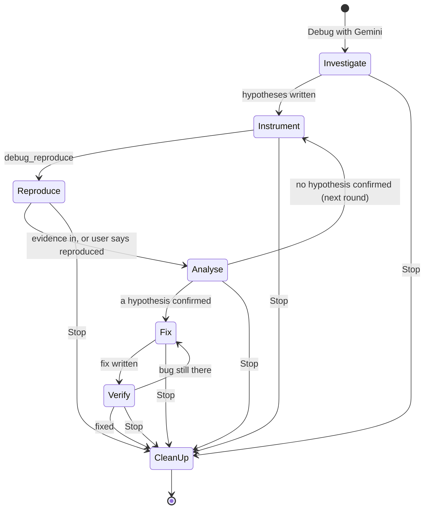
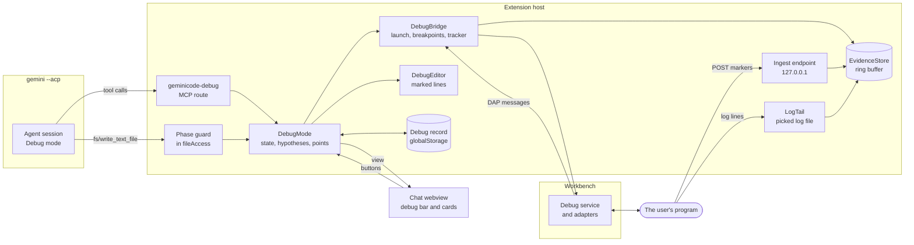

# Debug mode

Status: built behind `gemini.debugMode.enabled`, which is off by default. [Delivery](#delivery) lists the parts of the design that are not built. This page is the functional, architectural and visual design of Debug mode, with the edge cases it is built around.

Related pages: [ARCHITECTURE.md](ARCHITECTURE.md) (the security model, permissions, the local MCP servers, the browser), [FINDINGS.md](FINDINGS.md) (the CLI's behaviour this relies on), [ROADMAP.md](ROADMAP.md).

## Contents

1. [The idea](#the-idea)
2. [Goals and non-goals](#goals-and-non-goals)
3. [Functional design](#functional-design)
4. [Architecture](#architecture)
5. [Security](#security)
6. [Performance and memory](#performance-and-memory)
7. [Edge cases](#edge-cases)
8. [Visual design](#visual-design)
9. [Testing](#testing)
10. [Delivery](#delivery)
11. [Spikes and open questions](#spikes-and-open-questions)
12. [Decisions](#decisions)

## The idea

An agent that fixes a bug from reading code alone guesses. Debug mode makes it collect evidence from the running program first, and fix only what the evidence shows:

1. **Investigate.** The agent reads the code and writes down two to five hypotheses, each with what would confirm or refute it.
2. **Instrument.** It places observation points for the hypotheses: logpoints and breakpoints in VS Code's debugger first, short marked log lines in the code only where the debugger can't reach.
3. **Reproduce.** The agent reproduces the bug itself (a failing test, a command, the GeminiCode browser), or asks the user to and waits.
4. **Analyse.** It reads the evidence, marks each hypothesis confirmed or refuted, and goes round again with new points if none is confirmed.
5. **Fix.** Once one hypothesis is confirmed by evidence, it makes the smallest fix, through the usual approvals.
6. **Verify.** The same reproduction runs again with the same points, and the evidence is compared with the first run.
7. **Clean up.** GeminiCode, not the model, removes every point and every marked line, and ends what it started.

GeminiCode owns the steps between the model's turns: the debugger, the evidence, the hypotheses' state, the cleanup. The model reasons and calls tools. Nothing in the Gemini CLI changes.

Cursor's Debug mode (2.2) has the same loop with logging only: the agent writes log lines that post to a local server and has the user reproduce. Its users report two failures: the server that never receives anything, and log lines left in the code when the mode ends. This design answers both the same way. It prefers the debugger, which needs no code change and no network, and cleanup is plain code that runs on every way out, crashes included.

## Goals and non-goals

Goals:

- Evidence before fixes. A fix is made only against a hypothesis that evidence confirmed.
- Nothing left behind. No logpoint, breakpoint, marked line, debug session, server or grant outlives the mode. Marked lines left by a reload, a quit or a crash are offered for removal at the next start, which also removes a crashed mode's breakpoints.
- No new access. Debug mode reads only what reaches GeminiCode: the debugger's messages, GeminiCode's own endpoint, and a file the user picks. It never widens the agent's file policy or folder trust.
- Almost no cost until used. While the setting is on, every session lists the `geminicode-debug` route with no tools. The debug bundle loads with the first Debug mode command, and the tracker and the tools come only when a chat enters Debug mode.
- Works without the model's memory. The phase, the hypotheses and the points are GeminiCode's state, sent to the model each turn, so Compact, a context overflow or a rewind loses nothing.

Non-goals:

- Remote debugging (SSH, dev containers, Kubernetes). Attaching to a port on this Mac is in; anything else is a later stage.
- Debugging GeminiCode's own browser pages through a debugger. Browser code is observed through HTTP markers (below).
- Performance profiling and memory leak hunting. The points give timings, which is enough for simple timing bugs; CPU and heap profiles are a later stage.
- Languages with no debug adapter and no instrumentation template. They get the agent's terminal and a picked log file only.

## Functional design

### Entry points

| Where | What it does |
| --- | --- |
| The chat's **+** menu | **Debug with Gemini**, in every chat but a project coordinator's. |
| An agent's menu in the Agents view | **Debug with Gemini** (`gemini.debug.start`). |
| A failed or errored test in the Testing view | **Ask Gemini why** (`gemini.debug.askWhy`) on the test's context menu: the test's name and file become the bug report, and the agent is told to use the test as the reproduction. |

The commands are `gemini.debug.start`, `gemini.debug.askWhy`, `gemini.debug.stop` and `gemini.debug.showEvidence`, hidden from the Command Palette. **Debug with Gemini** asks for the bug in an input box ("Describe the bug: what you did, what you expected, what happened."), opens the agent and sends the report as its next message.

Run with no test while the user's own debug session is stopped, `gemini.debug.askWhy` reads the stopped thread once (a snapshot with the usual caps, redacted and wrapped as external text) and sends it as the bug report. It sets no points in the user's session, and no menu offers it from the debugger.

Debug mode is per agent. Any ordinary agent can enter it, an agent on its own branch included; a project thread can, a project's coordinator cannot (it has no code). At most two agents per window are in Debug mode at once; a third is told to stop one first.

### Approval modes

Debug mode is a workflow, not one of the CLI's approval modes. It runs on top of Default or Auto Edit. The phase guard (below) refuses code edits outside the Fix phase in both, since every edit through the CLI's edit tools reaches GeminiCode as a file request.

Starting it in a chat in YOLO or Plan shows a warning that asks the user to switch the chat to Default or Auto Edit in its mode menu and start again. GeminiCode never changes the mode on the user's behalf. YOLO is out because the CLI's shell runs there without a card, and a debug session can start a program, so the user would have no point at which to see what runs. A chat switched to YOLO after Debug mode started gets every debug tool call answered with "Debug mode is paused", and the model is told to ask the user to switch back.

### The phases



Only GeminiCode moves the phase, on the agent's tool calls and the user's buttons:

| Phase | What the agent may do | What moves it on |
| --- | --- | --- |
| Investigate | Read code, run read-only commands (the usual approvals), use the index. No edits: the phase guard refuses them with a message the model can read. | The agent calls `debug_hypotheses` with at least one hypothesis. |
| Instrument | Add and remove points (`debug_logpoint`, `debug_breakpoint`, `debug_instrument`), start or attach the program (`debug_launch`, `debug_attach`). No other edits. | The agent calls `debug_reproduce`: with steps for the user, or without when it runs the reproduction itself. |
| Reproduce | Run the reproduction: a test, a command in its terminal, the GeminiCode browser. Or wait for the user. | The agent reads the evidence (`debug_evidence`), or the user presses **Reproduced** or **Didn't happen**. |
| Analyse | Read evidence, inspect a held stop, update hypotheses. | `debug_hypotheses` marks one confirmed (with evidence references) and the agent calls `debug_fix`; or a new point takes it back to Instrument. |
| Fix | Edit code through the CLI's tools and the usual approvals. Points stay. | The agent calls `debug_verify`. |
| Verify | Run the same reproduction again. | The verify card shows the two runs side by side; the user presses **Fixed** (Clean up) or **Still broken** (back to Fix), or the agent calls `debug_fix` again. |
| Clean up | Nothing: plain code runs. | Done, with a summary card. |

`debugState.ts` holds which tools each phase allows; a call outside its phase is refused with the list of tools the phase does allow.

Rules that hold in every phase:

- After four rounds of Instrument, Reproduce and Analyse with nothing confirmed, the next turn ends with a card that asks the user to keep going, give a hint (which focuses the composer) or stop. Keep going allows four more rounds. A round with no evidence at all counts double, since it usually means the points are not where the code runs.
- The user can always move the phase: the debug bar offers Skip to fix, Back to investigate and Stop. With Skip to fix the user takes responsibility, and the agent is told the user allowed edits without a confirmed hypothesis.
- The agent never edits instrumentation by hand. A CLI edit that changes a marked region is refused in every phase with a pointer to `debug_instrument` and `debug_remove`, so the record of what was inserted stays exact.

### Evidence sources

In order of preference. The mode's instructions give the agent the order and why.

| Source | When | Needs | Reaches GeminiCode through |
| --- | --- | --- | --- |
| Logpoints | The program runs under VS Code's debugger: launched by Debug mode, or attached. | A debug adapter for the language: js-debug is built in; Python needs the debugpy extension. | The debug adapter's `output` events, seen by a `DebugAdapterTracker`. |
| Breakpoints with a snapshot | A value logpoints can't show well: an object's shape, the stack, many locals at once. | The same. | `stopped` events, then `stackTrace`, `scopes` and `variables` requests, then `continue`. |
| Console markers | A process Debug mode launched or attached where a debugger point doesn't bind, such as generated code with no source map. | Code edit (a marked line). | The debug adapter's `output` events. |
| HTTP markers | Code whose console GeminiCode can't see: a page in a browser, a process the user started elsewhere. | Code edit, and the program can reach `127.0.0.1` on this Mac. | A POST to GeminiCode's debug endpoint (below). |
| A picked log file | Evidence the program already writes, outside what the agent may read. | The user picks the file. | GeminiCode tails the file from the moment of the pick. |

None of them reads a folder GeminiCode doesn't already serve. The program sends its evidence to GeminiCode; GeminiCode doesn't go looking for it.

### Points

A point is one place to observe, owned by one agent's Debug mode, tied to one hypothesis:

- Logpoint (`debug_logpoint`): a file, a line, a hypothesis, up to eight expressions. GeminiCode builds the message itself, `@@gc:<nonce>:<point>@@ {"cart.total":{cart.total},...}` in the adapter's `{expression}` syntax, so every line it produces can be routed to its point.
- Breakpoint (`debug_breakpoint`): a file, a line, a hypothesis, an optional condition, an optional hit count, and `hold` (default off). Without `hold`, a hit takes a snapshot and continues at once. With `hold`, the thread stays stopped for up to 30 seconds so the agent can call `debug_inspect`, then continues by itself.
- Marked line (`debug_instrument`): a file, a line, a hypothesis, up to eight expressions, and a channel (`console` or `http`, chosen by GeminiCode unless the agent asks). GeminiCode writes the line from a template for the file's language (below); the agent never writes it.

A point that can't be placed says why, in the tool result:

- the file is outside the agent's folder, or the agent's file policy refuses it (a secret or git-ignored file);
- for a marked line: the line is blank, the file has unsaved changes, or it is generated, minified, or a format with no comments (JSON, lockfiles);
- the session already has a point on that line, or another agent's point is there;
- the user already has a breakpoint on that line (it is left alone, and the agent is told its hits are the user's);
- a limit is reached: 20 debugger points, 12 marked lines, 8 files and 8 expressions per point.

A debugger point the adapter does not bind (often a missing source map) is still placed. One second after it is placed or a session starts, `getDebugProtocolBreakpoint` says whether it is bound, and the bar and `debug_evidence` mark an unbound point as such.

### Reproduction

The agent reproduces first when it can, so the user is asked only when nothing else works:

- A test. `debug_launch` with kind `test` runs a test under the debugger, from a launch configuration or a small one (a Node program, or a Python module such as a test runner). Its output and exit code are evidence too.
- A command in the agent's terminal, under the usual shell approvals.
- A page in the GeminiCode browser, driven by the browser tools.

Neither the terminal nor the page's console is read for markers (see [Console and terminal evidence](#console-and-terminal-evidence)), so a marked line in code run those ways needs the HTTP channel.

`debug_reproduce` starts a run either way. With steps for the user, it shows the reproduce card (see [Visual design](#visual-design)): the steps, a live count of evidence by point, and three buttons:

- Reproduced sends "I reproduced the bug." as the chat's next message, queued if a turn runs.
- Didn't happen sends a message saying the bug did not show this time.
- Stop stops Debug mode and cleans up.

If no evidence has come 20 seconds after the card appears, the card says why that may be: a marked line needs the program to restart (with Restart program when Debug mode launched a server), the HTTP endpoint can't be reached (the program's address, a page's Content-Security-Policy, a container), or the points are on a path the steps don't reach. This answers the failure Cursor's users report, where the agent waits on evidence that can never come.

### Hypotheses

`debug_hypotheses` sets the whole list each time. The agent is asked for two to five; one is accepted, more than five refused. Each has an id (`h1`...), a one-line claim of at most 400 characters, what evidence would confirm it, what would refute it, a status (`open`, `confirmed`, `refuted`, `unclear`) and, for confirmed and refuted, the evidence references (`p3#12`: point 3, event 12) that support the status.

GeminiCode checks the references exist and belong to this debug session; a confirmed or refuted status without one is refused. The list is GeminiCode's: every turn's note carries it back to the model, and the debug bar shows how many are open.

### Fix and verify

- `debug_fix` names the confirmed hypothesis. The phase guard then lets edits through, with the usual approvals.
- `debug_verify` runs the reproduction again. The user's steps, if the last reproduction had them, go on a new reproduce card; otherwise Debug mode launches the same program or test again when it launched one that ends by itself; otherwise the agent runs its own reproduction again. Points stay where they are, so the second run's evidence lines up with the first.
- When a turn ends with a new run in Verify, the verify card shows both runs per point: the hits and the last value, marked when they changed. The agent says whether the bug is fixed; the user's buttons are **Fixed** (Clean up), **Still broken** (back to Fix; Back to investigate is on the bar) and **Add a regression test**.
- **Add a regression test** shows unless the program was launched with kind `test`. It takes the agent back to Fix and asks it to add a test, run it once, then call `debug_verify`.

### Clean up

Clean up runs on Fixed, on Stop (the bar, the reproduce card, the rounds card), when the setting is turned off, when the agent or its chat goes, and, with its quick steps only, when the window closes. A crash leaves the record for the next start (see [Records and crash recovery](#records-and-crash-recovery)). It is plain code in this order (`DebugMode.cleanup`), and each step is safe to repeat:

1. Remove the agent's logpoints and breakpoints. One the user edited is theirs and stays.
2. Continue any thread GeminiCode holds stopped, then `stopDebugging` every debug session Debug mode started or attached; an attached program is detached, not ended.
3. Remove every marked line that is unchanged (below for one that changed). Skipped when the window closes.
4. Close the agent's route on the endpoint, and the endpoint itself once no agent uses it.
5. End the log file grant.
6. Drop the evidence from memory, and delete the debug record, unless marked lines are left, which keep it.
7. Sweep: search the agent's folder for the session's nonce with the app's ripgrep (`--no-ignore --hidden`, `.git` left out). The summary card lists up to 20 files that still hold it.

The summary card says what was removed, and what was left and why.

### Settings

One setting, `gemini.debugMode.enabled`: off by default, application scope, tagged advanced. While it is off, the entry points are hidden, new sessions don't list the `geminicode-debug` route, and `gemini.debug.start` says Debug mode is off. Turning it off while a chat is in Debug mode runs Clean up, and the summary card says why.

### The agent's tools

The local MCP server `geminicode-debug` serves them, one route per agent, and lists them only for an agent in Debug mode (see [Tools in a running session](#tools-in-a-running-session)). Tool results are short text, never raw JSON. Evidence and anything the program printed is wrapped in `<external source="debug" ...>`.

| Tool | Arguments | What it does | Asks |
| --- | --- | --- | --- |
| `debug_hypotheses` | list of hypotheses | Sets the list (see above). | never |
| `debug_configs` | none | Lists the agent's folder's launch configurations (name, type, request, program; never `env` values), the debug sessions running in the window, and which of the common debug ports (9229, 9230, 5678) listen on 127.0.0.1. | never |
| `debug_launch` | a configuration's name, or a small config (`type`, `program` or `module`, `args`, `cwd`), kind `server`, `run` (the default) or `test` | Starts the program under the debugger. | always, unless the user allowed this exact configuration for the session |
| `debug_attach` | a port, or a process id of the user's | Attaches to a program the user started. | first time per port or process |
| `debug_logpoint` | file, line, hypothesis, expressions | Places a logpoint. | only when an expression is not a plain path |
| `debug_breakpoint` | file, line, hypothesis, condition, hit count, hold | Places a breakpoint. | only when the condition is not a plain comparison of plain paths |
| `debug_instrument` | file, line, hypothesis, expressions, channel | Inserts a marked line. | only when an expression is not a plain path |
| `debug_remove` | point ids, or `all` | Removes points. | never |
| `debug_reproduce` | steps for the user, or none when the agent runs it | Shows the reproduce card, or marks a run start for the agent's own run. | never |
| `debug_evidence` | point or hypothesis ids, `since` (a run), `limit` (events per point, default 5, at most 50) | The evidence, grouped by point (see [Evidence for the model](#evidence-for-the-model)). | never |
| `debug_inspect` | a held stop, a frame, expressions | Values at a stop held with `hold`. | only when an expression is not a plain path |
| `debug_request_log` | why | Asks the user to pick a log file (see [Picked log files](#picked-log-files)). | the user picks or declines |
| `debug_fix` | hypothesis id | Moves to Fix. | never (needs a confirmed hypothesis, unless the user chose Skip to fix) |
| `debug_verify` | none | Moves to Verify and runs or asks for the same reproduction. | never |

"Asks" is a modal dialog from GeminiCode, shown in every approval mode: these are code that runs in the user's program.

## Architecture

### Where the code lives

Pure logic in `src/acp/debug/` (no `vscode` import, unit tested); the editor side in `src/host/debug/`, loaded from a bundle of its own; two webview scripts.

| File | What it holds |
| --- | --- |
| `src/acp/debug/debugState.ts` | The phases and their moves, the round count, which tools each phase allows. |
| `src/acp/debug/hypotheses.ts` | The list, its checks (count, ids, evidence references). |
| `src/acp/debug/points.ts` | Points, ids, limits, ownership, the logpoint message format and how output lines are matched back to points. |
| `src/acp/debug/expressions.ts` | Whether an expression is a plain path, per language, and how a condition is joined with the environment guard. |
| `src/acp/debug/templates.ts` | The marked-line templates per language and channel, and which files never get one. |
| `src/acp/debug/regions.ts` | Inserted regions: the record of what went where, finding them again, the comparison that decides whether one can be removed exactly. |
| `src/acp/debug/evidenceStore.ts` | Events in a ring buffer with counts per point, runs, drops. |
| `src/acp/debug/evidenceFormat.ts` | The text the model gets, the `external` frame, and the comparison of two runs. |
| `src/acp/debug/debugBridgeLogic.ts` | Every decision of the debugger bridge, with the `vscode` calls passed in: the tracker, snapshots, holds, the resolved launch configuration, attach. |
| `src/acp/debug/ingest.ts` | The HTTP endpoint (routes, tokens, limits, the Host check). |
| `src/acp/debug/logTail.ts` | Tailing a picked file: offsets, rotation, line caps. |
| `src/acp/debug/debugRecord.ts` | The record on disk for crash recovery. |
| `src/acp/debug/debugPrompts.ts` | The mode's instructions and the per-phase prompt. |
| `src/acp/debug/debugMcp.ts` | The `geminicode-debug` tools' definitions and their argument checks. |
| `src/acp/redact.ts` | Redaction of credential-looking keys and values, shared with problem reports. |
| `src/host/debug/debugEntry.ts` | The part in the startup bundle: the `geminicode-debug` route, the turn note, and the check for a Debug mode that did not end. |
| `src/host/debug/debugFeature.ts` | The feature in `dist/debug.js`: the commands, every agent's Debug mode, the endpoint, the Evidence pages, the status bar item and crash recovery. |
| `src/host/debug/debugMode.ts` | One agent's Debug mode (`DebugMode`) and the set of them (`DebugModes`): wires the state to the chat, the server and the editor, and runs Clean up. |
| `src/host/debug/debugBridge.ts` | The one place that touches `vscode.debug`: launch, attach, breakpoints, the tracker factory. |
| `src/host/debug/debugEditor.ts` | Inserting and removing marked lines through `WorkspaceEdit`, decorations and CodeLenses. |
| `src/host/debug/evidencePage.ts` | The Evidence page, a `PagePanel` in the agent's side group. |
| `src/host/debug/debugProtocol.ts`, `debugStrings.ts` | The views and actions the webviews share with the host, and their words. |
| `webview-src/debugCard.ts` | The debug bar and cards, loaded by `debugCardLoader.ts` the first time a chat enters Debug mode. |
| `webview-src/evidence.ts` | The Evidence page. |

`src/debug.ts` bundles everything under `src/host/debug/` except `debugEntry.ts` into `dist/debug.js`, behind a `LazyFeature` on the five `gemini.debug.*` commands, like `dist/confluence.js`. It loads the first time one of them runs, or when a start finds a Debug mode that did not end. `test/perf/chunks.test.ts` checks what the chunk holds.

### How the parts fit



### Tools in a running session

ACP gives a session its MCP servers when it opens (`session/new`) or reopens (`session/load`); a chat that enters Debug mode already has a session. Listing the debug tools in every session would cost every request about 1,500 tokens for a feature most chats never use, which goes against the team tools' rule that a user pays nothing for what they don't use.

So while `gemini.debugMode.enabled` is on, every session lists the `geminicode-debug` route in its `mcpServers` (`DebugEntry.servers`). A spare session gets a slot that is bound to its agent when the agent takes it. The route lists no tools until the agent enters Debug mode.

Entering sends `notifications/tools/list_changed` on the route (`AgentMcpServer.notifyToolsChanged`). The CLI keeps a notification stream open per HTTP server and lists the tools again before the next prompt, so there is no session reload and no replay. Clean up sends the notice again and the tools go; a call that arrives after the end is answered "Debug mode is off for this session." A session opened while the setting was off has no route until it reopens.

The mode's instructions go with the first turn's note. Every turn's note (`turnNote`, added to the prompt by `chatTurn.ts`) carries the phase, the hypotheses, the points, the phase's guidance and its tools.

### The phase guard

The guard sits where GeminiCode already serves the CLI's writes (`fileAccess.ts`, `fs/write_text_file`): the debug bundle sets the `WriteGuard` on `AgentService` while it is loaded, and `DebugModes.guardWrite` finds the agent by the writing session. That covers Default and Auto Edit alike, since in Auto Edit the CLI still writes through GeminiCode.

- Outside Fix: every write inside the agent's folder is refused with "Debug mode is in <phase>: edits wait until a hypothesis is confirmed (debug_fix). To observe, use debug_logpoint or debug_instrument."
- In every phase: a write that changes a marked region is refused (see above).
- A write to a file with marked lines, outside those lines, is allowed in Fix. Regions are found by their markers, not by line number, so nothing needs updating after the write.
- Shell commands are not guarded by phase: the usual approvals apply, and the mode's instructions ask for read-only commands outside Fix. A command that changes files in Investigate is a judgement for the user on the card, as it is outside Debug mode.

### The debugger bridge

`DebugBridge` is the one place that touches `vscode.debug`; its decisions are in `debugBridgeLogic.ts`.

Launch:

- `startDebugging(folder, config, options)` with `suppressDebugView`, `suppressDebugToolbar` and `suppressSaveBeforeStart` set: the user's Run and Debug view stays as it was, and the debug bar's Stop program button stands in for the toolbar. A session that hasn't started after 15 seconds counts as not started.
- The configuration is a copy, resolved by GeminiCode (`resolveLaunchConfig`), never the user's object:
  - `${workspaceFolder}`, `${workspaceRoot}` and `${workspaceFolderBasename}` point at the agent's folder. For an agent in a worktree this is the worktree, which is not a workspace folder, so `folder` is passed as undefined and the variables are filled in first. `${env:...}`, `${userHome}` and `${pathSeparator}` are left for VS Code. Every other variable (`${file}`, `${input:...}`, `${command:...}`) is refused: it depends on the editor's state or runs a command.
  - `serverReadyAction` is removed (it opens the user's external browser).
  - `preLaunchTask` and `postDebugTask` are kept, since the program may need them; `preLaunchTask` is shown on the launch card, since it runs code.
  - `env` values never reach the model or the card, only names.
  - The marker `__geminiDebug: <nonce>` is added, so the tracker knows the session and its children, and `GEMINI_DEBUG=<nonce>` joins `env` (see Breakpoints).
- Compound configurations are refused: the agent is told to launch the parts one at a time.
- The launch card, a modal dialog, shows the configuration's name and type, the program with its arguments, the working folder, `preLaunchTask`, and the names of `env` entries, with **Allow once** and **Allow this configuration for the session**; cancelling rejects.
- With no `launch.json` entry, the agent can propose a small configuration (`smallConfig`): `node` or `debugpy`, a program or module and a working folder inside the agent's folder.

Attach: by port on 127.0.0.1 (port 5678 as debugpy, any other as Node's inspector), or by process id, passed to the adapter's `processId` attach argument. The configuration always names 127.0.0.1, and a non-loopback address is refused. The dialog says that detaching at Clean up never ends the program.

Sessions and children: js-debug runs a parent session with child sessions for each process and worker; output and stops arrive on the children. The tracker is created for any session whose configuration has the marker, or whose `parentSession` chain reaches one. Sessions the user started get no tracker; **Ask Gemini why** reads one stopped thread of the user's session once through its own `customRequest` and keeps nothing.

Breakpoints:

- Points go through `vscode.debug.addBreakpoints` as `SourceBreakpoint`s. They are global to the window: they show in the user's Breakpoints view and apply to every debug session on those files.
- So, for sessions Debug mode launched, the condition gets a guard that is true only in the agent's program: the condition is `process.env.GEMINI_DEBUG === "<nonce>"` (JavaScript and TypeScript) or `__import__("os").environ.get("GEMINI_DEBUG") == "<nonce>"` (Python), joined with the agent's own condition in the language's syntax (`expressions.ts`). The user's own debug sessions of the same files then never stop or log at the agent's points. Other languages get no guard.
- An attached program was not started with the variable, so once Debug mode attaches, its points are placed again without the guard, and the attach dialog and the tool result say the agent's points also apply to the user's debug sessions of those files while they exist.
- Each point's `SourceBreakpoint` is kept, with its condition, hit condition and message. `onDidChangeBreakpoints` tells Debug mode when the user removes or edits one: a removed point is marked removed, an edited one is the user's from then on (Clean up leaves it, and the next turn's note marks it).
- An agent's point in a worktree is on the worktree's path, so it never applies to the user's checkout.

The tracker: `registerDebugAdapterTrackerFactory('*', ...)` is registered when the first Debug mode starts and disposed with the last. Its `onDidSendMessage` runs for every DAP message of a tracked session, so it does almost nothing:

1. Only `event` messages are looked at; responses and requests are skipped by the first property read.
2. `output` (except `telemetry`): a line that holds `@@gc:` is parsed and routed to its point; any other text goes to a per-session tail of 256 KB, for exceptions and context. Text arrives in pieces, so lines are joined per category before matching, with a 16 KB cap on a line in progress.
3. `stopped`: handled as below.
4. `exited` and `terminated`: the run ends, with the exit code.

Stops: a `stopped` event with `hitBreakpointIds`:

- Ids are mapped back to points through `getDebugProtocolBreakpoint`. A stop at none of the agent's points (the user's breakpoint, an exception the user's filters catch, a pause the user pressed) is the user's: nothing is continued, and `debug_evidence` tells the agent the program is paused by the user.
- A stop at an agent's point takes a snapshot: `stackTrace` (3 frames), `scopes` of the top frame, `variables` of the locals (30 entries, two levels down, 20 children per level, 200 characters per value), each request with a 1.5-second timeout and the whole snapshot with 3 seconds. Then `continue` for that thread, unless the point holds.
- A held stop continues by itself after 30 seconds, when the agent's turn ends, or at Clean up, whichever comes first. A program never stays paused because a model stopped answering.
- While a point holds, `debug_inspect` evaluates with the `hover` context for plain paths, which some adapters evaluate without side effects (js-debug does), and `repl` for an approved expression.
- After 50 snapshots of one point in a run, further hits continue at once and count as drops in the evidence. A hit in a loop would otherwise pause the program up to 3 seconds at a time.

Focus: a stop makes the workbench reveal the stopped line, and `debug.openDebug` may open the Run and Debug view. With snapshot and continue the stop is short, but the reveal still moves the user's editor. This is an open spike (below); the fallback is a `GEMINI-FORK` edit that skips the reveal for sessions with the marker, a registration-point change of the kind the design rules allow when the API can't do the job.

### Marked lines

`debug_instrument` never lets the model write code into the program. GeminiCode builds the line, checks it, inserts it, and records it.

Templates: one per language and channel, in `templates.ts`. Each is a region of three or four lines: a start marker, the statement (two lines in Python), an end marker. The statement is wrapped so it can never throw, never awaits, and returns at once. The nonce is `gc` and eight hex digits. JavaScript and TypeScript, console channel:

```js
// GEMINI-DEBUG-START gc7f3a91 p4
try { console.log("@@gc:gc7f3a91:p4@@", JSON.stringify({ "cart.total": (() => { try { return cart.total; } catch (e) { return "<" + e + ">"; } })() }, (k, v) => typeof v === "bigint" ? String(v) : v).slice(0, 4000)); } catch {}
// GEMINI-DEBUG-END gc7f3a91 p4
```

HTTP channel: the same, with `fetch("http://127.0.0.1:<port>/debug/<token>", { method: "POST", body: ..., keepalive: true }).catch(() => {})` in place of `console.log`. A string body makes it a simple request, so browsers send no preflight.

Python, console channel (stderr, flushed):

```python
# GEMINI-DEBUG-START gc7f3a91 p4
try: __import__("sys").stderr.write("@@gc:gc7f3a91:p4@@ " + __import__("json").dumps({"order.total": order.total}, default=str)[:4000] + "\n"); __import__("sys").stderr.flush()
except Exception: pass
# GEMINI-DEBUG-END gc7f3a91 p4
```

Python's HTTP channel builds the body on the calling thread and posts it from a daemon thread with a 0.2-second timeout, so a slow or closed endpoint never holds the program.

Details:

- TypeScript gets a `// @ts-ignore` line before the statement, so a type error in an expression never breaks a type-checked build while the line is there.
- Indentation matches the line it is inserted before.
- In JavaScript and TypeScript each expression is evaluated in its own `try`, so one failing expression still sends the others. In Python one failing expression loses that hit's values.
- The values are cut at 4,000 characters in the program.
- There are templates for JavaScript (`.js`, `.jsx`, `.mjs`, `.cjs`), TypeScript (`.ts`, `.tsx`, `.mts`, `.cts`) and Python. Vue and Svelte files get the JavaScript template, and nothing checks that the line is inside their `<script>` block. Other languages get debugger points and picked files.

The channel: `console` while a debug session Debug mode launched or attached is running, `http` otherwise. The agent can ask for one, and the tool result says which was used and why. Code that runs in a page while a server runs under the debugger needs `http` asked for, since the page's console isn't read.

Checks before inserting:

1. The file is inside the agent's folder and its file policy allows it (not git-ignored, not a secret file).
2. The file is not generated or minified (`templates.ts`, `refusesInstrumentation`): no JSON, lockfile, source map, image or `.min` file, no `@generated`, `DO NOT EDIT` or "this file is generated" near its top, and no first line over 1,000 characters.
3. The file has no unsaved changes: it is refused rather than edited under the user's hands.
4. The line exists and is not blank.
5. The expressions pass `expressions.ts`, or the user approves them in a dialog that shows each one.

Nothing parses the file with the line inserted, so a line inside a multi-line expression, an object literal or a JSX tree breaks the program until it is removed.

Inserting: through a `WorkspaceEdit`, then a save, as the agent's own writes are, so the editor's undo and the disk agree. A save may run the user's format-on-save. The record keeps the exact inserted text and a normalised form (whitespace removed), so a region a formatter rewrapped still counts as unchanged.

Removing: `regions.ts` finds each region by its start and end markers with the nonce and point id, wherever it moved in the file.

- Normalised text equals what was inserted: the region goes, markers included, through a `WorkspaceEdit`. A file the user has unsaved changes in is left unsaved.
- Changed, by the user or a tool: it is not removed silently. The Clean up summary shows the region with Show diff, Remove anyway and Keep.
- Markers gone, or the file deleted or renamed: the region is gone from the record; the sweep by nonce finds a copy elsewhere.

Restarts: a marked line needs the code to load again. When Debug mode launched the program with kind `server`, the reproduce card's hint offers Restart program, and the hint says a restart is needed unless the launch command shows the program reloads itself (`nodemon`, `--watch`, `vite`, `next dev`, `--reload`, `tsx watch`). A logpoint needs no restart.

### The ingest endpoint

One small HTTP server for all agents (`ingest.ts`), on `127.0.0.1` with a port the system picks, started when the first HTTP marker is inserted and closed when no agent has a route.

- Routes: `POST /debug/<token>`, with a token of 128 random bits per agent's Debug mode. A missing or unknown token answers 404 and is not logged. Other methods answer 405.
- Host check: the `Host` header must be `127.0.0.1:<port>`, `localhost:<port>` or `[::1]:<port>`. Anything else answers 421. This stops DNS rebinding.
- Body: at most 16 KB per request, read with a 2-second deadline; a larger body answers 413, a slow one 408. Text, one event per line (`@@gc:<nonce>:<point>@@ <json>`), so a batch is allowed. Lines whose nonce isn't the route's are dropped.
- Rates: a token bucket per route, 200 events a second with bursts of 400. The store then allows 50 a second per point and counts the excess as drops. Nothing over a limit is stored.
- Answers: 204 with `Access-Control-Allow-Origin: *` and no body. A wildcard is safe because the answer holds nothing, and it keeps a page's console free of CORS errors.
- A page's Content-Security-Policy may block the request (`connect-src`). Nothing reaches the endpoint, so the reproduce card's no-evidence hint names this.
- Containers: a program in a container reaches the Mac through `host.docker.internal`, whose `Host` header the check refuses. `IngestRoutes.open` takes `fromContainer`, which makes the check accept `host.docker.internal:<port>` for that route, but Debug mode opens no such route and the template always posts to `127.0.0.1`.
- Lifetime: a route ends at Clean up. A marked line left in code after that (the user kept it) posts to a closed route: 404, or nothing listening, and the template's `catch` swallows it.

### Console and terminal evidence

Console markers reach GeminiCode only through the `output` events of a debug session Debug mode launched or attached. The console of the GeminiCode browser and the agent's terminal are not read for markers, and the user's own terminals never are; **Send to Gemini** stays the way to give their output.

### Picked log files

`debug_request_log` shows a modal dialog with the agent's reason and **Choose file...**; cancelling declines. The picker opens at the agent's folder, and the user can go anywhere.

- Grant: one file, read-only, for this debug session. Not a folder, and not the agent's file policy: the agent still can't `read_file` it. The grant is listed on the debug bar, with Stop reading, and ends at Clean up.
- What is read: only what is added after the pick, from the file's size at that moment. Never what was already in it: that history was written before the user chose to share anything.
- Following the file: `fs.watch` plus a stat every two seconds as a backstop, since watchers miss events on some file systems. A file that shrinks was truncated: reading starts again at zero. A file replaced under the same path (rotation: a new inode) is reopened and read from its start. A file that is deleted ends the grant with a note in the chat.
- Lines: UTF-8, cut at 2 KB each; a file with NUL bytes in its first 4 KB is refused as binary. At most 1 MB read per run.
- Where lines go: a line with this session's marker becomes evidence for its point; any other line goes to a 64 KB context tail, whose last lines `debug_evidence` adds to its answer. `LogTail` can keep only lines that hold one of up to five literal substrings, but `debug_request_log` passes none.

### Evidence for the model

`EvidenceStore` keeps, per debug session:

- events in a ring buffer: at most 2,000, or 1 MB of text, whichever comes first; the oldest go first; one event's text is cut at 16 KB;
- per point, counts that never drop (hits, drops, redactions), the first and last value, and up to five distinct values with their counts;
- runs: each reproduction starts a run, so evidence can be read per run and two runs compared.

Values are redacted as they arrive (see [Security](#security)), so the store never holds a credential, and nothing in it is written to disk.

`debug_evidence` answers in at most 12,000 characters, about 3,000 tokens: well under the CLI's 40,000-character cap on one tool output, since a debug session can run for many turns. Per point it gives:

- hit count and drops;
- first and last values;
- distinct values with counts;
- the last events (five unless the agent asks for up to 50), with times relative to the run's start.

Points are ordered by hypothesis. A timeline of the first 40 events across points follows, since ordering is often the evidence in timing bugs. When the text would pass the budget, events are left out from the back of the longest sections first, and the answer says how many lines were left out.

Every value is cut at 500 characters. The answer is wrapped in `<external source="debug">`, because program output can carry anyone's text, user input included. A second wrapped part follows with the last 1,500 characters of each debug session's plain output and of the log file's context tail, and a note when the program is paused by the user.

The bar's counts and the Evidence page read the same store. The chat gets the bar's view (counts and points, no events) at most once a second, and the page asks for events a page at a time.

### Records and crash recovery

`debugRecord.ts` writes `<globalStorage>/debug/<agent>.json` when Debug mode starts and on every change to what exists in the world. It holds:

- the agent, its folder and title, and when Debug mode started;
- the nonce;
- each debugger point: id, kind, file, line, condition, message;
- each marked region: file, point, nonce, the line it went before, the exact inserted text and its normalised form;
- the debug sessions it started, by their marker;
- the grant's path;
- the endpoint's port while a route is open (never the token).

It holds no evidence. Writes are batched to one per 500 ms, written to a temporary file and renamed. Clean up deletes it, unless marked lines are left, which keep it.

Five seconds after the next start, or a window reload, a record still there is a Debug mode that didn't end, and the debug bundle loads to deal with it (`DebugFeature.recover`):

- Its breakpoints are removed by matching file, line, condition and message. VS Code keeps breakpoints across reloads, but their ids don't survive.
- Its sessions are already gone with the old extension host.
- Its marked regions are offered in a notification, "Debug code was left in N files by a Debug mode that ended with the window", with Clean up and Open. They are removed by the same exact-text rule only when the user picks Clean up, which asks about each changed region with its diff, then deletes the record. Removing them at startup unasked would edit files the user may have worked on since. Dismissed, the notification comes back at the next start.

### Interaction with the rest of GeminiCode

| Feature | In Debug mode |
| --- | --- |
| Compact | The summary is the model's. The hypotheses, points and phase are GeminiCode's, so the next prompt carries them again in full. |
| Context overflow | The new session lists the `geminicode-debug` route like any other, and the next prompt's note carries the phase, the hypotheses and the points. The mode's full instructions came with the first note only and are not sent again. |
| Prompt queue and steering | The card buttons' messages go through the queue when a turn runs. A held stop is continued when the turn stops. |
| Several agents | Each agent's Debug mode has its own nonce, route, points and records. Points on the same file and line as another agent's are refused (lines are keyed by absolute path, so two worktrees of one repository never collide). At most two agents per window are in Debug mode, so the debug view and the user's attention stay manageable. |
| Projects | A thread can debug in its worktree. A coordinator can't start Debug mode, and its chat's + menu doesn't offer it. |
| Agents and Editor layouts | The Evidence page opens in the agent's side group (`agentColumn`). Its view type, `gemini.debugEvidence`, is not in `sidePageViewTypes` in `geminiAgentGroups.ts`, so the workbench counts it as an agents tab, not as a page of the side group. |
| The CLI's hooks | `AfterTool` hooks such as a formatter run on the CLI's own edit tools. Marked lines are not those, so hooks don't run on them; the normalised comparison covers format-on-save. |
| The CLI's checkpoints (Undo) | Undo of an agent's edit inside a file with regions keeps the regions: GeminiCode's own undo works from the agent's recorded text, and the regions were added after, as user edits are (`rebaseOriginal`). |

Rewind, Fork Agent, Try in Workspace, Merge Back, Keep Changes, Commit and the Changes panel do nothing special in Debug mode; see [Delivery](#delivery).

## Security

Debug mode runs code in the user's program by design. The rules below keep each place where code runs visible to the user, and keep everything else as narrow as it is outside Debug mode.

| Risk | What stops it |
| --- | --- |
| The model runs arbitrary code through an expression (logpoint message, condition, inspect, marked line). An expression like `{deleteAll()}` runs in the program. | Only plain property paths pass without a dialog (`a.b[0].c`, `a?.b`, `a["k"]`), checked per language (JavaScript, TypeScript, Python, Go, Java; any other language always asks). Anything with a call, an assignment, an operator other than a comparison in a condition, a template string or a lambda shows the exact expression in a dialog. Residual: a property getter can run code even on a plain path; the dialog and this page say so. |
| The model writes arbitrary code as "instrumentation". | It can't: `debug_instrument` takes expressions, GeminiCode writes the statement from a fixed template, and a CLI write that changes a marked region is refused. |
| A launch runs repository-controlled code (`preLaunchTask`, the program itself, a config the model wrote). | Every launch shows the configuration in a dialog: name, type, program and arguments, folder, `preLaunchTask`, and the names but not the values of `env`. Launch is refused in a folder that isn't trusted; attach to a program the user started is still offered, since the user ran it. Variables that run commands or read the editor (`${command:...}`, `${input:...}`, `${file}`) are refused. |
| YOLO auto-approves what would otherwise ask. | Debug mode doesn't run in YOLO, and the debug tools' dialogs come from GeminiCode in every mode, as team writes do. |
| Secrets in evidence: a logpoint on a request object prints its headers. | Redaction (`src/acp/redact.ts`) as evidence arrives, before anything reaches the model or the page. Keys: the value after a credential-looking key (`authorization`, `bearer`, `api_key`, `access_token`, `refresh_token`, `id_token`, `client_secret`, `secret`, `password`, `passwd`, `token`, `cookie`, `set-cookie`). Values that look like one: `AIza...`, `glpat-`, `ghp_` and the other GitHub prefixes, `ya29.`, JWTs, and long hex or base64 runs. Email addresses go too. The Evidence page and `debug_evidence` count redactions. A plain path into `process.env` or `os.environ` asks; the whole environment object is refused. |
| Prompt injection through program output (a log line that says "ignore your instructions"). | All evidence is wrapped in `<external source="debug">`, with inner tags escaped (`externalDebug` in `evidenceFormat.ts`, the same frame as `external` in `teamTools.ts`), and the mode's instructions say it is data. |
| Another local process or web page posts fake evidence. | A 128-bit token per route, the Host check against DNS rebinding, loopback only, closed at Clean up. Fake evidence would still only be data, never instructions. |
| The token is in a source file while the marked line exists. | It is scoped to one agent's route and dies at Clean up. The sweep finds leftovers by nonce. Nothing blocks a commit while regions exist. The leftover posts to a closed port and fails quietly. |
| Debug code reaches production. | The regions' markers make them easy to find (`GEMINI-DEBUG`), and Clean up's summary lists anything left. |
| A held stop blocks a server, or a lot of breakpoint hits slows the program. | Snapshot and continue by default, a 30-second cap on holds, continue at turn end and at Clean up, snapshots off after 50 hits of one point in a run. |
| The agent's points act in the user's own debug sessions. | The environment guard in conditions for programs Debug mode launched; the attach dialog says the agent's points apply to the user's sessions too. |
| Reading files the agent may not read. | A picked log file is a grant of one file to Debug mode's tail, never to the agent's file tools, and only lines written after the pick. |
| Attaching to someone else's program. | 127.0.0.1 only; the first attach to each port or process asks. |
| Evidence and records on disk. | Evidence is never written to disk. The record holds file paths, conditions, logpoint messages, inserted text and the nonce, not tokens or values, and goes at Clean up. |

The audit log records team writes and is not used here. Debug mode's own log lines (a launch or attach, the end with its counts, breakpoints removed after a crash) go to the extension's log, with names, paths and ids, never values.

## Performance and memory

Debug mode is off for almost every chat, so its first budget is close to zero. The budgets below are targets; the How column says where a test checks one.

| What | Budget | How |
| --- | --- | --- |
| Startup | under 1 KB in `dist/extension.js` | Only `debugEntry.ts` is in the startup bundle; everything else is in `dist/debug.js` (budget 125,000 bytes in `test/perf/budgets.test.ts`), loaded on first use. With the setting on, the route's server starts; five seconds after start, one directory read looks for records. |
| Chat webview | under 1 KB in `media/chat.js` | The bar and cards are `media/debugCard.js` (budget 7,000 bytes), loaded by `debugCardLoader.ts` the first time a chat enters Debug mode, as `threadCard.js` is. |
| Entering Debug mode | under 200 ms | Loading `dist/debug.js`, and one `tools/list_changed` notice; no session reload. |
| Tracker, per DAP message | under 5 microseconds for a message it skips | One property check for non-events; one substring check for output; no allocation for skipped messages. `debugBridgeLogic.test.ts` runs 100,000 mixed messages in under 500 ms. |
| Output lines | 10,000 lines of plain output under 20 ms | Plain output goes to a byte-capped tail, not parsed. |
| `debug_evidence` | under 20 ms for 2,000 events | Counts are kept as events arrive, not computed when asked. |
| Webview updates | at most one a second | The bar's view, and the Evidence page. |
| Ingest | under 0.2 ms per request in the extension host | The body is read as a stream under its cap, and lines are matched by a pattern, with no JSON parse. |
| Memory per Debug mode | under 4 MB | 1 MB of events, 256 KB of output tail per debug session, 64 KB of log context, snapshots inside events, points and records in kilobytes. |
| Memory when it ends | back to before | The tracker factory, listeners, watchers, server routes and store are released at Clean up or when the ended mode is dismissed. |

Other rules:

- Debug mode adds no timer while nothing happens. A held stop has one timer; the log tail's backstop stat runs only while a grant exists; the no-evidence hint is one timer per reproduce card; the view and the editor's decorations redraw at most once a second.
- The debug record write is batched (500 ms) and never on the tracker's path.
- Nothing scans a workspace except the one nonce sweep at Clean up, in the app's ripgrep, limited to the agent's folder.

## Edge cases

Behaviour for the cases the design is built around, grouped by where they arise.

### The program

| Case | Behaviour |
| --- | --- |
| No `launch.json` | `debug_configs` says so. The agent proposes a small configuration (a Node program or a Python program or module), which shows on the launch dialog. Debug mode never writes `launch.json`. |
| Several configurations, a multi-root workspace | `debug_configs` lists the configurations of the agent's folder (its `.vscode/launch.json`, or the folder's `launch` settings); the agent names one. Other workspace folders' configurations are not listed. |
| A compound configuration | Refused, with its parts listed. |
| The program is already running (port in use) | The launch fails, or the program's error shows in its output, whose last lines `debug_evidence` adds. `debug_configs` lists the common debug ports that listen, so the agent can attach instead. |
| The program exits before the reproduction | The run ends with the exit code, and `debug_evidence` adds the last lines of its output. The reproduce card says "The program exited (code 1)."; Restart program is on the bar. |
| The program crashes the debug adapter | `terminated` without `exited`: the run ends, and points stay so a new launch reuses them. |
| A program that forks workers or child processes | js-debug's child sessions are tracked through `parentSession`. For Python's multiprocessing, debugpy's `subProcess` option is on in GeminiCode's resolved config. |
| TypeScript or bundled code with source maps | Logpoints map through the adapter. An unbound point is marked as such, and `debug_evidence` advises checking source maps or using a marked line, which needs no map. |
| Code that runs only in the user's Chrome | A marked line on the HTTP channel. Launching Chrome through js-debug is not used: the user may not have Chrome, and it would be another browser profile with the user's sign-ins. |
| A page with a strict Content-Security-Policy | HTTP markers can't post, and the no-evidence hint names the Content-Security-Policy. |
| A program in Docker | Debugger attach to a port the container publishes on loopback works like any attach. HTTP markers from inside the container don't reach the endpoint (see [The ingest endpoint](#the-ingest-endpoint)). |
| The program logs heavily | Plain output goes only to the capped tail; marked events are rate-limited and counted; nothing grows without bound. |
| Evidence floods from a hot loop | Per-point rate limit (50 a second), drops counted and shown in `debug_evidence`, distinct values still kept. |
| Circular structures, BigInt, huge strings in values | In JavaScript each expression has its own `try`, and the template's replacer turns BigInt into a string. A circular value makes the line's `JSON.stringify` throw, and that hit sends nothing. The values are cut at 4,000 characters in the program and 500 in what the model gets. |
| Timing bugs that instrumentation hides | Logpoints and console markers change timing a little; snapshots change it a lot. The mode's instructions say to prefer logpoints for timing bugs, and events carry times so ordering is visible. |
| The bug doesn't happen every time | Didn't happen is a valid answer; runs are kept apart, so evidence of a run where it happened can be compared with one where it didn't. |

### The editor and the files

| Case | Behaviour |
| --- | --- |
| The user edits a file with marked lines | Allowed. Regions are found by markers, not line numbers. A region whose text the user changed is not removed silently. |
| Format on save rewraps a marked line | Covered by the normalised comparison. |
| The user deletes a region or its markers | The region leaves the record; the sweep checks for stray markers. |
| The file is renamed or moved | The region is lost at the old path; the sweep finds the nonce in the new one and lists the file on the summary card. |
| The file has unsaved changes when a line would go in | Refused, with a reason; the agent picks another point or uses a logpoint. |
| The user has a breakpoint on the same line | The agent's point isn't added; the agent is told the hits there are the user's. |
| The user removes or edits an agent's breakpoint | A removed point is marked removed. An edited one becomes the user's, and Clean up leaves it. |
| A git operation (checkout, stash, pull) while regions exist | The regions go or move with the files. Clean up finds each by its markers where it is, and the sweep names any file that still holds the nonce. A stash that holds a region is not followed. |
| Lint or type errors from a marked line | `// @ts-ignore` in TypeScript. A linter that bans console calls or `@ts-ignore` may complain until Clean up; that is the price of a visible marker, and the regions' tint and CodeLens show where they are. |
| Generated or minified files | Refused for marked lines. Debugger points are still allowed (they change no file). |
| Git-ignored files, vendored code among them | Refused for every point, by the agent's file policy. |

### The session and the app

| Case | Behaviour |
| --- | --- |
| The model stops answering mid-turn | Held stops continue at turn end or after 30 seconds; the stall notice works as it does outside Debug mode. |
| The user closes the chat or removes the agent | Clean up runs when the Agents list changes and the agent or its chat is gone. |
| The window reloads or the app quits | Clean up's quick steps (breakpoints, sessions, routes, the grant) run when the extension is disposed; marked lines wait for the next start (see [Records and crash recovery](#records-and-crash-recovery)). |
| A crash | The record is there at the next start; breakpoints are removed, regions offered for Clean up. |
| Two windows on the same folder | Each window's GeminiCode is separate; nonces differ; an agent sees only its own points. VS Code keeps breakpoints per workspace, so the other window shows them too while they exist; each window removes only its own. |
| Debug mode in an untrusted folder | Investigate works, launch is refused (attach and debugger points in a user-started program work), marked lines are allowed (they are GeminiCode's own text, not the folder's code running). |
| The CLI process restarts (trust file change, settings change) | The session reopens and lists the route like any new session; the agent is still in Debug mode, so the route lists its tools. |
| Debug mode is turned off while a chat uses it | Clean up runs; the summary card says why. |
| Compact, overflow | See [Interaction with the rest of GeminiCode](#interaction-with-the-rest-of-geminicode). |

## Visual design

Debug mode uses the chat's existing look: GeminiCode's theme tokens, its pill shape, themed tooltips (`setTip`) and codicons. Nothing is new in colour except one tint for marked regions in the editor, the theme colour `gemini.debugRegion` (a faint blue, none in high contrast themes). Status is never shown by colour alone: the current phase has its word in a pill, and done phases have a check icon.

### The composer

**Debug with Gemini** in the composer's + menu, with the detail "Find the bug from the running program's evidence before fixing it", asks for the bug in an input box (see [Entry points](#entry-points)). Debug mode starts with the report as the chat's next message. Leaving Debug mode goes through Stop on the debug bar.

### The debug bar

Shown while Debug mode is on, under the queue strip and above the composer. Folded by default:

```
+--------------------------------------------------------------------------+
| (bug) Debug  Investigate > Instrument > [Reproduce] > Fix > Verify       |
| 2 hypotheses open - 4 points - 37 events [Show points] [Evidence] [Stop] |
+--------------------------------------------------------------------------+
```

- The phase line shows where it is; done phases are marked with a check icon, the current one in a pill.
- The counts, and Evidence, open the Evidence page. Stop ends Debug mode and cleans up.
- Show points unfolds the bar. It lists the points, each with its id, file and line (a link that opens the line, with the kind's icon), hypothesis, kind, hit count and Remove; the log file, while the grant lasts, with Stop reading; and the bar's actions: Skip to fix, Back to investigate, Restart program and Stop program (when Debug mode launched the program), Remove all points:

```
| Points                                                                   |
|  p1  <> cart.ts:42      h1  logpoint      12 hits              [Remove]  |
|  p2  || cart.ts:88      h2  breakpoint    1 hit - not bound    [Remove]  |
|  p3  {} checkout.js:17  h2  marked line   0 hits               [Remove]  |
| (file) Log file: ~/Library/Logs/shop/server.log (since 10:42)            |
|                                                       [Stop reading]     |
| [Skip to fix] [Back to investigate] [Restart program] [Stop program]     |
| [Remove all points]                                                      |
```

### Cards in the chat

One card at a time shows under the bar and updates in place: the reproduce, verify, rounds and clean-up cards. Launching, attaching, an expression that needs the user's yes, and picking a log file ask in modal dialogs instead, with the details shown in the dialog's text. The launch dialog:

```
Start the program under the debugger?

Configuration: Launch Server (node)
Program: /Users/me/shop/src/server.js --port 3001
Folder: /Users/me/.geminicode/worktrees/shop/debug-cart
Before start: npm: build
Environment: NODE_ENV, PORT (values not shown)

[Allow once]  [Allow this configuration for the session]  [Cancel]
```

An expression that is not a plain path:

```
Add a logpoint that runs code in your program?

cart.ts:42  h1
items.map(i => i.price).join(",")  (It defines a function.)
An expression runs in your program each time the line runs. A property can
run code too, through a getter.

[Allow once]  [Cancel]
```

Reproduce, in its states:

```
+--------------------------------------------------------------------------+
| Reproduce the bug                                                        |
|  1. Open http://localhost:3001/cart with two items.                      |
|  2. Apply the code SAVE10, then reload the page.                         |
|                                                                          |
|  Waiting for evidence...                                                 |
|                                                                          |
|  [Reproduced]  [Didn't happen]  [Stop]                                   |
+--------------------------------------------------------------------------+

  after 20 s with nothing (the hint depends on what may be wrong):
|  (i) No evidence yet. A marked line needs the program to restart         |
|      before it runs.                              [Restart program]      |

  while evidence arrives (updated at most once a second):
| Receiving: p1 12 - p2 1 - p3 4                                           |

  when the program exits:
| The program exited (code 1).                                             |
```

Verify, at the end of a turn with a new run in Verify:

```
+--------------------------------------------------------------------------+
| Before and after the fix                                                 |
|                          Before                 After                    |
|  p1  cart.ts:42          2 hits {"applied":2}   1 hit {"applied":1}      |
|  p3  checkout.js:17      1 hit {"total":8.1}    1 hit {"total":9}        |
|  The program exited with code 0.                                         |
|  [Fixed]  [Still broken]  [Add a regression test]                        |
+--------------------------------------------------------------------------+
```

Rounds, after four rounds with nothing confirmed:

```
+--------------------------------------------------------------------------+
| Nothing confirmed yet                                                    |
|  Several rounds of points and reproductions have confirmed no            |
|  hypothesis. Keep going, give Gemini a hint, or stop and clean up.       |
|  [Keep going]  [Give a hint]  [Stop]                                     |
+--------------------------------------------------------------------------+
```

Clean up:

```
+--------------------------------------------------------------------------+
| Debug mode ended                                                         |
|  Removed 3 logpoints, 1 breakpoints and 2 marked lines in 2 files.       |
|  Ended 1 debug session.                                                  |
|  Stopped reading server.log.                                             |
|  checkout.js:17 was edited after it was added.                           |
|        [Show diff]  [Remove anyway]  [Keep]                              |
|  [Dismiss]                                                               |
+--------------------------------------------------------------------------+
```

### The Evidence page

A page in the agent's side group:

```
+--------------------------------------------------------------------------+
| Evidence - Fix checkout total                                            |
| [All runs v]  [All hypotheses v]  [All points v]  [Search values]        |
+--------------------------------------------------------------------------+
| Before and after                                                         |
| Point  Where           Before                After                       |
| p1     cart.ts:42      2 hits {"applied":2}  1 hit {"applied":1}         |
+--------------------------------------------------------------------------+
| Time      Point  Where           Values                                  |
| +0.012 s  p1#1   cart.ts:42      {"cart.total":9,"discount":0.1}         |
| +0.015 s  p2#1   cart.ts:88      > Snapshot: #0 applyDiscount            |
| +0.420 s  p3#1   checkout.js:17  {"total":8.1}                           |
| ...                                                                      |
| 412 events - 38 dropped (rate) - 2 values redacted         [Show more]   |
+--------------------------------------------------------------------------+
```

- A snapshot row unfolds into its frames and variables.
- The run picker shows all runs or one. With two runs or more, the last two show side by side above the table.
- The `Point` column names each event as the hypotheses' references do (`p1#1`), and the location opens the line.
- Rows come 200 at a time; Show more adds 200, up to 2,000.

### The editor

- Debugger points use VS Code's own breakpoint and logpoint glyphs, since they are real breakpoints. A faded after-text on the line says whose they are and how often they were hit: `Gemini p1 (h1) - 12 hits`.
- Marked regions get a left border and a faint background tint (`gemini.debugRegion`), and two CodeLenses above the start marker: `Gemini debug code (p3, h2) - 4 hits`, which opens the Evidence page, and `Remove`.
- The status bar shows `(bug) Debugging: 4 points, 37 events` while any agent is in Debug mode; clicking it opens the Evidence page.

### After a reload or a crash

A notification, with the agent's title:

```
Debug code was left in 2 files by a Debug mode that ended with the window
(Fix checkout total).                                     [Clean up] [Open]
```

### Accessibility and words

- Every control is a button with a label and reachable with the keyboard; the phase line is a list with the current item marked for screen readers (`aria-current="step"`).
- The bar's counts go to the chat's polite live region at most every five seconds, so a screen reader isn't flooded.
- Strings come from the host (`vscode.l10n.t`, sent with each view), with `{0}` placeholders, never joined.
- Words follow the rest of the chat: plain verbs on buttons (Reproduced, Stop, Remove). A point's kind is in words beside it and in its location's tooltip.

## Testing

- Unit tests (`test/acp/debug/`, Vitest), one file per pure module:
  - the phases and their moves;
  - the hypotheses' checks;
  - point ids, limits and ownership;
  - expression checks per language, with property getters noted as a known case;
  - templates per language and channel, with the JavaScript statement run;
  - finding and removing regions after edits, formatting, moves and deletes;
  - the store's caps, counts and redaction;
  - evidence formatting under its character budget;
  - the endpoint's routes, Host check, limits and rates, also against a real socket on loopback;
  - log tail across truncation, rotation and deletion;
  - the record's writes, reads and batching;
  - the tools' phase and argument checks, and the prompts.
- A scripted debug adapter (`test/fake-dap`), like `test/fake-agent`, answers requests from a script, slowly or never when the script says so, and builds events as an adapter would. It tests the bridge's logic, which lives in a pure module (`debugBridgeLogic.ts`) with the `vscode` calls passed in.
- Real CLI test (`test/acp/realMcpReload.test.ts`): `session/load` with an added MCP server lists its tools and keeps the history, and the CLI lists a server's tools again on `notifications/tools/list_changed`. It fails when a CLI release changes that.
- Speed and size: `debugBridgeLogic.test.ts` checks the tracker's skip path (100,000 mixed messages); `test/perf/budgets.test.ts` holds the sizes of `dist/debug.js`, `media/debugCard.js` and `media/evidence.js`; `test/perf/chunks.test.ts` checks what `dist/debug.js` holds.
- Webview tests (`test/webview/debugCard.test.ts`): the cards' states, the bar's folding, the count's throttle.
- In the real app (the `geminicode-real-app` skill), with two sample programs in `test/fixtures/debug/`: a Node server with a discount bug (`node-discount/server.mts`), and a Python script with an off-by-one (`python-off-by-one/report.py`). The runs cover:
  - logpoints;
  - snapshot and continue;
  - a held stop;
  - marked lines on both channels;
  - a page in the GeminiCode browser;
  - a picked log file;
  - Stop in every phase;
  - a reload in the middle;
  - a worktree agent;
  - two agents at once.

## Delivery

The rest of this page describes what is built. These parts of the design are not:

- `/debug` in the composer, a Debug entry in its mode menu and a Debug pill.
- Debug with Gemini beside Fix with Gemini on runtime problems (`quickFix.ts`), Debug This on a Jira bug, and Ask Gemini why in the debug toolbar.
- Reading console markers from the GeminiCode browser's console and from the agent's terminal.
- HTTP markers from a container through `host.docker.internal`.
- A syntax check of a marked line before it goes in (the indexer has the grammars), and `debug_instrument` refusing a marked line where a debugger point would reach the line.
- Filters for a picked log file in `debug_request_log`.
- A hypotheses card with evidence links, and the hypothesis and its evidence above the fix's diff.
- Home's Unfinished entry for marked lines left after a crash, and Clean up or Resume in the reopened chat.
- Debug mode's part in the rest of GeminiCode: Clean up on Fork Agent, Try in Workspace, Merge Back and a rewind to before Debug mode; refusing Keep Changes, Commit, Merge Back, Try in Workspace and Open Merge Request while marked lines exist (`recordIsEmpty` in `debugRecord.ts` is there for it); a "Debug code" group in the Changes panel; checking the record when `CommitSettler` sees HEAD move.
- Settings to turn off marked lines, the HTTP endpoint or launches, and to ask even for plain paths.
- Speed tests for 10,000 output lines and for `debug_evidence` on 2,000 events, and a test that every disposable is released.

Later: more languages (Go with delve, Java), remote attach, CPU and heap profiles as evidence, and regression tests written from the reproduction by default.

## Spikes and open questions

| Question | Why it matters | How to answer |
| --- | --- | --- |
| Can a running session get new MCP tools? | It decides how a running chat gets the debug tools. | Answered (`test/acp/realMcpReload.test.ts`, [FINDINGS.md](FINDINGS.md)): `session/load` with an added server starts it and declares its tools, and gemini-cli 0.66 keeps one notification stream open per HTTP server and lists its tools again on `notifications/tools/list_changed`, which `AgentMcpServer.notifyToolsChanged` sends. The debug tools arrive with no reload. |
| Does Plan mode let the CLI call an MCP tool that isn't read-only? | Investigate could then run in Plan for a second guard. Not needed for the design, which guards writes itself. | A real CLI test. |
| Can a stop of a session started with `suppressDebugView` avoid revealing the line in the user's editor? | A reveal that moves the user's editor is disruptive. | Try in the real app; if not, a `GEMINI-FORK` edit in the debug service's stop handling that skips the reveal for sessions with the marker. |
| Is debugpy (`ms-python.debugpy`) on Open VSX, and can GeminiCode offer to install it when a Python program is debugged? | Python logpoints depend on it. | Check Open VSX; install through the extensions service with the user's yes. |
| Does Docker Desktop on macOS forward `host.docker.internal` to a server that listens only on `127.0.0.1`? | HTTP markers from containers. | Try it. If not, containers use `docker logs` in the agent's terminal. |
| Does js-debug's `hover` evaluation stay side-effect free for getters? | It decides how far plain paths can be trusted. | A fixture with a getter that counts calls. |
| Do VS Code's breakpoint ids survive a window reload? | The record matches by location. | Try it; switch to ids if they do. |

## Decisions

| Decision | Why | Rejected |
| --- | --- | --- |
| Debugger points first, code instrumentation only where they can't reach. | No file edits, no cleanup risk, no network, live without restarts. | Logging only (Cursor's approach): both of its reported failures come from it. |
| GeminiCode writes marked lines from templates; the model gives only expressions. | Exact cleanup, no arbitrary code under an auto-approval, consistent routing. | Letting the model write log lines between markers: an auto-approved block of model-written code is a hole, and cleanup can't be exact. |
| The program sends evidence to GeminiCode. | No new read access. Works for folders GeminiCode doesn't serve or trust. | Reading the program's log folder. |
| Phases and hypotheses are GeminiCode's state. | Survive Compact, overflow and rewind; checkable; drawable. | Keeping them in the model's context. |
| The guard is on file writes, not on a CLI mode. | Works in Default and Auto Edit, needs no CLI change. | Plan mode for Investigate: unproven for MCP tools, and it can't tell instrumentation from edits. |
| Debug mode refuses YOLO and asks the user to switch. | Launches and expressions run code; the user must see them. Never change the mode for the user. | Silently switching to Default. |
| The debug tools arrive through `tools/list_changed` on entry: the `geminicode-debug` route is in every session's list and offers nothing until then. | Zero tokens for chats that never debug, and no reload or replay (the spike found the CLI honours the notice). | Listing them in every session; reloading the session with the route added on entry, which replays the history. |
| Snapshot and continue by default, holds capped at 30 s. | A paused server breaks the reproduction and the user's other work. | Plain stopping breakpoints. |
| Regions found by markers and compared normalised; changed ones ask. | Survive formatters, user edits and moves without ever deleting the user's code. | Line numbers; silent removal. |
| A picked log file is a one-file, from-now grant to Debug mode only. | The smallest grant that works, and nothing from before the user chose to share. | Widening folder trust or the agent's file policy. |
