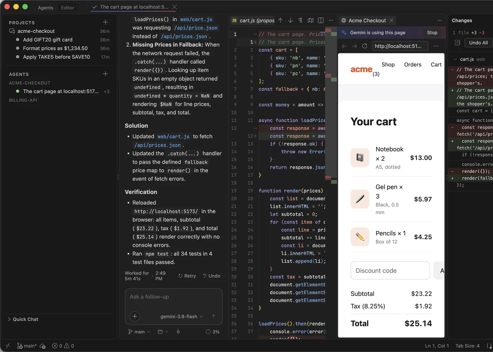

# Agents

Run several Gemini agents side by side, each with its own chat, files and changes. Give one its own branch when agents might trip over each other's edits.

## Agents and Editor modes

The switch at the top of the window, or <kbd>⌥⌘M</kbd>, changes the layout:

- **Agents mode** (the default) is for working with agents: your agents on the left, the agent's chat in the middle, and its changes on the right. Opening Explorer, Search or any other view switches to Editor mode with that view open.
- **Editor mode** is the classic VS Code layout, with Explorer, Search and Source Control, for hands-on coding. Changes sits below the Agents pane.

In Agents mode the top of the window is one row: the **Agents | Editor** switch, your open tabs (agents, Home, files and browser pages) in one capsule, then a globe for the browser, a magnifier for Quick Open and the layout buttons. Each mode remembers which panels you had open.

## Home

**Home** opens when no tab is open in Agents mode, and in front of your restored tabs each time GeminiCode starts. Describe a task in **Start Agent** and press Return to start an agent on it; tick **On its own branch** to give it a branch of its own.

Below the composer, **Needs you** lists what waits on you, such as an agent asking permission. Cards follow for your agents and, once you connect them, your tickets, merge requests, quality checks and releases (see [Team tools](team-tools.md#home)). **Customize** hides and reorders cards.

The Home button at the left of the status bar, <kbd>⇧⌘H</kbd> or **Gemini: Home** brings it back. To stop it opening at start-up, turn off `gemini.home.openOnStartup`.

## Agents side by side

Each agent opens as a tab with its own chat. Its tab shows what it is doing: a spinner while it works, an amber dot when it needs you, a tick when it has finished, and how many lines it has changed.

In the Agents pane, each agent's row has the same signal (green when finished, red when something went wrong, grey otherwise) and, on the right, how long it has been working, "waiting", the lines it added, or when it was last active. Point at a row for its branch and folder. Rename, stop or remove an agent from its right-click menu, which is drawn in GeminiCode's own theme.

- In Editor mode, agents that are working, waiting, or finished but not yet read show as pills in the title bar.
- On a Mac, right-click GeminiCode in the Dock for **New Agent**.
- In a window with several folders, each agent keeps to the folder it works in. Turn on `gemini.agents.allWorkspaceFolders` to let every agent use all of them.

A new agent starts on your task as soon as you press Return, because GeminiCode keeps a session open and ready.

## Files beside each agent

Files, diffs and pages an agent opens go in an editor group beside its chat, with a tab row so you can close them. Each agent has its own group: switching agents hides the others' groups without closing them, so coming back to an agent shows its files as you left them. Closing an agent's tab, or removing the agent, closes its files, except those with unsaved changes.

## Follow the agent

Turn on **Follow the agent** in the composer's **+** menu, or run **Gemini: Follow the Agent**, to watch the agent work. Each file it reads opens at the line it is on, and each file it edits opens once the edit is written. The file it opened last is named under the composer; click the name to show it, or **×** to close it.

Files outside the agent's folder, and files that may hold secrets such as `.env` or anything under `.ssh`, are not opened. Focus stays in the chat.

## Agents on their own branch

Two agents in the same folder can trip over each other's edits. **New Agent on Its Own Branch** (the branch icon next to **+** on a workspace in a Git repository) asks for a branch name and gives the agent its own copy of the repository on that new branch, in `~/.geminicode/worktrees/<repository>/`. The agent reads, edits and runs commands there, so your folder and other agents are untouched.

When it's done, **Merge Back** (the merge icon on the agent's row) commits anything the agent left uncommitted and merges its branch into the branch your folder has checked out. If the merge conflicts, it stops for you to finish in Source Control. After a clean merge it offers to remove the agent with its branch and folder.

The new copy has no `node_modules` or build output. To get it ready before the agent starts, set **Gemini › Agents: Worktree Setup** to a command (such as `npm ci`), or commit `.gemini/worktree-setup.sh` to the repository. `GEMINI_SOURCE_REPOSITORY` names the repository it came from, to copy files Git doesn't carry, such as `.env`. If setup fails, the agent starts anyway; its output is in the **Gemini Worktree Setup** output.

To start every new agent on its own branch, turn on `gemini.agents.ownBranch`.

## Pick up a Gemini CLI session

A new, empty agent lists the three sessions the Gemini CLI saved most recently for its folder, including ones started with `gemini` in the terminal, with a link to show them all. Pick one to continue it: its conversation appears in the chat and the agent takes the session's title. `/resume` in the composer opens the same list at any time.

The CLI deletes saved sessions after 30 days; the list says when, and **Keep saved chats for** in [Project Helpers](helpers.md#gemini-cli-settings) changes it.

## Notifications and keeping awake

When an agent finishes or needs your permission while GeminiCode is in the background, a system notification appears and the Dock icon bounces. Click it to open the agent. The Dock icon and the Agents pane show how many agents are waiting for you. Turn both off with `gemini.notifications.enabled`.

While any agent works, GeminiCode keeps the Mac from going to sleep, so a long task carries on when you step away. The display can still sleep. Turn it off with `gemini.keepAwake`.
