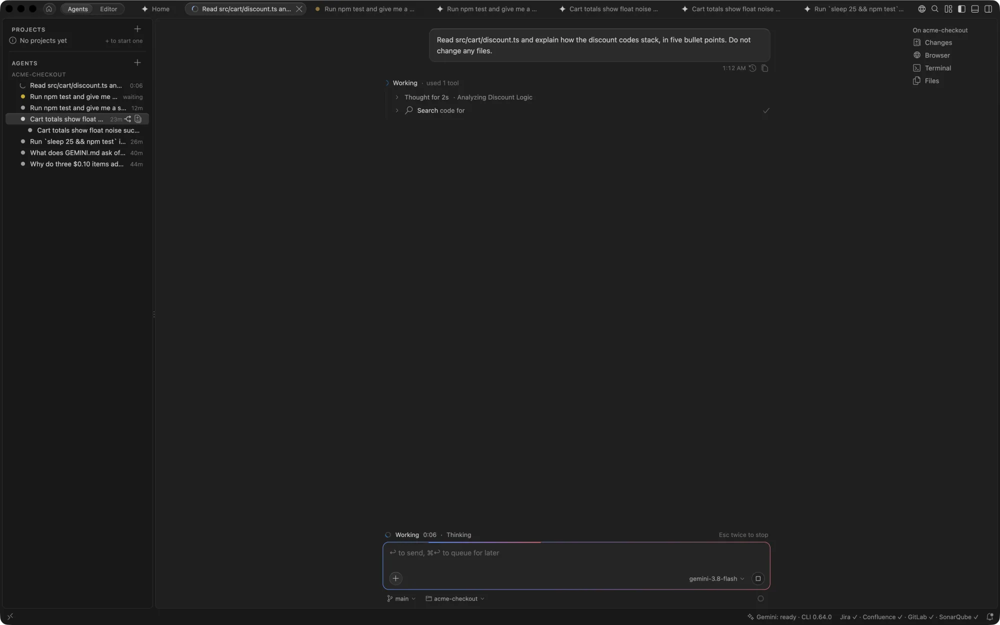
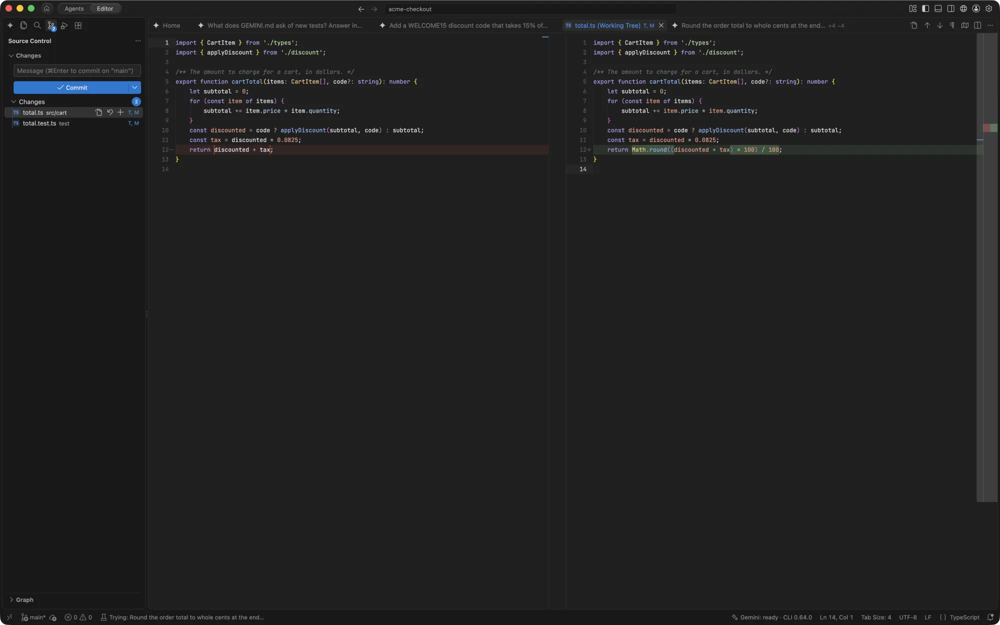
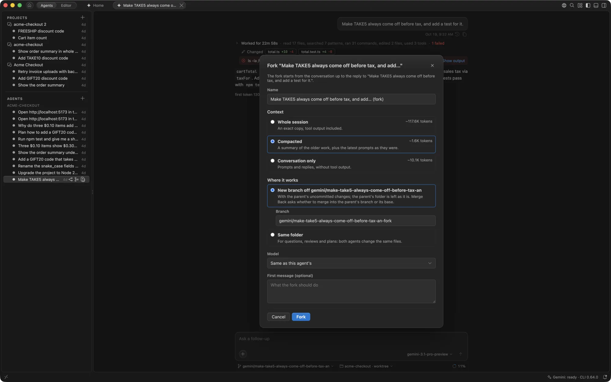
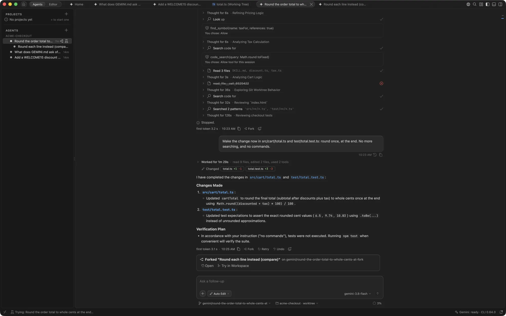
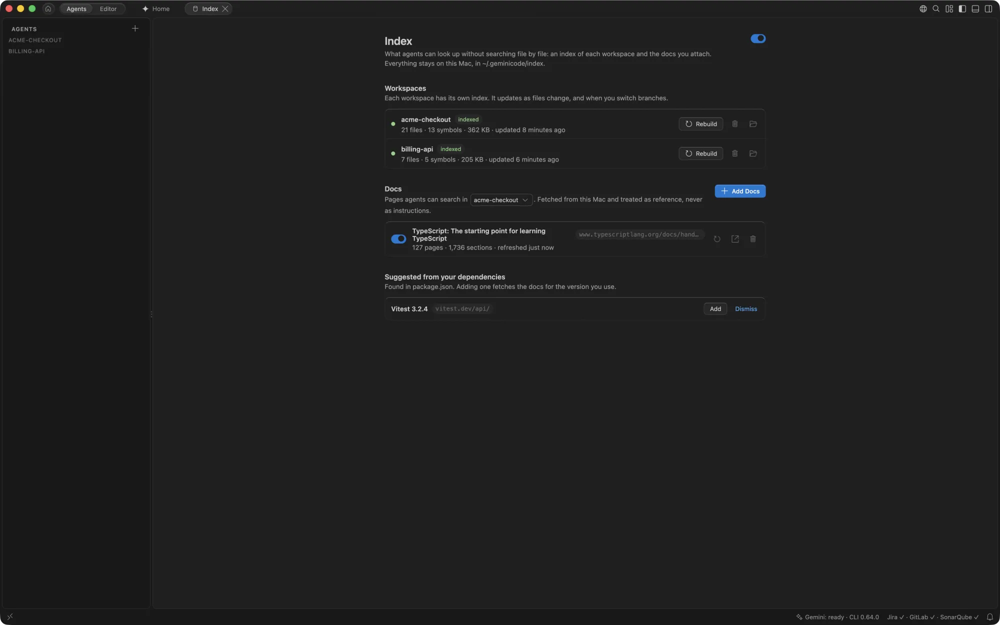

# Agents

Run several Gemini agents side by side, each with its own chat, files, changes and [terminal](terminal.md). Give an agent its own branch when agents might trip over each other's edits, and fork one when its work splits in two. Every agent finds code through a local index of its workspace, and searches the documentation you attach.

## Agents and Editor layouts

GeminiCode has two layouts. Switch between them with the **Agents | Editor** switch at the top of the window, or <kbd>⌥⌘M</kbd>.

- **Agents layout**, the default, is for working with agents: your agents on the left and the chat in the middle. The agent's changes open on the right when the agent in front starts changing files; the window opens with them closed, and if you close them during a turn they stay closed until the next turn changes something. Opening Explorer, Search or any other view switches to the Editor layout with that view open.
- **Editor layout** is the classic VS Code layout, with Explorer, Search and Source Control, for hands-on coding. The agent's changes sit below the Agents pane.

In the Agents layout the top of the window is a single row: the Home button, the layout switch, your open tabs (agents, Home, files and browser pages) in one capsule, then a globe for the browser, a magnifier for Quick Open, and the layout buttons. Each layout remembers which panels you had open.

## Home

**Home** is where you start agents and see what needs you. It opens when no tab is open in the Agents layout, and in front of your restored tabs each time GeminiCode starts.

To start an agent, describe the task in **Start Agent** and press Return. Under the task, choose where it works: **Here**, in this folder on your current branch; **On Its Own Branch**, a new branch and folder (see [Agents on their own branch](#agents-on-their-own-branch)); or **To a Project**, which sends the task to a project's coordinator, which makes it a thread or passes it on (see [Projects](projects.md)). Hold the pointer over a choice to see what it does. A branch and a project need a Git repository, and **To a Project** shows while Projects are on.

With **To a Project**, a picker beside the chooser lists the projects of the folder's repository first, then those of other repositories, and **New Project in** the folder. The button then reads **Send to Project**, or **Start Project** for a new one.

The bar under the composer shows the folder, with a drum for its index (full when indexed, half while indexing, empty when not yet), the approval mode and the model the agent starts with, and **From Your Tools…** lists your tickets and merge requests to start from one. The folder picker marks each folder **Trusted**, **Trusted by parent** or **Needs trust**, and **Open Folder...** adds a folder for agents without adding it to the window. **On Its Own Branch** and **To a Project** need a trusted folder: in one that isn't, Home says so in place, with **Trust...**. See [Folder trust](review.md#folder-trust).

Below the composer:

- **Agent Setup**, on the right, opens the MCP servers, skills, rules and hooks your agents load. See [Agent Setup](helpers.md).
- **Index**, beside it, opens the workspace index. A drum icon beside the workspace shows its state. See [Workspace index and docs](#workspace-index-and-docs).
- **Needs you** lists what is waiting on you, most pressing first, such as an agent asking for permission or an agent's work ready to try. See [Team tools](team-tools.md#home) for the rest.
- Cards follow for your agents and, once you connect your team's tools, your tickets, the merge requests waiting on you and your own, quality checks, and Gemini's usage. See [Team tools](team-tools.md#home).

Each card names the query that fills it, so you can check its numbers against the tool. **Customize** hides and reorders cards.

If GeminiCode quit while something was running, two cards come first. **Unfinished when GeminiCode last quit** lists the flows to reopen and any write whose result never came back. **What came back, and when** stays for a few minutes and says what is already back and what is still starting. In the chat, a turn that was cut off shows a card with **Retry the Turn**.

To get back to Home, click the house at the start of the title bar, press <kbd>⇧⌘H</kbd> (outside the editor, where it is Replace in Files), or run **Gemini: Home**. To stop it opening at start-up, turn off `gemini.home.openOnStartup`.

In the Agents layout the agent list highlights the agent, project or thread whose tab is in front. The status bar leaves out the window's repository, branch and problem counts, because each agent's own folder and branch show under its composer. The Editor layout keeps them.

## Agents side by side

Each agent opens as a tab with its own chat. The tab shows what the agent is doing: a spinner while it works, an amber dot when it needs you, a tick when it has finished, and how many lines it has changed.

In the Agents pane, each agent's row has the same signal (green when finished, red when something went wrong, grey otherwise). On the right it shows how long the agent has been working, "waiting", the lines it added, or when it was last active. Point at a row to see its branch and folder. Rename, stop or remove an agent from its right-click menu; **Gemini: Stop Agent** (<kbd>⌘esc</kbd>) stops the one in front. Removing an agent deletes its conversation and undo history, and the question names any files whose changes you haven't reviewed yet. **Archive**, in the same question, keeps all of that and moves the agent under an **Archived** row in its workspace, out of the list and off Home; its next prompt brings it back.

- In the Editor layout, agents that are working, waiting, or finished but not yet read show as pills in the title bar.
- Right-click GeminiCode in the Dock for **New Agent**.
- In a window with several folders, each agent keeps to the folder it works in. Turn on `gemini.agents.allWorkspaceFolders` to let every agent use all of them.

A new agent starts on your task as soon as you press Return, because GeminiCode keeps a session open and ready.

## Files beside each agent

Files, diffs and pages an agent opens go in an editor group beside its chat, with a tab row so you can close them. Each agent has its own group. Switching agents hides the other groups without closing them, so when you come back to an agent its files are as you left them. Closing an agent's tab, or removing the agent, closes its files, except those with unsaved changes.

## Follow the agent

To watch an agent work, turn on **Follow the agent** in the composer's **+** menu. Each file the agent reads opens at the line it is on, and each file it edits opens once the edit is written. Focus stays in the chat.

The file opened last is named under the composer. Click the name to show it, or **×** to close it.

Files outside the agent's folder, and files that may hold secrets, such as `.env` or anything under `.ssh`, are never opened this way.

## Agents on their own branch

Two agents in the same folder can trip over each other's edits. To keep them apart, give an agent its own branch: choose **New Agent on Its Own Branch** (the branch icon next to **+** on a workspace in a Git repository) and enter a branch name. The agent gets its own copy of the repository, on that new branch, in `~/.geminicode/worktrees/<repository>/`. It reads, edits and runs commands there, so your folder and other agents are untouched.

When the work is done, **Try in Workspace** (the icon on the agent's row, its right-click menu, the Changes panel or the agent's card on Home) copies the agent's changes into your checkout of the repository as unstaged files, so your local server and tests run with them. Nothing is committed, staged or merged: your branch, its index and HEAD stay as they are. Each time the agent finishes a turn, your workspace updates with what it changed. The status bar shows **Trying:** and the agent's name, and in Source Control the tried files carry a **T**.

While you try it, the Changes panel offers **Keep Changes** and **Take Back**:

- **Keep Changes** makes the changes yours, unstaged; commit them when you're ready. Committing the tried files yourself keeps them too.
- **Take Back** removes the agent's changes from your workspace. Edits you made yourself stay.

Edits you make to the tried files stay through every update. To hand them to the agent, tick **Include your edits to** the files above its message box: they are copied into its folder before your message, so it builds on them. When you and the agent changed the same lines, the file gets conflict markers, and updating waits until you resolve them. A file with unsaved edits updates when you save it. One agent's work is tried in a workspace at a time. Removing an agent whose work you are trying asks first: **Keep Changes and Remove** or **Take Back and Remove**.

The chevron beside **Try in Workspace** offers the other ways to take the work, and remembers your pick for the repository, so the button then does that: **Merge Back** commits anything the agent left uncommitted, with a message written from its diff, and merges its branch into the branch your folder has checked out (if the merge conflicts, it stops so you can finish it in Source Control; after a clean merge, it offers to remove the agent with its branch and folder); **Open Merge Request**, with GitLab connected, pushes the branch and opens a merge request. The agent's row in the Agents pane lists Try in Workspace and Merge Back in its menu too.

A new copy has no `node_modules` or build output. To get it ready before the agent starts, set **Gemini › Agents: Worktree Setup** in your user settings to a command such as `npm ci` (a repository's own settings can't set it), or commit a `.gemini/worktree-setup.sh` to the repository. Before a repository's script runs the first time, GeminiCode shows it and asks: **Don't Run**, **Run Once** or **Run and Remember**. It asks again whenever the script changes, and runs none in a workspace you haven't trusted. The command can use `GEMINI_SOURCE_REPOSITORY`, the repository the copy came from, to copy files Git doesn't carry, such as `.env`. If setup fails, the agent starts anyway, and the output is in the **Gemini Worktree Setup** output channel.

To start every new agent on its own branch, turn on `gemini.agents.ownBranch`: Home's chooser then starts on **On Its Own Branch**.

## Fork an agent

When an agent's work splits in two, fork it. The fork is a new agent that starts from the same conversation, so it already knows what the agent read, decided and planned. It works on its part while the original carries on.

There are two ways to fork:

- **Fork Agent** forks the conversation as it is. It is the split-arrows icon on an agent's row (on hover), in the row's right-click menu and in the composer's **+** menu, and you can type `/fork`.
- **Fork**, beside Retry at the end of any reply, forks the conversation as it was at the end of that reply.

The Fork dialog asks three things.

**What the fork takes with it.** Each choice shows about how many tokens it sends with every request.

- **Whole session** is an exact copy of the agent's session, tool output included.
- **Compressed** has Gemini summarise the older work first and keeps the latest messages as they were. It is much smaller, and waits for the agent to finish its turn. Large sessions start on this choice.
- **Conversation only** has your messages and the agent's replies, without tool output.

**Where it works.**

- On a **new branch** off the agent's branch, in its own copy of the repository, with the agent's uncommitted changes copied in. The agent's own folder is left as it is.
- In the **same folder** as the agent. This suits questions, reviews and plans, but both agents change the same files.

**A name, a model and a first message.** The model is the agent's own unless you pick another, and the first message is optional.

A fork is listed under the agent it came from, and the agent's chat gets a card for it with **Open** and **Try in Workspace**, which tries the fork's work in your checkout as for any agent on its own branch. With **Merge Back** remembered for the repository, the card offers it, and when the agent itself works on its own branch, it asks whether to merge the fork into the agent's branch or into the branch your folder has checked out. Removing an agent that has forks asks whether to remove them too; forks you keep stay as agents of their own.

## Workspace index and docs

GeminiCode keeps an index of the code in each workspace, and of any documentation you attach. With it, an agent finds the code it needs in one step instead of searching file by file. The index stays on your Mac, in `~/.geminicode/index`, and is built in a separate process at low priority, so it never slows the editor.

Open the **Index** page from **Index** on Home, beside Agent Setup, or with **Gemini: Manage Index**. On Home, a drum icon beside the workspace shows its state: full when it is indexed, half full while it is indexing, and empty when it has no index yet. Click it to open the Index page.

### Index tools for agents

Every agent's session gets the `geminicode-index` tools for the folder it works in:

| Tool | What it answers |
| --- | --- |
| `code_search` | The code that best matches some words, a name in any case (`applyDiscount`, `apply_discount`) or a short description. Results are whole functions or classes where possible, with path and line numbers. |
| `find_symbol` | Where a function, method, class or type is defined, with its first line, and optionally every line that uses it. Use `Container.name` for a method. |
| `related_files` | A file's imports, the files that import it, its tests, and the files most often changed in the same commits. |
| `repo_map` | An outline of the folder or a subfolder: what the project says it is, its languages, its folders and the public definitions in each. |
| `docs_search` | The documentation attached to the workspace, when there is some. |
| `code_type` | A function's, variable's or class's type and documentation, from the editor's language server: what hovering shows. |
| `code_diagnostics` | Errors and warnings in the files the agent changed, or the files it names, from the language servers: a check after an edit without running a build. |
| `code_calls` | What calls a function, or what it calls, as the language server resolves them. |

GeminiCode is an editor, so its language servers are running already: agents ask them through the same tools. `find_symbol` with references lists the exact uses of a symbol, through imports and aliases, where a language server covers the file, instead of every line that shares its name. Where none answers (a language with no extension, a server still loading, or an agent's own branch outside the workspace), the index answers alone and the result says so. When a turn changes files and the language servers report errors in the folder's changed files, a notice under the turn lists them, with **Fix**, which asks the agent to fix them and check again. Agents only reach files in their own folder that are neither secret nor ignored by git. `gemini.index.languageServers` turns this off.

Each session also starts with a short outline of the folder, so the agent knows its way around before its first search. Once the index is built, the session's first prompt asks the agent to use these tools before searching file by file. Results rank the code above its tests, unless you ask about tests, and say when they are complete, so the agent reads only what they point to. In the chat, the calls read as "Search code for …", "Look up …" and so on.

GeminiCode also gives the Gemini CLI the app's own ripgrep, so the agent's plain text searches are fast too, with or without an index.

An agent uses these tools only in a folder the Gemini CLI trusts. The Index page says when a workspace isn't trusted, and offers **Trust Folder**, which asks first, as Chat does, since trust also lets the Gemini CLI load the folder's MCP servers, hooks and project settings.

### One index per workspace

Each workspace has its own index. An agent on its own branch starts from a copy of its workspace's index, so it is ready at once. Indexes never mix, and two GeminiCode windows on the same folder share one index that only one of them writes.

By default a workspace is indexed the first time an agent starts there. Until the index is ready, the tools answer from a plain text search and say so. `gemini.index.buildOn` changes when the first build happens: when an agent starts (the default), when the window opens, or only when you choose **Index Now**.

After that, the index keeps itself up to date:

- a file you save, add or delete, about a second later
- a checkout or a pull, when the branch moves
- an agent's edits in its own worktree, as it makes them

The **Gemini** status bar item shows **Indexing N%** while a large build runs; hover it for each folder's progress. Small updates don't show.

For each workspace, the Index page shows its state and size, with:

- **Index Now**, for a workspace that has no index yet
- **Rebuild**, to build the index again from scratch
- **Pause** and **Resume**, while a build runs
- the trash icon, to remove the index; the next agent that starts there builds a new one

### What is left out

By default, an index leaves out files git ignores, entries in `.geminiignore`, secret files such as `.env` and private keys, binaries, lock files, minified code and files over 1 MB. Add exclusions of your own with `gemini.index.exclude`, in `.gitignore` syntax.

**Files Left Out**, on the Index page, lists the files that were skipped, grouped by reason, with a filter. To index one anyway:

- **Index Anyway** on a file adds it to `gemini.index.include`. It is indexed a moment later, without a rebuild.
- **Index All Anyway** does the same for a whole group, up to 50 files.
- For more than that, add a pattern such as `src/generated/**` with **Edit Included Files**.

Included files are indexed even when they are generated, minified or lock files, are listed in `.geminiignore` or `gemini.index.exclude`, or are over the size limit (up to 16 MB). Secret files and files with binary content are never indexed.

**Open .geminiignore** opens the folder's ignore file, creating it if needed. The Gemini CLI reads the same file.

### Attach documentation

Attach a library's documentation, and agents search it with `docs_search` instead of fetching pages from the web.

1. Choose **Add Docs**, or **Add** on a suggestion.
2. Enter the address, such as `https://react.dev/reference`.
3. Choose what to fetch: only that page, the pages under that address, or the whole site. GeminiCode uses the site's `llms.txt` or sitemap when it has one, and otherwise follows links under the address.
4. Pick how many pages to fetch at most, how often to refresh them, and which workspaces can search them.

Pages are fetched from your Mac, through its network settings, and stored once however many workspaces use them. Fetching follows the site's `robots.txt`. Pages behind a sign-in can't be indexed: a page that asks you to sign in is reported rather than stored. Agents treat fetched pages as reference material, never as instructions.

Each source is refreshed daily by default, set with `gemini.docs.refresh` or per source. A page that hasn't changed costs one small request. The switch on a source detaches it from the workspace without deleting it.

**Suggested from your dependencies** offers the documentation of the libraries your `package.json`, `requirements.txt`, `pyproject.toml`, `go.mod`, `Cargo.toml`, `pom.xml` or `build.gradle` names, for the versions you use. The list ships with GeminiCode, so nothing is looked up to make it.

### Index settings

| Setting | Default | What it does |
| --- | --- | --- |
| `gemini.index.enabled` | on | Keep indexes and give agents the index tools. |
| `gemini.index.languageServers` | on | Let the index tools ask the editor's language servers too: exact references, types, errors and callers. |
| `gemini.index.buildOn` | `agentStart` | When a workspace's index is first built. |
| `gemini.index.exclude` | empty | Extra files and folders to leave out, in `.gitignore` syntax. |
| `gemini.index.include` | empty | Files to index even though they would be left out, in `.gitignore` syntax. |
| `gemini.index.maxFileSizeKb` | 1024 | Larger files are left out. |
| `gemini.docs.enabled` | on | Allow attaching documentation from the web. |
| `gemini.docs.allowedDomains` | empty | The only sites docs may come from, such as `react.dev` or `*.example.com`. Empty allows any site. |
| `gemini.docs.refresh` | `daily` | How often attached docs are fetched again. |

An administrator can lock `gemini.index.enabled`, `gemini.docs.enabled` and `gemini.docs.allowedDomains` as policies. See [Settings](settings.md#settings-your-administrator-can-lock).

## Pick up a Gemini CLI session

A new, empty agent lists the three sessions the Gemini CLI saved most recently for its folder, including ones you started with `gemini` in a terminal, with a link to show them all. Pick one to continue it: its conversation appears in the chat, and the agent takes the session's title. Type `/resume` (or `/chat`, as the CLI also calls it) in the composer to open the session browser at any time: each session's first prompt, how many prompts it has and when it was last used, newest first; type to search them, and the trash icon on a row deletes the session's files, as the CLI's `--delete-session` does. GeminiCode opens sessions on the folder's real path, as a terminal does, so the two share one list.

The CLI deletes saved sessions after 30 days. The list says when each one goes, and **Keep saved chats for** in [Agent Setup](helpers.md#gemini-cli-settings) changes how long they are kept.

## Notifications and keeping awake

When an agent finishes, or needs your permission, while GeminiCode is in the background, a notification appears and the Dock icon bounces. Click the notification to open the agent. The Dock icon and the Agents pane show how many agents are waiting for you. Turn both off with `gemini.notifications.enabled`.

While any agent works, GeminiCode keeps the Mac from going to sleep, so a long task carries on when you step away. The display can still sleep. Turn this off with `gemini.keepAwake`.

