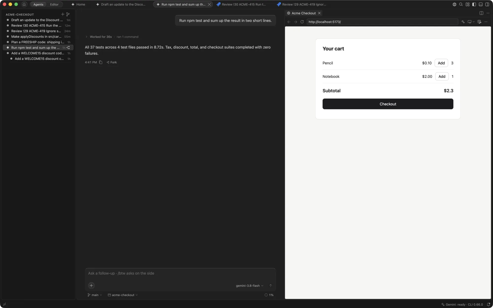
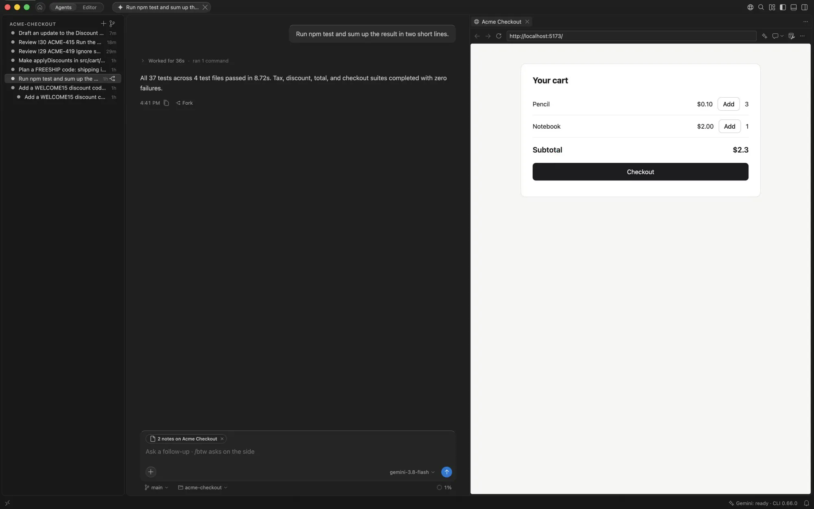
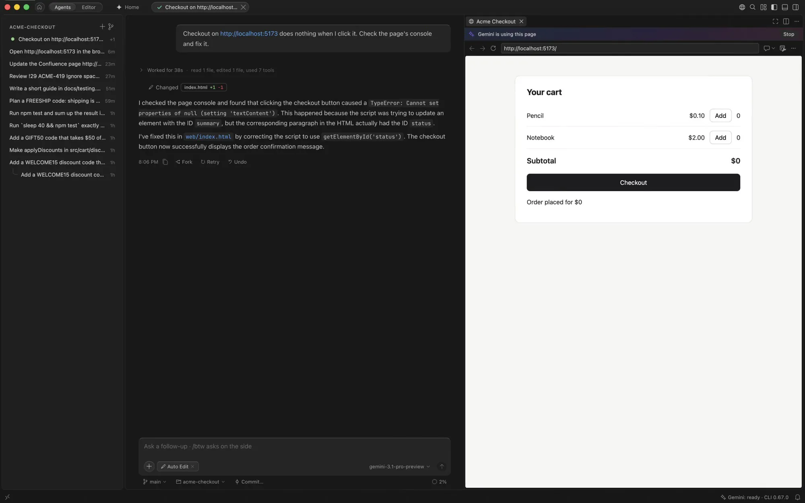

# Browser

You and your agents share GeminiCode's browser. Point at an element or pin notes where something should change, and an agent can open your app, check its own work and read the page's console and network.

## Let an agent open your app

Ask, for example, "open http://localhost:5173 and check the cart total". The agent opens the page in a tab beside its chat, under a **Gemini is using this page** bar, and reads the page, clicks, types, scrolls, presses keys and takes screenshots while you watch. **Stop** on the bar stops the agent's turn. In Default mode the agent still asks before each browser action.

To open the browser yourself, click the globe in the title bar. Links to `localhost` in the terminal and in the chat open in it too.

## Point at what to change

**Add to Gemini** in a page's toolbar puts part of the page into your prompt: the prompt of the agent using that page, or else of the chat in front.

- **An element.** Choose **Add Element to Gemini**, or press <kbd>⇧⌘C</kbd>, then click an element. A chip joins the composer with the element's place in the page, its HTML and styles, and a picture of it.
- **A screenshot** of the page (**Add Screenshot to Gemini**), or of an area you drag out (**Add Area Screenshot to Gemini**).
- **The console** of the page (**Add Console Logs to Gemini**).

The screenshot and console choices are under the button's chevron. The left side of the button picks an element or [leaves notes](#leave-notes-on-the-page), whichever you used last.

## Leave notes on the page

**Leave Notes for Gemini** (<kbd>⌥⌘C</kbd>, also under the **Add to Gemini** chevron) lets you click elements and write a change on each, such as "make this button primary". The notes stay pinned on the page while you add more. **Send to Gemini** on the notes bar sends them as one numbered list, each with its element; **Discard** drops them.

## Share a page you're signed in to

An agent can also use a page you opened yourself, such as a QA or intranet site you're signed in to. Click the sparkle, **Let Gemini Use This Page**, in the page's toolbar, then pick a running or recent agent, or **New Agent...** to start one. The agent's chat comes to the front with the page attached, so you can say what to do with it.

The agent uses the page as you, signed in, so share only pages you trust it with. While a page is shared, the agent's composer shows a **Shared page** chip. The share lasts until you click the chip's ×, choose **Stop Sharing** on the page's bar, close the page or remove the agent.

The Gemini CLI's own web fetch can't reach private addresses. For a QA or intranet site, ask Gemini to open it in the browser, or share it with the agent.

## Console and network

Agents read the page's console (every level, filtered by text or level) and its requests (method, URL, status, type and time, or only the failed ones). They can also go back, forward and reload, right-click, answer a page's alert, confirm or prompt dialog, and list the web servers already running on your Mac, so they open yours rather than starting another.

## Which sites agents can open

- Pages on your Mac (`localhost`, `127.0.0.1`) open freely. Local files follow the same rules as the agent's file tools.
- Any other site asks you first, once per agent and site, because a page can contain instructions aimed at the agent. The check uses the page's real address after every step, so a redirect or a click can't skip it.
- Turn off `gemini.browser.allowOtherSites` to keep agents to local pages, or list the only sites they may open in `gemini.browser.allowedOrigins`, such as `https://*.example.com`. You can still open any site yourself.
- Turn off `gemini.browser.enabled` to take the browser away from agents.

## Sign in once

By default, agents' pages forget their cookies and storage when GeminiCode quits. Turn on `gemini.browser.keepSignIns` to keep them between sessions, separately for each workspace, so an agent signs in to a QA site once. Agents' pages never share your own pages' storage.
