# Chat and prompting

Everything you need to talk to an agent sits in the composer's **+** menu. Attach the files that matter, turn a rough request into a precise prompt, and let the agent plan before it builds.

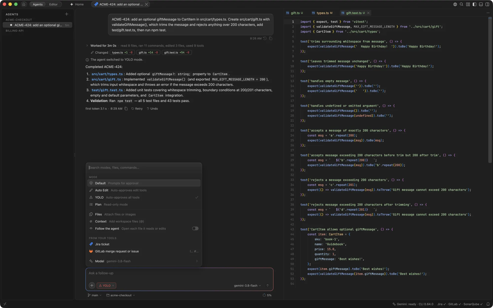

## The + menu

The **+** menu at the bottom left of the composer holds:

- **Mode**: Default, Auto Edit, Plan and, if your admin allows it, YOLO. See [Approval modes](review.md#approval-modes). In a trusted folder that is a Git repository with at least one commit, Auto Edit is tagged **Recommended here**: its edits apply at once and you review them with Keep and Undo, while commands still ask. The tag never switches the mode for you. `gemini.agents.defaultMode` sets the mode new agents start in.
- **Files** and **Context**: attach files from anywhere, or workspace files with `@`.
- **Follow the agent**: open each file the agent reads or edits.
- **Model**: the models the terminal's `/model` shows, in the same order. The model you pick is used for every new or reopened agent. **Set as Default for the CLI**, the menu's last row, saves it as the model the Gemini CLI itself starts on (`model.name` in `~/.gemini/settings.json`), as the terminal's `/model` dialog does, so a `gemini` started in a terminal uses it too.
- **Fork**: start a new agent from this conversation. See [Fork an agent](agents.md#fork-an-agent).
- **Open Terminal**: the agent's own terminal, in its folder. See [Terminal](terminal.md).
- **Usage and quota**: how full the chat is, what each turn carries, and today's quota.
- **Skills and commands**: the same list as typing `/`.

A mode other than Default shows as a chip beside **+**; click its × to go back. From the keyboard, <kbd>⇧Tab</kbd> steps to the next mode and <kbd>⌘Y</kbd> toggles YOLO, as in the Gemini CLI's own terminal (<kbd>⌘.</kbd> still steps too); <kbd>⌥⌘.</kbd> switches the model (**Gemini: Cycle Approval Mode**, **Gemini: Toggle YOLO** and **Gemini: Switch Model...**), and <kbd>⌃⌘I</kbd> puts the cursor back in the message box (**Gemini: Focus Chat**).

## Attaching context

- **Workspace files.** Type `@`, or choose **Context** in the **+** menu. The agent gets a link and reads the file itself, including unsaved changes.
- **More with `@`.** Under the files, the `@` list has groups of its own:
  - **Folders**: the folders the matching files are in. The agent reads every file in the folder.
  - **Symbols**: functions, classes and other definitions from the [workspace index](agents.md#workspace-index-and-docs), attached as their lines. Shown only while the index is on and built.
  - **Workspace**: **Problems** (the folder's errors and warnings from the Problems view), **Uncommitted changes** (the diff against the last commit, new files included) and **Last terminal command** (the command that finished last in the agent's terminal, else in the terminal in front, with its output). Each shows only when it has something to send.
- **Fix with Gemini.** The light bulb on any error or warning in the editor offers **Fix with Gemini**: the problem and the ten lines either side of it are attached to the agent in front, or to a new agent, ready for you to add a word and send.
- **The selection.** <kbd>⌘L</kbd> adds the editor selection with its line numbers, to the agent in front or to a new agent.
- **Files from anywhere.** Choose **Files** in the **+** menu, paste, or drop files from Finder. Hold <kbd>⇧</kbd> when dropping from the Explorer. Text and code files up to 1 MB are sent with their contents; images and PDFs up to about 7 MB are sent inline; other files outside the workspace are sent as links, and the CLI asks once before reading each.
- **Your team's tools.** Paste a Jira key, a GitLab merge request or a Figma link, or choose **From your tools** in the **+** menu, where **Figma Design...** attaches a design as a frame link for each screen size. See [Team tools](team-tools.md#in-chat).

The agent can't read secret files such as `.env` and private keys, or git-ignored files.

GeminiCode has no inline (ghost text) completions as you type, and none are planned: the agents, inline edit and **Fix with Gemini** are how Gemini changes code in the editor.

## Slash commands and skills

Type `/` at the start of the composer, or choose **Skills and commands** in the **+** menu, to list commands, under a heading for each source: GeminiCode's own first, then the team's, the skills and the CLI's. Keep typing to filter, then press <kbd>Tab</kbd> or <kbd>Enter</kbd> to complete the name and add arguments.

- **Gemini CLI commands** such as `/init`, `/memory` and `/restore` run in the CLI.
- **The Gemini CLI's commands, as GeminiCode offers them**, listed first under the names the terminal uses: `/resume` (also `/chat`) browses the saved sessions and restores one, `/rewind` goes back to before a message, `/plan [goal]` switches to Plan mode with a goal and `/plan copy` copies the latest plan, `/compress` summarizes the older work (below), `/context` (also `/stats`) shows what each turn carries (see [Usage and quota](#usage-and-quota)), and `/permissions trust` opens the folder trust dialog.
- **GeminiCode's own**: `/btw` asks a [side question](#side-questions), `/research` reads widely in parallel ([Research](#research)), and `/fork` forks the agent.
- **Team commands** are TOML files in `.gemini/commands/` in the workspace, or in `~/.gemini/commands/` for your own. It's the Gemini CLI's own format, so the same files work in the terminal: `git/commit.toml` becomes `/git:commit`.
- **Skills** are folders with a `SKILL.md`, in `.gemini/skills/` (or `.agents/skills/`) in the workspace, or in `~/.gemini/skills/` for your own. Picking one asks the agent to load it, with what you typed after the name as the task.

```toml
description = "Review a file for bugs"
prompt = "Review {{args}} for bugs and suggest fixes."
```

In a team command, `{{args}}` is replaced by what you typed after the name, `@{path}` puts a file's text in the prompt, and `!{command}` the output of a shell command run in the agent's folder. Before any `!{command}` runs, GeminiCode shows every command and asks.

## Enhance prompt

Write what you want in plain words, then click **Enhance** at the end of your text, or press <kbd>⌥⌘E</kbd>. Gemini rewrites the draft as a clearer prompt: what to do, where, and how to tell it's done, with open questions where your draft leaves something out. It keeps your `@` mentions, a leading `/command`, file names and code as you wrote them. In a workspace with an index, the rewrite also sees an outline of the project and the files most likely involved, so it can name the right ones.

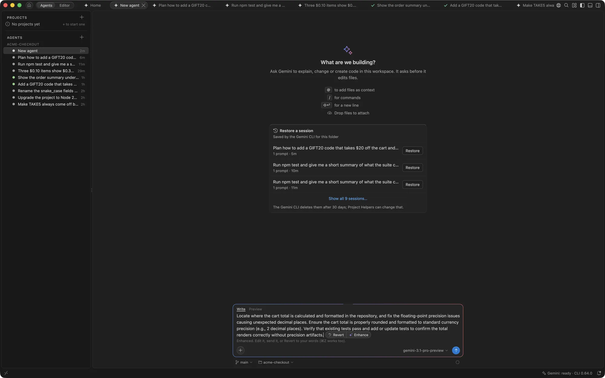

The rewrite replaces your draft as Gemini writes it; **Cancel** or <kbd>esc</kbd> stops it. **Revert** (or <kbd>⌘Z</kbd>) puts your draft back. Nothing is sent to the agent until you press Send, and Enhance works while the agent is busy.

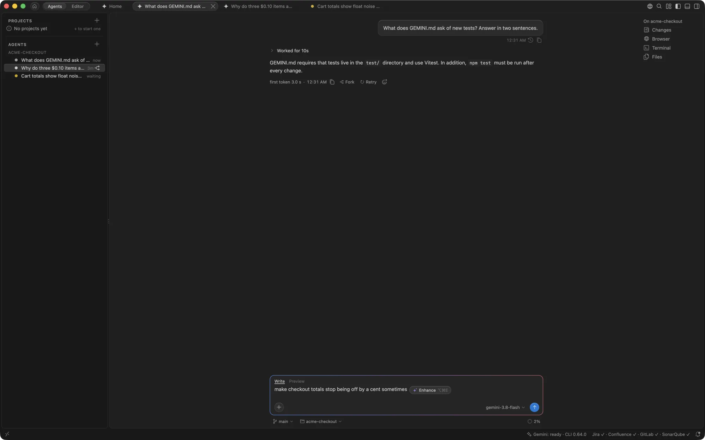

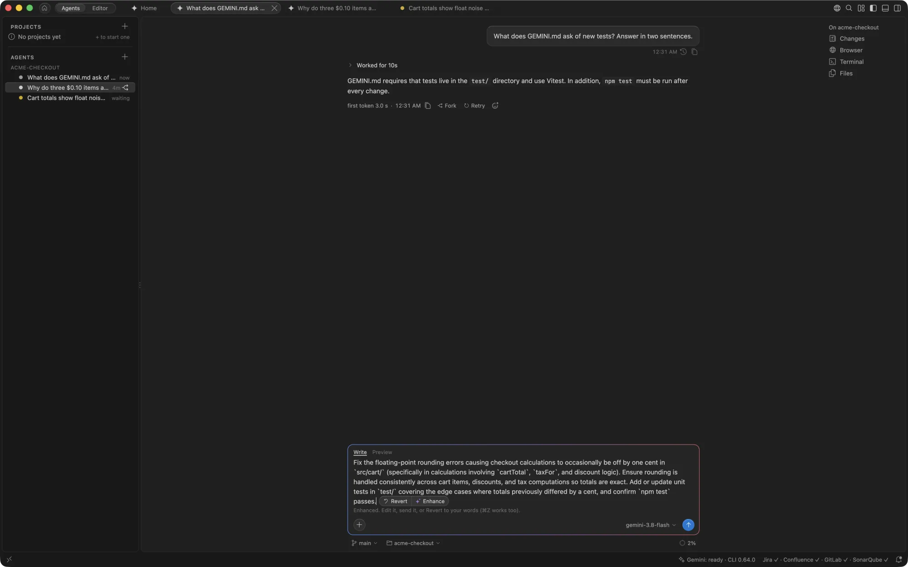

## Plan, then build

In **Plan** mode the agent reads and proposes a plan without changing anything. When a reply ends in Plan mode, **Approve Plan** under it switches the chat back to the mode it was in before Plan (Default when it started in Plan) and asks Gemini to carry out the plan. The chevron beside it is the CLI's own approval dialog, in its words: **Yes, automatically accept edits** builds in Auto Edit, **Yes, manually accept edits** builds in Default, **Edit or comment the plan first** opens Plan Review, and **Not yet** leaves the plan as it is. When you switched to another model after planning, a line under the button names both: "Builds with … ; planned with …". The Gemini CLI doesn't say ahead which model Auto will pick, so with Auto there is no such line.

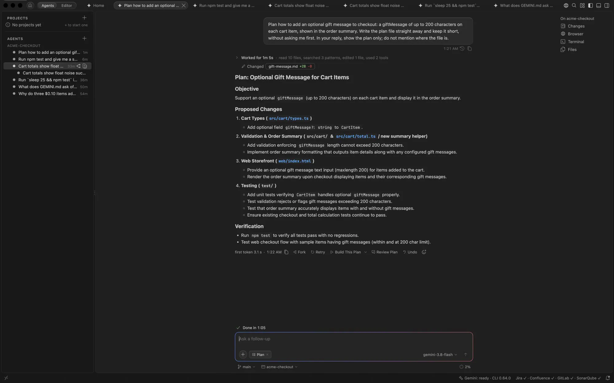

With the model on Auto, Gemini plans with Pro and builds with Flash. Turn off **Plan with Pro, build with Flash** in [Agent Setup](helpers.md#gemini-cli-settings) to keep one model throughout.

### Review the plan

When a Plan mode turn writes a plan file, **Review Plan** beside **Approve Plan** opens it on a page of its own, in the agent's side group; so does the plan's file chip while the agent is in Plan mode. The page shows the plan section by section.

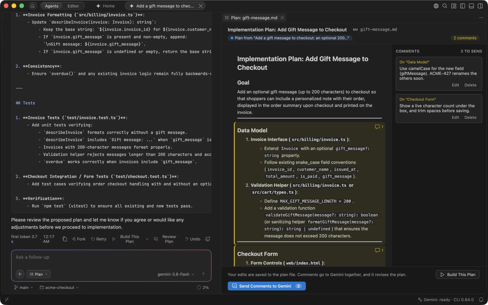

- **Edit in place.** Click a section, or press Return on it, to edit its Markdown; **Done** (<kbd>⌘↩</kbd>) saves it to the plan file. Sections can't be edited while Gemini works on the plan.
- **Comment.** The **+** beside a section, or **Comment** over selected text, adds a comment. Comments wait in a panel beside the plan, and are kept when you close the page.
- **Send Comments to Gemini** sends every comment at once, with the sections you edited, and Gemini revises the plan. When its turn ends, the page says how many sections changed and marks them **changed**; **Show What Changed** finds them, and **Clear Sent Comments** tidies the panel.
- **Approve Plan** builds it as it is now, edits included. With comments not yet sent, it asks first: **Send Comments First** or **Build As It Is**.

**Open as Text** opens the plan file in the editor. Plans stay with their session: reopening the session, after a restart for example, keeps the plan, and **Review Plan** still opens it.

## Watching the agent work

While the agent works, its thoughts and steps show under a **Working** line, with steps of one kind (nine searches, five commands) as one line that opens to each step.

When the turn ends they fold under one line, such as **Worked for 3m 12s · read 14 files, searched 11 patterns, ran 9 commands**, with the answer below it. The files the turn changed stay in sight as chips that open their diffs, and so does any step that failed, with **Show output**. Click the line to open the turn again. Turn folding off with `gemini.chat.foldFinishedWork`.

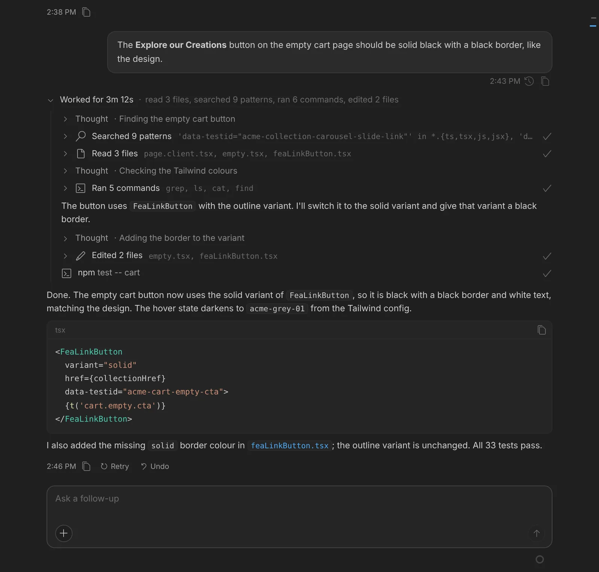

A command's output over 80 lines shows its first and last 20, with **1,240 lines hidden · Show All** between them. **Show All** fetches the rest; the chat keeps the whole of the latest outputs, up to 16 MB, so a long chat doesn't hold every output in memory. An output from before the window reloaded may no longer be kept whole.

If nothing at all arrives from Gemini for 45 seconds, no text, step or thought, the turn says so: **No response from Gemini for 45 s. It may be retrying a busy server.** When the CLI's log shows it retrying after a server error, the notice says which attempt it is on. **Stop** stops the turn and **Show Log** opens the Gemini log. The notice goes by itself as soon as anything arrives. It doesn't show while a command runs or a card waits for you.

When the agent hands part of the work to one of the Gemini CLI's subagents (such as the Codebase Investigator, or your own in `.gemini/agents/`), the chat shows a **Subagent** row with its name and how long it has worked. Click it to read the subagent's report.

## When a turn fails

A failed turn says what went wrong in plain words and offers a way out:

- **Quota used up**: **Retry** sends your message again and **Switch Model…** opens the model menu. The reset time shows when the Gemini CLI reports one, which it usually doesn't.
- **Can't reach Google**: check your connection, VPN or proxy, then **Retry**. **Show Log** opens the Gemini log.
- **Your Gemini sign-in has expired**: **Sign In** signs in again in the browser, then **Retry**.
- **The turn reached the request limit**: **Continue** tells Gemini to carry on.

Any other error keeps the CLI's own message, without its JSON wrapper, with **Retry** and **Show Log**. The buttons stay on the latest failure until your next message.

Gemini sometimes refuses a session's request after a tool result, most often after an image such as a screenshot, and a retry sent the same way is refused again. When that happens twice, the chat says so and offers **Continue in a New Session**, which carries the conversation on without the tool outputs, and **Switch Model…**. Your files stay as the agent left them.

## Sending while the agent works

You don't have to wait for the agent to finish. While it works, the composer says **↩ to steer, Tab or ⌘↩ to queue · ⌥⌘; asks on the side**: <kbd>Tab</kbd> queues the message for after this turn, as it does in the Gemini CLI, and the strip under the composer shows it as **Queued**. With `gemini.chat.sendWith` set to `cmdEnter`, ⌘↩ sends, ⇧⌘↩ queues and ↩ makes a new line (Ctrl takes ⌘'s place on Windows and Linux).

- **↩ sends now**, to steer the agent: "use pnpm, not npm", or "leave the tests alone". The message shows above the input as **Sending after the current step**. At the next safe point, the chat stops the turn and sends your message, telling the agent to adjust its plan and carry on. A safe point is when no command or edit is running and Gemini has answered the last tool's result, so no tool's work is lost. That is straight away while the agent is thinking or writing, or showing a permission card.
- **⌘↩ queues** the message for after the turn. It shows as **Queued: goes after this turn**. Several queued messages go together as one.

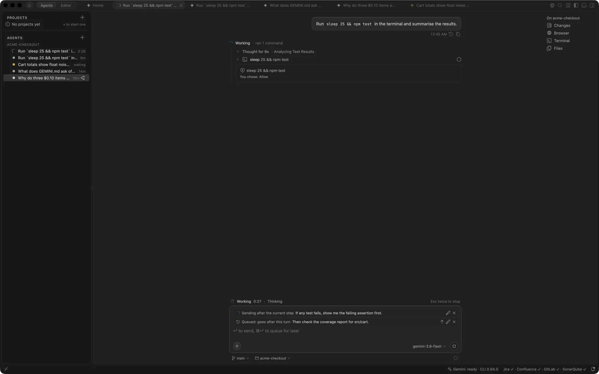

Each waiting message has **Send now**, **Edit** and **Remove**, and <kbd>↑</kbd> in the empty input takes the last queued one back to edit. If you stop the agent (<kbd>esc</kbd> <kbd>esc</kbd>), or the turn fails, nothing is sent by itself: your messages stay queued until you send them.

Sending now stops the turn between steps, never in the middle of a command, so a running command or edit always finishes. When a long run of tools gives no safe point for 15 seconds, the message's row says **Waiting to stop safely: a tool is finishing** and offers **Stop Now**, which stops the turn at once; a tool that finished but whose result Gemini hasn't read yet is lost, and the agent may run it again. The turn you steered gets its own end line and **Undo**, and your message starts a new turn. The Gemini CLI can't add a message to a running turn, so steering costs one more model request, mostly served from its cache.

In a project's thread, notes from the coordinator wait in the same place, as **From coordinator: goes after this turn**. In the project chat itself, ↩ and ⌘↩ both wait for the coordinator's turn to end; see [Projects](projects.md#talk-to-the-coordinator).

## Side questions

Ask about the conversation without stopping the agent: type `/btw` and your question, such as `/btw why did it add axios?`, or press <kbd>⌥⌘;</kbd> (<kbd>Ctrl+Alt+;</kbd> on Windows and Linux) to open the side panel above the message box.

A fast model answers from the chat as it is, in a second or two, while the agent keeps working. The question and its answer never go into the agent's conversation, so they don't slow its later steps or change what it does. The side answer sees your messages, Gemini's replies, plans and tool calls, with long tool outputs cut short; it has no tools of its own, so it says when the chat doesn't hold the answer.

Under an answer:

- **Send to Agent** puts the question and the answer in the message box, to edit and send as a steering message.
- **Fork into Agent** opens Fork Agent with the question as the fork's first message, for a question that needs reading files or running commands.
- **Copy** copies the answer.

Earlier side questions stay in the panel until the chat closes; <kbd>⇧←</kbd> and <kbd>⇧→</kbd> step through them, and later questions can build on them. Side questions use the quick requests' model (`gemini.inlineEdit.model`); with a sign-in that can't make quick requests, a session of their own on the Gemini CLI answers instead.

## Research

For a broad question about the code, such as `/research where are auth tokens read, stored or logged?`, GeminiCode reads widely in parallel instead of one step at a time:

1. It splits the question into parts by area of the code, from the workspace index's outline.
2. Read-only workers, four at a time by default (`gemini.research.concurrency`, 1 to 8), each read one part with the index tools. They run in Plan mode and every permission request they make is refused, so nothing changes.
3. One more worker rereads the most serious findings.
4. A report answers the question, with each finding's `path:line`, verified ones marked.

When a question in the message box reads like a broad one, such as "where are all the places that…", **Run as Research** appears under it; its × stops the suggestion for that chat. The card in the chat shows each part as it's read. **Stop** ends every worker and reports what was done. Under the report, **Send to Agent** puts it in the message box for the agent to act on, and **Copy** copies it. The research isn't part of the agent's conversation until you send it. A project's chats have no `/research`: their threads do the reading.

## Replies

- Code is coloured like the editor, and the button at the top of a code block copies it. A shell command also has **Run**, which runs it in the agent's terminal; see [Terminal](terminal.md#run-a-command-from-a-reply).
- A file name in a reply, such as `src/cart/total.ts:11`, opens the file at that line.
- Math written as `$...$`, `$$...$$`, `\(...\)` or `\[...\]` is typeset; prices and shell variables stay plain text.
- Notes, tips and warnings show as coloured callouts.

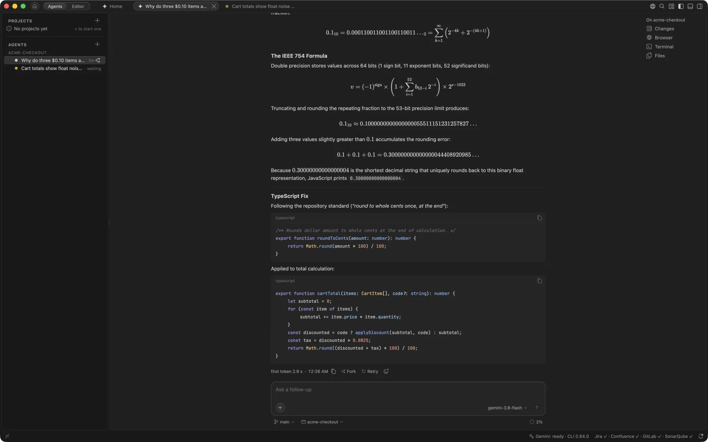

Each message you send shows the time you sent it, **Rewind** and **Copy**. Under each reply is how long the agent worked, the time it finished and **Copy**.

### Reacting to replies

Sometimes a reply only needs a nod, or a quick "no, not that". React to it with an emoji instead of writing a message.

The smiley at the end of a reply's row opens the reaction bar when you point at it or tab to it. It has four quick reactions, and a smiley of its own that opens every emoji, with search and the ones you used last.

The picker shows what an emoji will do before you pick it: its footer gives the meaning of the emoji under the pointer, such as "Go ahead", or says that Gemini will tell you how it reads it first. Its first row, **With a meaning**, lists every emoji that has one, your own included. Pointing at a reaction chip later shows what it asked for.

To react from the keyboard, send `+` and one emoji, such as `+👍`: it reacts to the latest reply instead of being sent as a message.

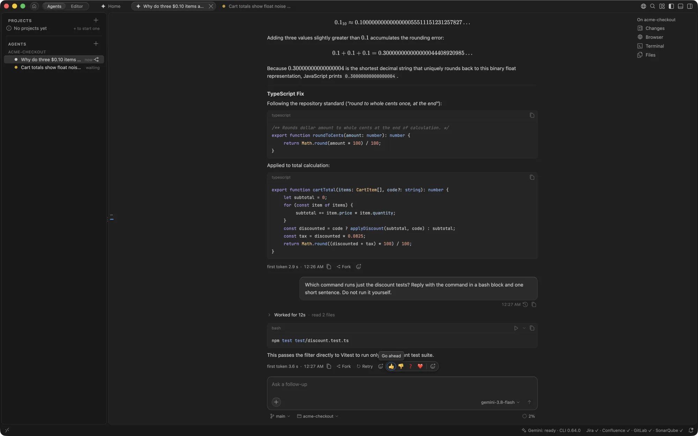

| Reaction | What Gemini does |
| --- | --- |
| 👍 Go ahead | Carries on with what it proposed. On a plan, this is the same as **Approve Plan**. |
| 👎 Not what I meant | Stops, says in one line what it understood, and asks what to change. While the agent works, 👎 stops the turn at the next safe point, as ↩ does. |
| ❓ Explain more simply | Explains the reply again, more simply, with an example. |
| ❤️ Thanks | Nothing. The reply is marked, and no message is sent. |

Any other emoji is read as intent: Gemini says in one line how it read it before it does anything, so a misreading shows before any tool runs. Its edits and commands still ask for permission as usual.

A reaction is sent straight away. It shows as a chip on the reply and as a line in the conversation; click the line to go back to the reply. While the agent works, reactions other than 👎 wait in the queue with your other messages, and a second reaction to the same reply replaces one that is still waiting.

Gemini may react to your message too, with a small emoji on its corner, when it has something to add. Most messages get none.

To change what an emoji asks for, or to give a new one a meaning, set `gemini.chat.reactions.meanings`, such as `{ "🚀": "Go ahead, then commit with a short message." }`. In a workspace's settings it is shared with everyone who opens the folder. `gemini.chat.reactions.agentReactions` turns Gemini's own reactions off, and `gemini.chat.reactions.enabled` turns reactions off altogether.

Reactions work in agents' and threads' chats. A project's coordinator chat has none.

## Writing in the composer

Messages you send show Markdown the way replies do. In the composer, <kbd>⌘B</kbd> makes the selection bold and <kbd>⌘E</kbd> makes it code, and <kbd>⇧↩</kbd> on a list line starts the next item. The **Write** and **Preview** tabs (or <kbd>⇧⌘V</kbd>) switch between your draft and how it will look.

The composers underline misspelt words; right-click a word for suggestions or **Add to Dictionary**. Turn it off with `gemini.chat.spellCheck`.

## Usage and quota

The ring at the bottom right of the composer shows how full this chat's context window is. It turns amber at 50%, where Gemini starts summarising older messages, and red at 90%. Click it, or choose **Usage and quota** in the **+** menu, for:

- **Context window**: the tokens in the latest request out of the model's limit, and what they are: the conversation, the MCP servers' tools, the rule files (`GEMINI.md` and the files it imports), GeminiCode's own tools and the CLI's own prompt. The parts are measured with one short request each on the lightest model, in the background, at most once a day per folder; **Measure Again** measures now. The rule files are listed as the CLI loaded them, with their sizes, and one over 20 KB gets a warning, since every turn carries it. Typing `/context` opens the same view. Agent Setup's **Context cost** shares the measure.
- **Today's quota**: how much of today's quota each model has used for your account, and when it resets. **All models** shows the rest.
- **This chat**: input, cached and output tokens over the chat's replies, with **Details by model**.

Hover the **Gemini** item in the status bar to see today's quota too; once a model passes 80% it shows the percentage, and the popover offers **Get higher limits**. The quota needs a Google sign-in. Turn it off with `gemini.usageMeter.enabled`.

## Long conversations

### Compress

When a session's history reaches half of the model's context window, the Gemini CLI summarises the older part and keeps the most recent 30% as it was. Its `/compress` does the same on request. Both happen only in memory: when the session is reopened, after a restart for example, it comes back whole.

**Compress** in GeminiCode does the same when you ask, under the CLI's name, and the result is kept. Type `/compress`, or choose **Compress** in the usage popover, which offers it once the agent has answered and is idle. Once the context passes 40%, the chat also offers it, once.

Gemini writes a summary of the work so far (goal, decisions, files, current state and next steps), and the chat moves to a new session made of that summary and your latest messages, as they were. A line across the chat shows the tokens before and after, with **View Summary** and **Undo**. Undo goes back to the full session, even after a restart. The conversation above the line stays in the chat either way.

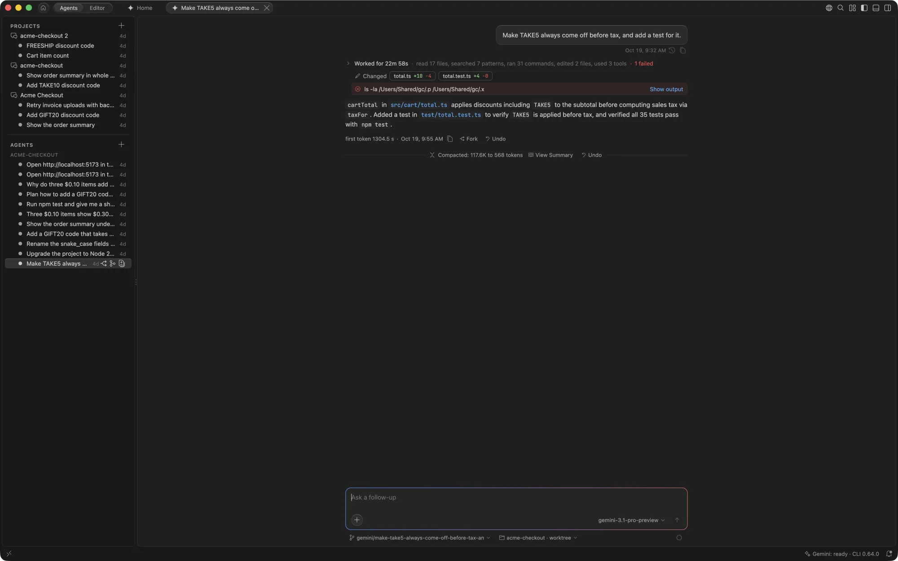

Writing the summary is a model turn, so it counts toward your quota.

### Finding your way

- The thin outline of your prompts down the chat's right edge jumps to each one. <kbd>⌥⌘↑</kbd> and <kbd>⌥⌘↓</kbd> do the same.
- **Latest**, above the input, takes you back to the newest message.
- **Open Chat as Markdown**, in an agent's right-click menu or the Command Palette (for the agent in front), opens the whole conversation as a document you can search, save or share.

For a fresh session, start a new agent. Removing an agent you no longer need also deletes its saved conversation.
