# Chat and prompting

Each agent has a chat. The composer at the bottom is where you write, attach files, and pick the mode and the model. Most of what it offers sits in its **+** menu.

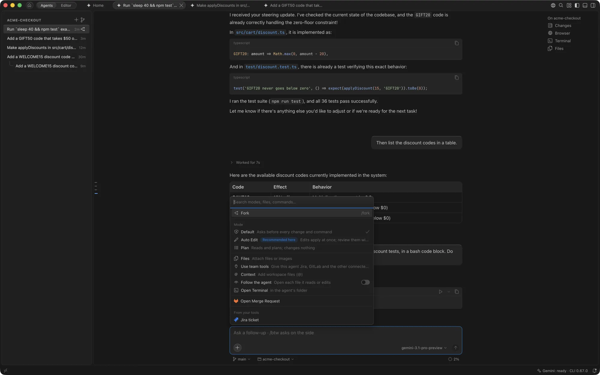

## The + menu

The **+** button at the bottom left of the composer opens a menu you can type into to search. It holds:

- **Fork**: start a new agent from this conversation (`/fork`). See [Fork an agent](agents.md#fork-an-agent).
- **Mode**: Default, Auto Edit and Plan, plus YOLO once you turn on `gemini.approval.allowYolo`. Turning off `gemini.approval.allowAutoEdit` removes Auto Edit. See [Approval modes](review.md#approval-modes). In a trusted folder that is a Git repository with at least one commit, Auto Edit carries a **Recommended here** tag: its edits apply at once and you review them with Keep and Undo, while commands still ask. The tag never switches the mode for you. New agents start in the mode `gemini.agents.defaultMode` sets, or in the Gemini CLI's own `general.defaultApprovalMode` when you haven't set it.
- **Files**: attach files or images from anywhere.
- **Use team tools**, while a team tool is connected and this agent doesn't have them yet: gives the agent Jira, GitLab and your other connected tools for the rest of its life. A ticket, merge request, page or design in a message or an attachment does the same by itself. Until then, the agent's model calls carry none of the tools' definitions. See [Team tools](team-tools.md#in-chat).
- **Context**: attach workspace files with `@`.
- **Follow the agent**: a switch that opens each file the agent reads or edits.
- **Open Terminal**: the agent's own terminal, in its folder. See [Terminal](terminal.md).
- **Debug with Gemini**, while `gemini.debugMode.enabled` is on: describe a bug, and the agent collects evidence from the running program before it fixes anything.
- **Open Merge Request**, with GitLab connected: the Open Merge Request page for the agent's branch.
- **From your tools**, for the tools you connected: **Jira ticket**, **GitLab merge request or issue**, **Figma Design...** and **Confluence page**. See [Team tools](team-tools.md).
- **Model**: the models the terminal's `/model` lists, in the same order. **Set as Default for the CLI**, the last row, saves the model as the one the Gemini CLI itself starts on (`model.name` in `~/.gemini/settings.json`), as the terminal's `/model` dialog does, so a `gemini` started in a terminal uses it too.
- **Usage and quota**: how full the chat is, what each turn carries, and today's quota. See [Usage and quota](#usage-and-quota).
- **Skills and commands**: the same list as typing `/`.

The model also shows on the button beside Send, which opens the same list. The model you pick is the one every new or reopened agent starts on, in every window; until you pick one, agents start on the newest Flash model.

A mode other than Default shows as a chip beside **+**: click it to change the mode, or click its × to go back to Default. From the keyboard:

| Keys | Command | What it does |
| --- | --- | --- |
| <kbd>⇧Tab</kbd> or <kbd>⌘.</kbd> | **Gemini: Cycle Approval Mode** | Steps to the next mode, as <kbd>⇧Tab</kbd> does in the Gemini CLI. It skips YOLO, and skips Plan while a turn runs. |
| <kbd>⌘Y</kbd> | **Gemini: Toggle YOLO** | Turns YOLO on or off. |
| <kbd>⌥⌘.</kbd> | **Gemini: Switch Model...** | Opens the model list. |
| <kbd>⌃⌘I</kbd> | **Gemini: Focus Chat** | Puts the cursor back in the message box. |

On Windows and Linux, Ctrl takes ⌘'s place, and **Focus Chat** is <kbd>Ctrl+Alt+I</kbd>.

## Attaching context

- **Workspace files.** Type `@`, or choose **Context** in the **+** menu. The agent gets a link and reads the file itself, unsaved changes included.
- **Folders, with `@`.** Below the files, the `@` list's **Folders** group has the folders the matching files are in. The agent reads every file in the folder.
- **Symbols, with `@`.** The **Symbols** group has functions, classes and other definitions from the [workspace index](agents.md#workspace-index-and-docs), attached as their lines (up to 400). It shows only while the index is on and built.
- **Workspace, with `@`.** The **Workspace** group has **Problems** (the folder's errors and warnings from the Problems view), **Uncommitted changes** (the diff against the last commit, new files included) and **Last terminal command** (the command that finished last in the agent's terminal, else in the terminal in front, with its output). Each row shows only when it has something to send.
- **Fix with Gemini.** The light bulb on any error or warning in the editor offers **Fix with Gemini**. It attaches the problem and the ten lines either side of it to the agent in front, or to a new agent, ready for you to add a word and send.
- **The selection.** <kbd>⌘L</kbd> (**Add Selection to Chat**) attaches the editor selection with its line numbers, to the agent in front or to a new agent.
- **Files from anywhere.** Choose **Files** in the **+** menu, paste, or drop files from Finder. Hold <kbd>⇧</kbd> when you drag from the Explorer. A file inside the workspace goes as a link, as with `@`. From outside it, text and code files up to 1 MB go with their contents, and images and PDFs up to about 7.5 MB go inline; any other file goes as a link, and the CLI asks once before it reads it.
- **Your team's tools.** Paste a Jira key, a GitLab merge request or a Figma link, or pick from **From your tools** in the **+** menu, where **Figma Design...** attaches a design as one frame link per screen size. See [Team tools](team-tools.md#in-chat).

The agent can't read secret files, such as `.env` and private keys, or git-ignored files.

GeminiCode has no inline (ghost text) completions while you type. Gemini changes code in the editor through the agents, inline edit and **Fix with Gemini**.

## Slash commands and skills

Type `/` at the start of the composer, or choose **Skills and commands** in the **+** menu, to list the commands under a heading for each source: GeminiCode's first, then your team's, the skills, and the Gemini CLI's. Keep typing to filter, then press <kbd>Tab</kbd> or <kbd>Enter</kbd> to complete the name and add arguments.

Some of GeminiCode's commands are Gemini CLI commands that GeminiCode runs itself, under the names the terminal uses:

| Command | What it does |
| --- | --- |
| `/resume` (also `/chat`) | Lists the CLI's saved sessions for this folder and restores the one you pick. |
| `/rewind` | Goes back to before one of your messages. See [Rewind](review.md#rewind). |
| `/plan [goal]` | Switches to Plan mode, and sends the goal if you give one. `/plan copy` copies the latest plan. |
| `/compress` | Summarises the older work. See [Compress](#compress). |
| `/context` (also `/stats`) | Shows what each turn carries. See [Usage and quota](#usage-and-quota). |
| `/permissions trust` | Opens the folder trust dialog. |

Two are GeminiCode's alone: `/btw` asks a [side question](#side-questions), and `/fork` forks the agent. The CLI's other commands, such as `/init`, `/memory` and `/restore`, go to the CLI and run there.

Team commands are TOML files in `.gemini/commands/` in the workspace, or in `~/.gemini/commands/` for your own; when both have a command of the same name, the workspace's wins. They use the Gemini CLI's own format, so the same files work in the terminal. `git/commit.toml` becomes `/git:commit`.

```toml
description = "Review a file for bugs"
prompt = "Review {{args}} for bugs and suggest fixes."
```

In a team command, `{{args}}` is replaced by what you typed after the name, `@{path}` puts a file's text in the prompt, and `!{command}` puts in the output of a shell command run in the agent's folder. Before any `!{command}` runs, GeminiCode lists the commands and asks. With `gemini.tools.allowShell` off, a team command that runs shell commands doesn't send.

Skills are folders with a `SKILL.md`, in `.gemini/skills/` or `.agents/skills/` in the workspace, or in `~/.gemini/skills/` or `~/.agents/skills/` for your own. Picking one asks the agent to load it, with what you typed after the name as the task.

## Enhance prompt

Write what you want in plain words, then click **Enhance** at the end of your text, or press <kbd>⌥⌘E</kbd> (<kbd>Ctrl+Alt+E</kbd> on Windows and Linux). Gemini rewrites the draft as a clearer prompt: what to do, where, and how to tell it's done, with a short list of open questions where your draft leaves something unclear. It keeps your `@` mentions, a leading `/command`, file paths, names and code exactly as you wrote them, and writes in your draft's language. It also sees the last few messages of the chat, so "do the same for the tests" gets resolved. In a workspace with an index, it sees an outline of the project and the files most likely involved, so it can name the right ones.

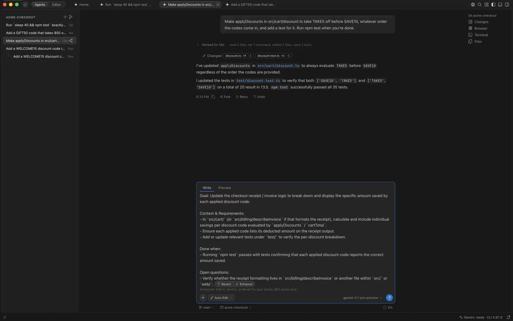

The rewrite replaces your draft as Gemini writes it; **Cancel** or <kbd>esc</kbd> stops it and leaves your draft as it was. Afterwards, **Revert** (or <kbd>⌘Z</kbd>) puts your draft back. Nothing goes to the agent until you press Send, and Enhance works while the agent is busy. The rewrite is a quick request to a fast model; when quick requests are off (`gemini.inlineEdit.enabled`) or your sign-in can't make them, the Gemini CLI writes it instead, a little more slowly.

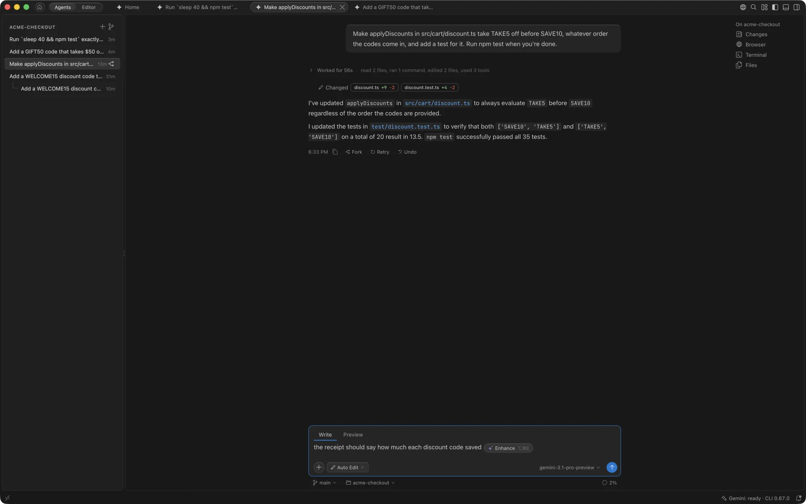

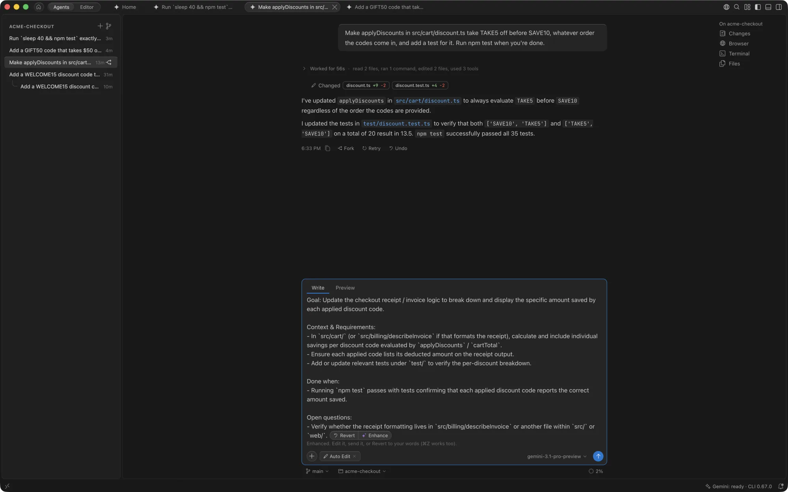

## Plan, then build

In **Plan** mode the agent reads and proposes a plan without changing anything. When a reply ends in Plan mode, **Approve Plan** appears under it. It switches the chat to the mode it was in before Plan (Default if the chat started in Plan) and asks Gemini to carry out the plan.

The chevron beside **Approve Plan** offers the CLI's own approval choices, in its words:

- **Yes, automatically accept edits** builds in Auto Edit.
- **Yes, manually accept edits** builds in Default, asking for each edit.
- **Edit or comment the plan first** opens Plan Review.
- **Not yet** leaves the plan as it is.

A choice shows only when its mode is on offer, so with Auto Edit turned off the first one is missing.

If you switch to another model after planning, a line under the button names both: "Builds with ...; planned with ...". With the model on Auto there is no such line, because the Gemini CLI doesn't say ahead which model Auto will pick.

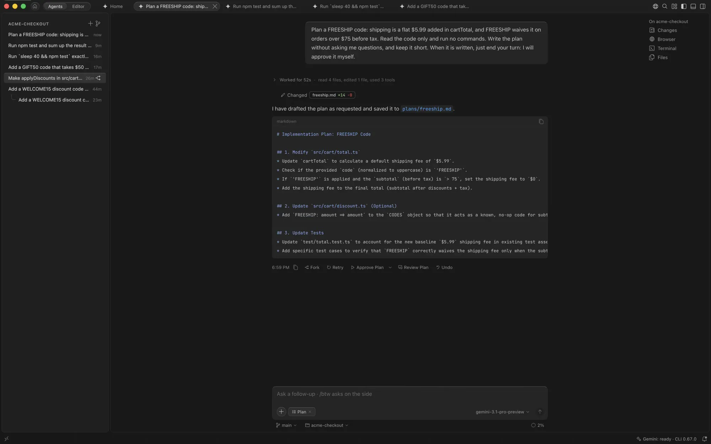

With the model on Auto, Gemini plans with Pro and builds with Flash. Turn off **Plan with Pro, build with Flash** in [Settings](helpers.md#gemini-cli-settings) to keep one model throughout.

### Review the plan

When a Plan mode turn writes a plan file, **Review Plan** beside **Approve Plan** opens it on a page of its own, in the agent's side group. So does the plan's file chip while the agent is in Plan mode. The page shows the plan section by section.

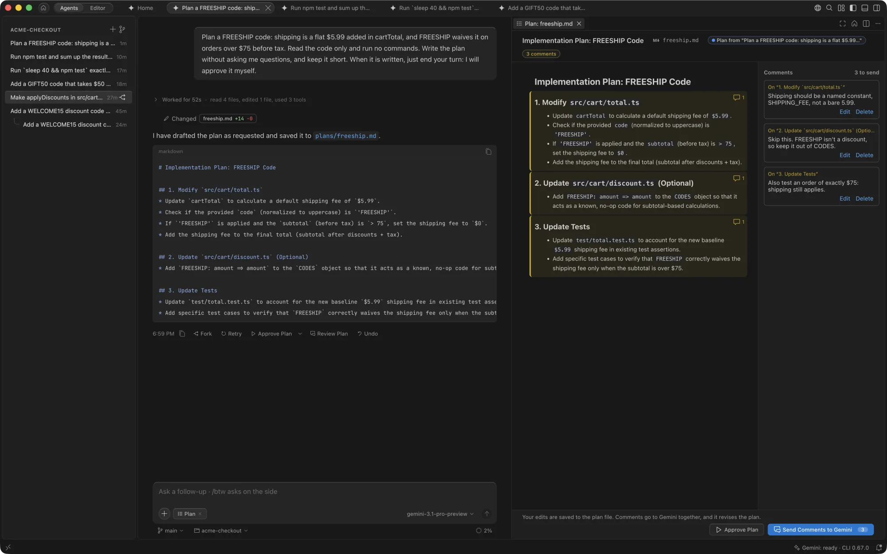

- **Edit in place.** Click a section, or press Return on it, to edit its Markdown; **Done** (<kbd>⌘↩</kbd>) saves it to the plan file and <kbd>esc</kbd> cancels. You can't edit while Gemini is working on the plan.
- **Comment.** The **+** beside a section, or **Comment** over selected text, adds a comment. Comments wait in a panel beside the plan, and stay there when you close the page.
- **Send Comments to Gemini** sends every comment at once, with the sections you edited, and Gemini revises the plan. When its turn ends, the page says how many sections changed and tags them **changed**. **Show What Changed** finds them, and **Clear Sent Comments** tidies the panel.
- **Approve Plan** builds the plan as it stands, your edits included. If some comments haven't been sent, it asks first: **Send Comments First** or **Build As It Is**.

**Open as Text** opens the plan file in the editor. A plan stays with its session: when you reopen the session, after a restart for example, the plan is still there and **Review Plan** still opens it.

## Watching the agent work

While the agent works, its thoughts and steps show under a **Working** line. Several steps of one kind in a row (nine searches, five commands) show as one line that opens to each step.

When the turn ends, they fold under one line, such as **Worked for 3m 12s · read 14 files, searched 11 patterns, ran 9 commands**, with the answer below it. The files the turn changed stay in sight as chips that open their diffs, and so does any step that failed, with **Show output**. Click the line to open the turn again. `gemini.chat.foldFinishedWork` turns the folding off.

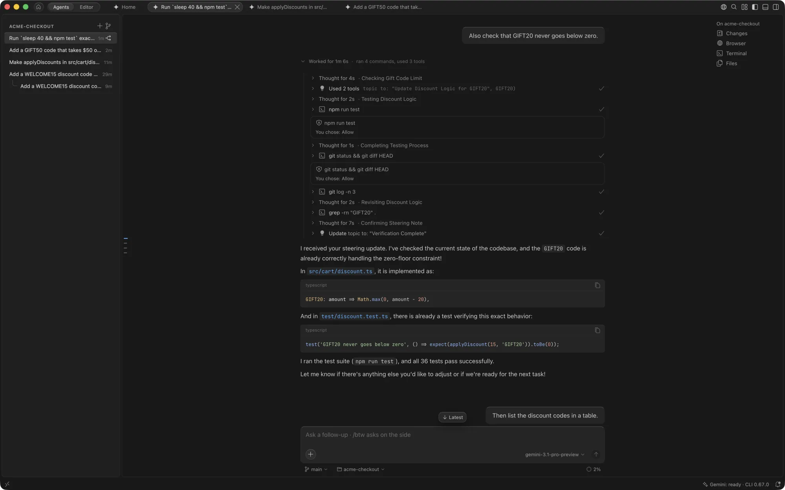

A command's output longer than 80 lines shows its first and last 20, with a line such as **1,240 lines hidden · Show All** between them. **Show All** fetches the rest. The chat keeps the whole of the latest outputs, up to 16 MB, so a long chat doesn't hold every output in memory; an output from before the window reloaded may be kept only in part.

If nothing at all arrives from Gemini for 45 seconds (no text, step or thought), the turn says so: **No response from Gemini for 45 s. It may be retrying a busy server.** When the CLI's log shows it retrying after a server error, the notice says which attempt it is on. **Stop** stops the turn and **Show Log** opens the Gemini log. The notice goes away as soon as anything arrives, and it doesn't show while a command runs or a card waits for you.

When the agent hands part of the work to one of the Gemini CLI's subagents (such as the Codebase Investigator, or your own in `.gemini/agents/`), the chat shows a **Subagent** row with its name and how long it has worked. Click it to read the subagent's report.

After a turn that changed files, if the language servers report errors in those files, a notice lists up to five of them with **Fix**, which asks the agent to fix them and check again. This needs the [workspace index](agents.md#workspace-index-and-docs).

To stop the agent, click the stop button, press <kbd>esc</kbd> twice in the message box, or press <kbd>⌘esc</kbd> (**Gemini: Stop Agent**).

## When a turn fails

A failed turn says what went wrong in plain words and offers a way out:

| Notice | Buttons |
| --- | --- |
| The quota is used up, for a model or for your account | **Retry** sends your message again; **Switch Model…** opens the model list. The reset time shows when the Gemini CLI reports one, which it usually doesn't. |
| **Can't reach Google.** Check your connection, VPN or proxy. | **Retry**, and **Show Log** for the Gemini log. |
| **Your Gemini sign-in has expired.** | **Sign In** signs in again in the browser; then **Retry**. |
| **Gemini's service had a problem**, with the service's message | **Retry** and **Show Log**. |
| **The agent restarted.** | **Retry** sends your message again. |
| **The turn reached the request limit.** | **Continue** tells Gemini to carry on. |

Any other error shows the CLI's own message, without its JSON wrapper, with **Retry** and **Show Log**. The buttons stay on the latest failure until your next message.

Gemini sometimes refuses a session's request after a tool result, most often after an image such as a screenshot, and a retry sent the same way is refused again. When that happens twice, the chat says so and offers **Continue in a New Session**, which carries the conversation on without the tool outputs, and **Switch Model…**. Your files stay as the agent left them.

## Sending while the agent works

You don't have to wait for the agent to finish. While it works, the composer reads **↩ to steer, Tab or ⌘↩ to queue · ⌥⌘; asks on the side**.

- **<kbd>↩</kbd> steers.** Use it to change course: "use pnpm, not npm", or "leave the tests alone". The message shows above the input as **Sending after the current step**. At the next safe point, the chat stops the turn and sends your message, telling the agent to adjust its plan and carry on. A safe point is a moment when no command or edit is running and Gemini has read the last tool's result, so no tool's work is lost. While the agent is thinking, writing or waiting at a permission card, that is straight away.
- **<kbd>Tab</kbd> or <kbd>⌘↩</kbd> queues** the message for after the turn, as <kbd>Tab</kbd> does in the Gemini CLI. It shows as **Queued: goes after this turn**. Several queued messages go together as one.

With `gemini.chat.sendWith` set to `cmdEnter`, <kbd>⌘↩</kbd> steers, <kbd>⇧⌘↩</kbd> queues and <kbd>↩</kbd> starts a new line. On Windows and Linux, Ctrl takes ⌘'s place.

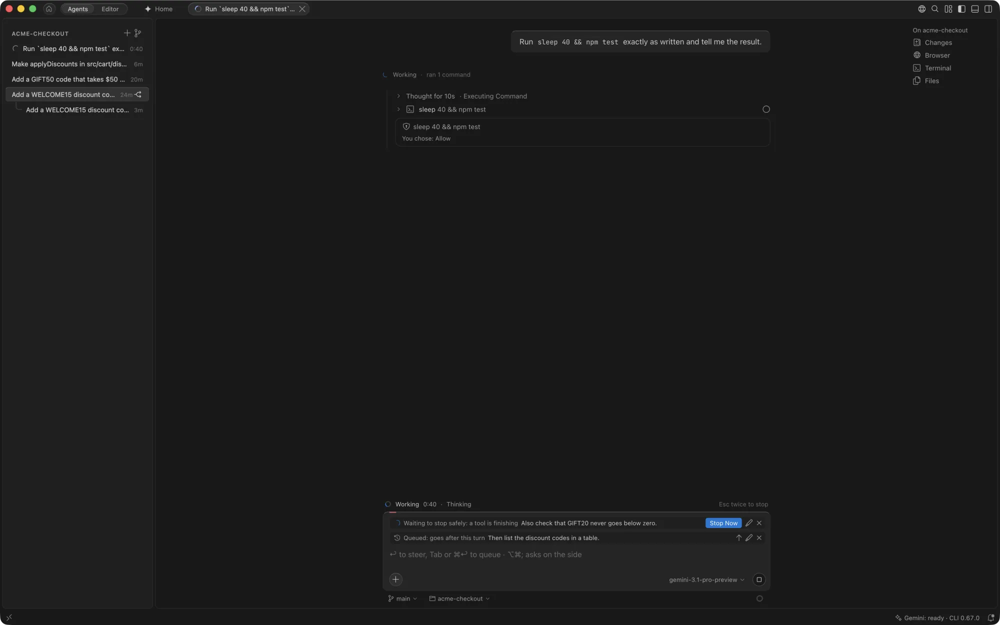

Each waiting message has **Send now**, **Edit** and **Remove**, and <kbd>↑</kbd> in an empty message box takes the last queued one back to edit. If you stop the agent, or the turn fails, nothing goes by itself: your messages stay queued until you send them.

Steering stops the turn between steps, never in the middle of a command, so a running command or edit always finishes. When a long run of tools gives no safe point for 15 seconds, the message's row says **Waiting to stop safely: a tool is finishing** and offers **Stop Now**. That stops the turn at once; a tool that finished but whose result Gemini hasn't read yet is lost, and the agent may run it again. The turn you steered gets its own end line and **Undo**, and your message starts a new turn. The Gemini CLI can't add a message to a running turn, so steering costs one more model request, mostly served from its cache.

In a project's thread, notes from the coordinator wait in the same place, as **From coordinator: goes after this turn**. In the project chat itself, every message waits for the coordinator's turn to end; see [Projects](projects.md#talk-to-the-coordinator).

## Side questions

To ask about the conversation without stopping the agent, type `/btw` and your question, such as `/btw why did it add axios?`, or press <kbd>⌥⌘;</kbd> (<kbd>Ctrl+Alt+;</kbd> on Windows and Linux) to open the side panel above the message box.

A fast model answers from the chat as it stands, in a second or two, while the agent keeps working. The question and its answer never enter the agent's conversation, so they don't slow its later steps or change what it does. The answer sees your messages, Gemini's replies, plans and tool calls, with long tool outputs cut short. It has no tools of its own, so it says when the chat doesn't hold the answer.

Under an answer:

- **Send to Agent** puts the question and the answer in the message box, for you to edit and send as a steering message.
- **Fork into Agent** opens Fork Agent with the question as the fork's first message, for a question that needs files read or commands run.
- **Copy** copies the answer.

Earlier side questions stay in the panel until the chat closes. <kbd>⇧←</kbd> and <kbd>⇧→</kbd> step through them, and later questions can build on them. Side questions use the quick requests' model (`gemini.inlineEdit.model`). If your sign-in can't make quick requests, a session of their own on the Gemini CLI answers instead.

### Read the code too

For a broad question about the code, such as "where are auth tokens read, stored or logged?", tick **Read the code too** beside **Ask**. GeminiCode then reads the agent's folder instead of answering from the chat alone:

1. It splits the question into up to eight parts by area of the code, from the workspace index's outline.
2. Read-only workers, four at a time, each read one part with the index tools. They run in Plan mode and every permission request they make is refused, so nothing changes.
3. One more worker rereads the most serious findings.
4. A report answers the question, with each finding's `path:line`. Findings the rereading confirmed are marked verified, and ones it disproved are left out.

The panel shows each part as it is read. **Stop** ends every worker and reports what was done so far. The report is the answer, so **Send to Agent**, **Fork into Agent** and **Copy** work on it as on any side answer, and later side questions can build on it. It is slower than an answer from the chat and uses more of your quota. A project's coordinator chat doesn't offer it, since the project's threads do the reading there.

## Replies

- Code is coloured as in the editor, and the button at the top of a code block copies it. A shell command also has **Run in Terminal**, which runs it in the agent's terminal; see [Terminal](terminal.md#run-a-command-from-a-reply).
- A file name in a reply, such as `src/cart/total.ts:11`, opens the file at that line.
- Math written as `$...$`, `$$...$$`, `\(...\)` or `\[...\]` is typeset; prices and shell variables stay plain text.
- Notes, tips, important points, warnings and cautions show as coloured callouts.

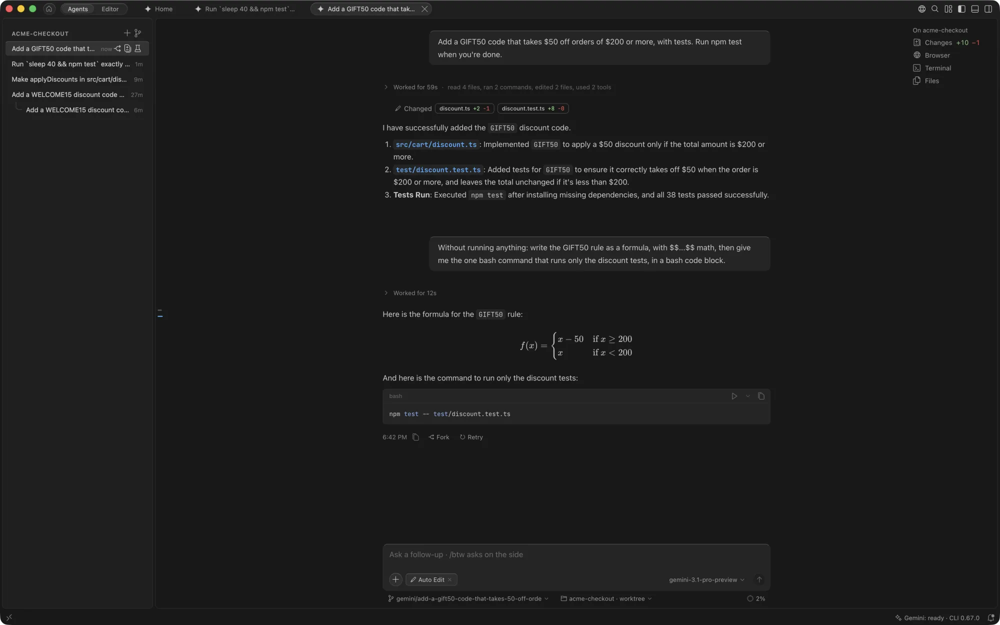

Each message you send shows the time you sent it, **Rewind** (the clock) and **Copy**. Under each reply are how long the agent worked, the time it finished, **Copy** and **Fork**, with **Retry** on the latest reply and **Undo** on one that changed files; see [Undo or retry a reply](review.md#undo-or-retry-a-reply).

### Reacting to replies

When a reply only needs a nod, or a quick "no, not that", react to it with an emoji instead of writing a message.

The smiley at the end of a reply's row opens the reaction bar when you point at it or tab to it. The bar has four quick reactions, and a smiley of its own that opens every emoji, with search and the ones you used last.

The picker tells you what an emoji will do before you pick it. Its footer gives the meaning of the emoji under the pointer, such as "Go ahead", or says that Gemini will tell you how it reads it first. Its first row, **With a meaning**, lists every emoji that has a meaning, your own included. Pointing at a reaction chip later shows what it asked for.

To react from the keyboard, send `+` and one emoji, such as `+👍`. It reacts to the latest reply instead of going as a message.

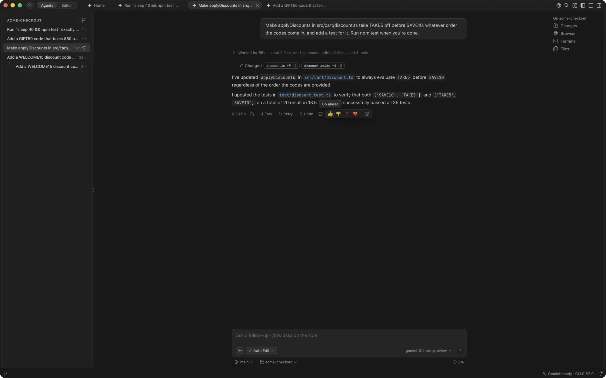

| Reaction | What Gemini does |
| --- | --- |
| 👍 Go ahead | Carries on with what it proposed. On a plan, this is the same as **Approve Plan**. |
| 👎 Not what I meant | Stops, says in one line what it understood, and asks what to change. While the agent works, 👎 stops the turn at the next safe point, as <kbd>↩</kbd> does. |
| ❓ Explain more simply | Explains the reply again, more simply, with an example. |
| ❤️ Thanks | Nothing. The reply is marked, and no message is sent. |

Gemini reads any other emoji as intent: it says in one line how it read it before doing anything, so a misreading shows before any tool runs. Its edits and commands still ask for permission as usual.

A reaction goes straight away. It shows as a chip on the reply and as a line in the conversation; click the line to go back to the reply. While the agent works, reactions other than 👎 wait in the queue with your other messages, and a second reaction to the same reply replaces one that is still waiting.

Gemini may react to your message too, with a small emoji on its corner, when it has something to add. Most messages get none.

To change what an emoji asks for, or to give another emoji a meaning, set `gemini.chat.reactions.meanings`, such as `{ "🚀": "Go ahead, then commit with a short message." }`. Set in a workspace's settings, it is shared with everyone who opens the folder. `gemini.chat.reactions.enabled` turns reactions off, Gemini's own included.

Reactions work in agents' and threads' chats. A project's coordinator chat has none.

## Writing in the composer

Messages you send show Markdown the way replies do. In the composer, <kbd>⌘B</kbd> makes the selection bold, <kbd>⌘E</kbd> makes it code, and <kbd>⇧↩</kbd> on a list line starts the next item. The **Write** and **Preview** tabs (or <kbd>⇧⌘V</kbd>) switch between your draft and how it will look.

In an empty message box, <kbd>↑</kbd> and <kbd>↓</kbd> step through the prompts you sent earlier, as in a terminal, and <kbd>esc</kbd> twice opens [Rewind](review.md#rewind).

The composers underline misspelt words; right-click a word for suggestions or **Add to Dictionary**. The languages are the operating system's.

## Usage and quota

The ring at the bottom right of the composer shows how full this chat's context window is. It turns amber at 50%, where the Gemini CLI starts summarising older messages, and red at 90%. Click it, or choose **Usage and quota** in the **+** menu, for:

- **Context window**: the tokens in the latest request out of the model's limit, and what they are made of: the conversation, the MCP servers' tools, the rule files (`GEMINI.md` and the files it imports), GeminiCode's own tools and the CLI's own prompt. The parts are measured in the background with one short request each on the lightest model, at most once a day per folder; **Measure Again** measures straight away. The rule files are listed as the CLI loaded them, with their sizes, and one over 20 KB gets a warning, since every turn carries it. Typing `/context` opens the same view, and the Settings page's **Context per model call** shows the same measure.
- **Today's quota**: how much of today's quota each model has used for your account, and when it resets. **All N models** shows the rest. Once a model passes 80%, **Get higher limits** opens the page the CLI's `/upgrade` opens.
- **This chat**: input, cached and output tokens over the chat's replies, with **Details by model**.

Hover the **Gemini** item in the status bar to see today's quota too. Once a model passes 80%, the item shows the percentage, and at 95% it turns amber. The quota needs a Google sign-in, since API keys have no daily quota to read. `gemini.usageMeter.enabled` turns it off.

## Long conversations

### Compress

When a session's history reaches half of the model's context window, the Gemini CLI summarises the older part and keeps the most recent 30% as it was. The CLI's `/compress` does the same on request. Both happen only in memory: when the session is reopened, after a restart for example, it comes back whole.

GeminiCode's **Compress** summarises when you ask, and keeps the result. Type `/compress`, or click **Compress** in the usage popover, which offers it while the agent is idle and has answered enough to compress. Once the context passes 40%, the chat suggests it once, with **Compress** and **Not Now**.

Gemini writes a summary of the work so far (the goal, decisions and constraints, files, current state and next steps), and the chat moves to a new session made of that summary and your latest prompts, kept as they were. A line across the chat shows the tokens before and after, with **View Summary** and **Undo**. **Undo** goes back to the full session, even after a restart. The conversation above the line stays in the chat either way.

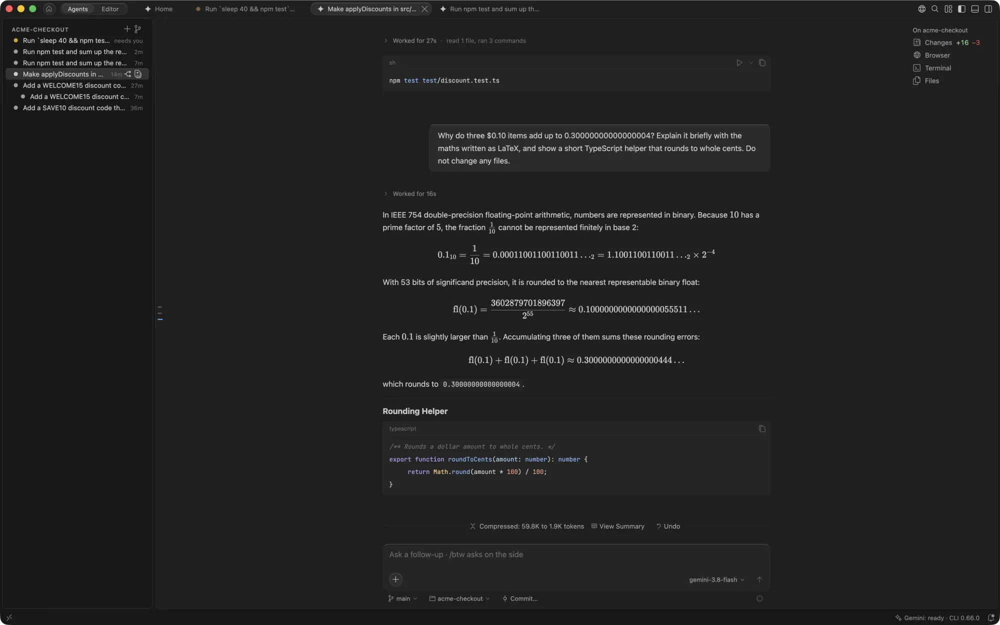

Writing the summary is a model turn, so it counts toward your quota.

### Finding your way

- Once a chat has two prompts, a thin outline of them runs down its left edge, one tick for each. Point at a tick to see the prompt and the start of its reply, and click it to jump there. <kbd>⌥⌘↑</kbd> and <kbd>⌥⌘↓</kbd> (<kbd>Ctrl+Alt+↑</kbd> and <kbd>Ctrl+Alt+↓</kbd> on Windows and Linux) jump from prompt to prompt.
- **Latest**, above the input, takes you back to the newest message.
- **Open Chat as Markdown**, under **More** in an agent's right-click menu in the Agents pane, or in the Command Palette for the agent in front, opens the whole conversation as a document you can search, save or share.

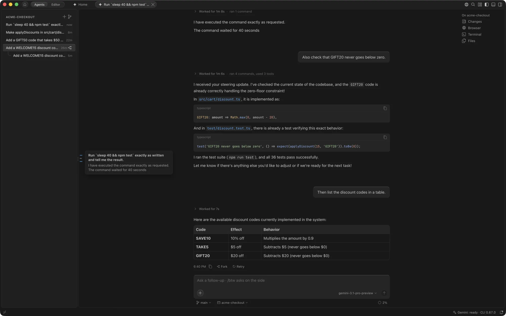

For a fresh session, start a new agent. Removing an agent you no longer need also deletes its conversation and undo history.
