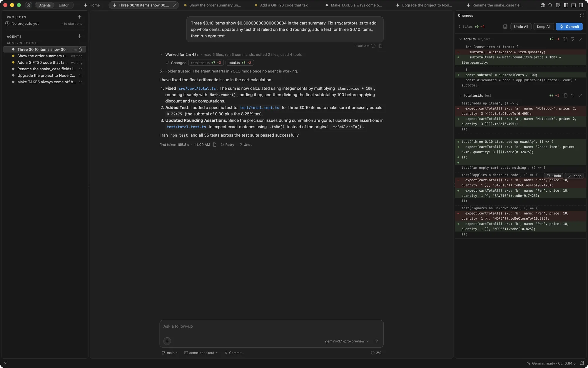

# Getting started

Install GeminiCode, sign in with Google and start your first agent. The Gemini CLI comes with the app, so there is nothing else to install.

## What you need

- A Mac with Apple silicon, on macOS 26 or later. On an older macOS or an Intel Mac, macOS refuses to open GeminiCode.
- A Google account with a **Gemini Code Assist** license.
- A **Google Cloud project** to bill usage to. Your organisation may set it for you.

## Install

1. Download GeminiCode from the [download page](https://pulkitjain-org.github.io/vscode-gemini-cli/).
2. Open the `.dmg` and drag GeminiCode to Applications.
3. Open GeminiCode. It opens on **Home**, whose **Get started** card lists what is left to set up.

> [!NOTE]
> If a build isn't signed by Apple yet, macOS blocks it the first time. Open it once and choose **Done**, then open **System Settings › Privacy & Security** and choose **Open Anyway** next to GeminiCode. Or run `xattr -dr com.apple.quarantine /Applications/GeminiCode.app` in Terminal.

## Set up

Home's **Get started** card has a button for each step that is left: **Sign In**, **Set Project**, **Connect** for your team's tools, and **Open Folder**. The **Get Started with GeminiCode** walkthrough, from **Gemini: Get Started**, goes through the same setup in five steps:

1. **Gemini CLI.** GeminiCode comes with a tested Gemini CLI. It uses `gemini.cliPath`, then a copy you installed from GeminiCode, then the bundled copy, then `gemini` on your `PATH`.
2. **Sign in.** Run **Gemini: Sign In with Google**. If your account needs a one-time step the editor can't show, run **Gemini: Complete Setup in Terminal**.
3. **Google Cloud Project ID.** Run **Gemini: Set Google Cloud Project ID** and enter the project ID, such as `my-project-123`, not the project number.
4. **Make it yours.** Pick a theme, a code font and file icons.
5. **First agent.** Describe a task on Home and press Return.

The **Gemini** item in the status bar shows the agent's state. Hover over it for the account, project and CLI version. Click it to start or restart the agent, change the project or CLI version, sign in, open the chat or open the log.

## Your first agent

Describe a task on **Home** and press Return. The agent opens in a tab of its own: it reads your code, asks before each edit and command, and shows every file it changes in the **Changes** panel on the right. Keep or undo each change when it's done.

- The first time you pick a folder for agents, GeminiCode asks whether to trust it. See [Folder trust](review.md#folder-trust).
- To give the agent its own branch, choose **On Its Own Branch** under the task before you press Return. See [Agents on their own branch](agents.md#agents-on-their-own-branch).
- To start more agents, choose **New Agent** in the Agents pane, or press <kbd>⌥⌘N</kbd>.
- Your terminal's `gemini` and GeminiCode share settings, sign-in and saved chats.

Read [Agents](agents.md) for the layout, and [Review and safety](review.md) for how approvals work.

## Make it yours

Run **Make It Yours** from the Command Palette, or open the step of the same name in Get Started, to pick:

- **A theme.** GeminiCode Dark or GeminiCode Light (the default follows your system), or any other installed theme with **More themes**.
- **A code font.** JetBrains Mono (the default) and Geist Mono ship with GeminiCode; SF Mono and Menlo come with macOS.
- **File icons.** GeminiCode's own, Seti, or none.

Each choice applies at once. Picking a theme stops following the system's light or dark setting, so your pick holds.

GeminiCode Dark and Light share one calm look: soft greys, panels as cards with a hairline border, and solid menus and pop-ups drawn in the theme, never the system's own. Blue is the one accent. The Gemini colours are kept for Gemini's own moments, such as the bar along the chat input while an agent works.

## Updates

GeminiCode checks for a newer version every few hours and offers the download; it never downloads on its own. **Gemini: Check for Updates...** (also in the GeminiCode menu, under About GeminiCode) checks now and says whether you are up to date. Turn the automatic check off with `gemini.app.checkForUpdates`.

GeminiCode also ships with a tested Gemini CLI, and can install, update and switch between newer CLI versions in its own storage with **Install or Change Gemini CLI Version...** in the menu of the **Gemini** status bar item, without touching your system.
