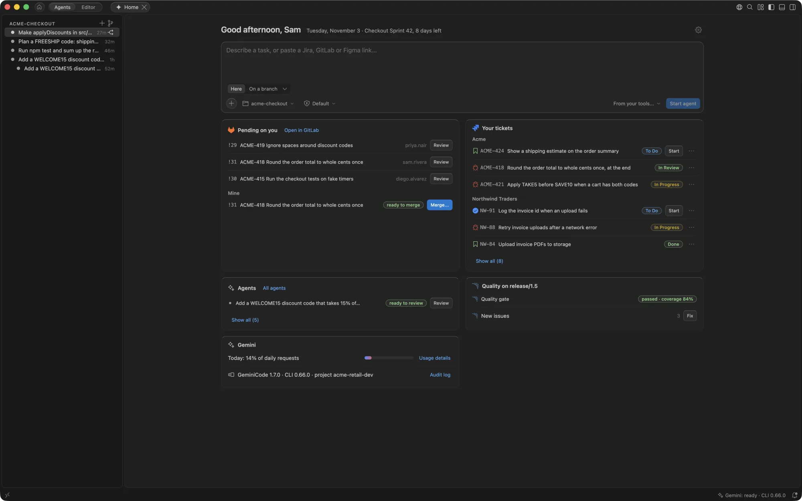

# Getting started

GeminiCode is a code editor with Gemini agents built in. You describe a task, an agent reads your code and does the work, and you approve and review what it changes. This page takes you from the download to your first agent. The Gemini CLI comes with the app, so there is nothing else to install.

## What you need

- A Mac with Apple silicon, on macOS 26 or later. On an older macOS or an Intel Mac, macOS refuses to open GeminiCode.
- A Google account with a **Gemini Code Assist** license.
- A **Google Cloud project** to bill usage to. Your organisation may set it for you.

## Install

1. Download GeminiCode from the [download page](https://pulkitjain-org.github.io/vscode-gemini-cli/).
2. Open the `.dmg` and drag GeminiCode to Applications.
3. Open GeminiCode. It opens on **Home**, whose **Get started** card lists the setup steps.

> [!NOTE]
> Releases are signed and notarized, so macOS opens them as it would any app. A prerelease or test build may be unsigned, and macOS blocks it the first time. Open it once and choose **Done**, then open **System Settings › Privacy & Security** and choose **Open Anyway** next to GeminiCode. Or run `xattr -dr com.apple.quarantine /Applications/GeminiCode.app` in Terminal.

## Set up

Home's **Get started** card has four steps, each with a button until you have done it: **Sign In**, **Set Project ID**, **Connect** for your team's tools, and **Open Folder**. The card stays on Home until you connect a team tool.

1. **Sign in.** Choose **Sign In**. If your account needs a one-time step the editor can't show, GeminiCode offers **Complete Setup in Terminal**: finish the step there, then exit the CLI with `/quit`.
2. **Google Cloud Project ID.** Choose **Set Project ID** and enter the project ID, such as `my-project-123`, not the project number.
3. **Team tools.** **Connect** opens Connections, where you add Jira, GitLab, SonarQube, Snyk and Figma, each with your own account. You can skip this. See [Team tools](team-tools.md).
4. **A folder.** **Open Folder** opens the repository agents will work in.

Signing in, finishing setup in a terminal and the project ID are also in **Gemini: Troubleshoot...** in the Command Palette, and in the **Gemini** status bar item's menu.

You don't need to set up the Gemini CLI. GeminiCode runs the CLI at `gemini.cliPath` if you set one. Otherwise it runs the newest copy you installed from GeminiCode, or the bundled copy when that is newer, and falls back to `gemini` on your `PATH` only when there is neither.

The **Gemini** item at the right of the status bar shows the agent's state. Hover over it for the account, project and CLI version. Click it for a menu to start or restart the agent, change the project or CLI version, sign in, start a new agent, open Settings, Connections, the index or the audit log, show the log, open the Gemini CLI's documentation, or report a problem. While an agent's work is tried in your workspace, a **Trying** item shows at the left of the status bar.

## Your first agent

Describe a task on **Home** and press Return. The agent opens in a tab of its own: it reads your code, asks before each edit and command, and shows every file it changes in the **Changes** panel on the right. Keep or undo each change when it's done.

- The first time you pick a folder for agents, GeminiCode asks whether to trust it. See [Folder trust](review.md#folder-trust).
- To give the agent its own branch, choose **On a branch** under the task before you press Return. See [Agents on their own branch](agents.md#agents-on-their-own-branch).
- To start more agents, choose **New Agent** (the **+**) in the Agents pane, or press <kbd>⌥⌘N</kbd>.
- Your terminal's `gemini` and GeminiCode share settings, sign-in and saved chats.

Read [Agents](agents.md) for the layout, and [Review and safety](review.md) for how approvals work.

## Make it yours

Run **Gemini: Make It Yours: Theme, Font and Icons** from the Command Palette. It opens a page where you pick:

- **A theme.** GeminiCode's **Dark** or **Light**, or any other installed theme with **More themes...**.
- **A code font.** JetBrains Mono (the default) and Geist Mono ship with GeminiCode, and Menlo comes with macOS. SF Mono is offered when it is installed on your Mac.
- **File icons.** GeminiCode's own (the default), Seti, or none.

Each choice applies at once, and the page always shows what is set now. If the window follows the system's light or dark setting (`window.autoDetectColorScheme`), picking a theme turns that off, so your pick holds.

## Updates

GeminiCode checks for a newer version every six hours and, when there is one, offers to open its download in your browser; it never downloads anything itself. **Gemini: Check for Updates...** (also in the GeminiCode menu, under About GeminiCode) checks at once and says whether you are up to date. Turn the automatic check off with `gemini.app.checkForUpdates`.

The Gemini CLI updates separately. Once a day GeminiCode checks for a newer CLI and offers to install it (`gemini.cli.checkForUpdates`). **Install or Change Gemini CLI Version...** in the **Gemini** status bar item's menu installs, updates and switches between CLI versions in GeminiCode's own storage, without touching your system.
