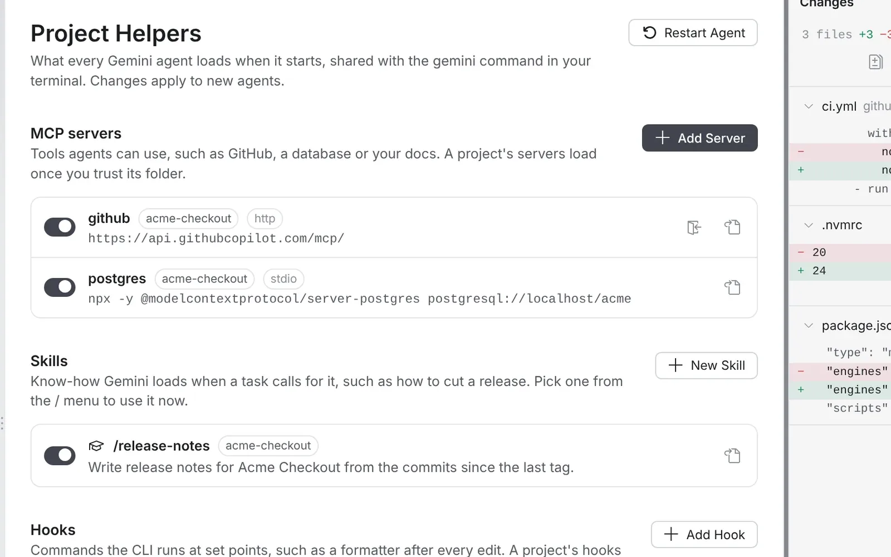

# Project Helpers and settings

**Project Helpers** shows what every agent loads when it starts: MCP servers, skills, hooks, extensions, memory and rules, each with a switch. It shares them with the `gemini` command in your terminal.

Open it with **Gemini: Project Helpers**, or from the Agents pane's **...** menu. Changes apply to agents started afterwards; **Restart Agent** applies them now. Opening the page never starts the Gemini CLI.

## MCP servers

The page lists the MCP servers in your personal `~/.gemini/settings.json` and in each open folder's `.gemini/settings.json`. Each has a switch, the same as the CLI's `/mcp enable` and `/mcp disable`, so the terminal sees the change too.

- **Add Server** asks for a name and the command that starts the server, or its URL, and adds it to your personal settings.
- **Sign In**, on a server reached by URL, runs the CLI's `/mcp auth` in a terminal, which opens your browser. Type `/quit` when it's done and restart the agent.
- When a server can't start, GeminiCode shows a warning naming the server and the reason, and marks it on the page.

A project's servers load only once you trust its folder.

## Skills

Skills are folders with a `SKILL.md` that teaches Gemini a task, such as cutting a release. The page lists your own (`~/.gemini/skills`) and each project's (`.gemini/skills`, and `.agents/skills` in both places). **New Skill** makes one from a template and opens it.

Gemini loads a skill by itself when a task calls for it; to use one now, pick it from the `/` menu. Each skill has a switch, like the CLI's `/skills enable` and `/skills disable`, and a skill that is off leaves the `/` menu.

## Hooks

Hooks are commands the CLI runs at set points: before or after a tool, when a turn starts or ends, and so on. Each has a switch. **Add Hook** asks when it runs, which tools it applies to, the command and whether it's yours or the project's. A project's hooks run only in trusted folders.

## Extensions

**Extensions** lists the Gemini CLI extensions installed, with a switch for each. **Install**, **Update** and **Uninstall** run the CLI's installer in a terminal, because it shows a security warning and may ask questions.

## Memory and rules

**Memory** lists the `GEMINI.md` files the CLI loads for the folder, including those in subfolders and extensions. **Add Memory** adds a line to your own or the project's `GEMINI.md`. The page also opens or creates your project's rules (`GEMINI.md`, or the name in `context.fileName`) and your personal rules (`~/.gemini/GEMINI.md`).

## Gemini CLI settings

Four of the CLI's own settings, in your personal `~/.gemini/settings.json`:

| On the page | Setting | Default |
| --- | --- | --- |
| Allow for all future sessions | `security.enablePermanentToolApproval` | Off |
| Plan with Pro, build with Flash | `general.plan.modelRouting` | On |
| Send usage statistics | `privacy.usageStatisticsEnabled` | On |
| Keep saved chats for | `general.sessionRetention` | 30 days |

A project's `.gemini/settings.json` can still override them, as in the CLI. A settings file with comments is never rewritten: GeminiCode opens it at the right place so you can make the change yourself.

## GeminiCode settings

| Setting | What it does |
| --- | --- |
| `gemini.projectId` | Google Cloud project ID to bill. A workspace value overrides a user value. |
| `gemini.cliPath` | Path to a `gemini` executable or `bundle/gemini.js`. Overrides GeminiCode's own copies. |
| `gemini.cli.version` | Which of GeminiCode's own CLI copies to run. Empty means the newest. |
| `gemini.cli.checkForUpdates` | Offer newer CLI releases, at most once a day. |
| `gemini.app.checkForUpdates` | Say when a newer GeminiCode is out. |
| `gemini.approval.allowAutoEdit` | Offer the Auto Edit mode. |
| `gemini.approval.allowYolo` | Offer the YOLO mode. Off by default. |
| `gemini.tools.allowShell` | Let the agent run shell commands. Each command still asks first. |
| `gemini.tools.denyEnvironmentCommands` | Refuse the commands that print the environment (`env`, `printenv`, and `set` or `export` alone), where a token could be. On by default; an agent that needs one variable can `echo` it. |
| `gemini.mcp.allowedServers` | The only MCP servers agents may use, besides GeminiCode's own. Usually set by your organisation. |
| `gemini.agents.ownBranch` | Start every new agent on its own branch. Off by default. |
| `gemini.agents.worktreeSetup` | A command run in each new agent branch's folder before the agent starts, such as `npm ci`. |
| `gemini.agents.allWorkspaceFolders` | Let every agent use all folders of a multi-folder window. Off by default. |
| `gemini.projects.enabled` | Projects. Off by default. |
| `gemini.home.openOnStartup` | Open Home each time GeminiCode starts. On by default. |
| `gemini.chat.followAgent` | Open each file the agent reads or edits. Off by default. |
| `gemini.chat.foldFinishedWork` | Fold each finished turn under one "Worked for" line. On by default. |
| `gemini.chat.spellCheck` | Check spelling in the composers. On by default. |
| `gemini.inlineEdit.enabled` | Inline edit, Enhance prompt's quick rewrite and commit messages. On by default. |
| `gemini.inlineEdit.model` | The model those use: the newest Flash, the chat's model, or one you name. |
| `gemini.browser.enabled` | Let agents use the browser. On by default. |
| `gemini.browser.allowOtherSites` | Let agents open sites other than local ones, after asking. On by default. |
| `gemini.browser.allowedOrigins` | The only sites agents may open. Empty allows every site. |
| `gemini.browser.keepSignIns` | Keep agents' browser sign-ins per workspace. Off by default. |
| `gemini.usageMeter.enabled` | Show today's quota. On by default. |
| `gemini.notifications.enabled` | Notify you and badge the Dock when an agent finishes or needs you. On by default. |
| `gemini.keepAwake` | Keep the Mac awake while any agent works. On by default. |
| `gemini.team.openMergeRequestsIn` | Open merge requests in GeminiCode's browser or your default browser. |

Changing the CLI path or version, the project, or an approval or shell setting restarts the agent so the change applies; open agents resume their sessions. Admins can lock the CLI, update, approval, shell, inline edit, usage and browser settings through policy.
