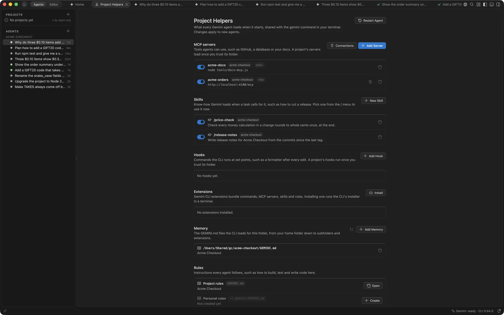

# The Settings page

**Settings** is one page for everything you can set. It lists every GeminiCode setting, each with a switch, a picker or a field, in the sections of its side index: Account and CLI, Agents, Chat, Browser, Workspace Index and Docs, Team Tools, Safety and Limits, and Developer. Search the page to find a setting; advanced settings show only in search results. The full list is in [Settings](settings.md).

Below the settings, **Loads** shows what every agent loads when it starts: MCP servers, skills, hooks and extensions, each with a switch, and memory and rules. It also holds your trusted folders and a few of the Gemini CLI's own settings. All of these are shared with the `gemini` command in your terminal.

Open it with **Gemini: Settings**, from Home's gear menu, the **Gemini** status bar item's menu, or the Agents pane's **...** menu. Its side index also opens the other pages: **Index & Docs** ([Workspace index and docs](agents.md#workspace-index-and-docs)), **Connections** ([Team tools](team-tools.md)) and **Storage & Audit**, which shows how much space GeminiCode's data takes, cleans up what is no longer needed, and holds the [audit log](team-tools.md#audit-log). Changes under Loads apply to agents started afterwards; **Restart Agent** at the top of the page applies them now. Opening the page never starts the Gemini CLI.

## Context per model call

Every step an agent takes is a model call, and each call sends the same context before your prompt: the Gemini CLI's own instructions and tools, your project's `GEMINI.md` and the files it imports, the skills list, and the tool definitions of every MCP server. On a large team project this can be over 60,000 tokens, which makes each step slower and uses more of your quota.

**Measure** shows how much each part costs: the total, a bar of the parts, and each MCP server's share beside its switch below. The button shows when `gemini.developer.showTools` is on. It sends one short prompt per part to the lightest Gemini model, and those prompts count against your quota, so it runs only when you ask; the result is kept until you measure again. The Memory list shows each file's size in characters, counting the files it imports.

When a part is heavy, the page says what you can do:

- **An MCP server with many tools.** Turn it off with its switch when agents don't need it, or list only the tools they use in its `includeTools`. A server's tools cost the same on every call, whether the agent uses them or not.
- **Long context files.** Rules needed only for some tasks can move into skills, which load only when a task calls for them.

## MCP servers

The page lists the MCP servers in your personal `~/.gemini/settings.json` and in each open folder's `.gemini/settings.json`. Each has a switch, the same as the CLI's `/mcp enable` and `/mcp disable`, so the terminal sees the change too.

- **Add Server** asks for a name and the command that starts the server, or its URL, and adds it to your personal settings.
- **Sign In**, on a server reached by URL, runs the CLI's `/mcp auth` in a terminal, which opens your browser. Type `/quit` when it's done and restart the agent.
- When a server can't start, GeminiCode shows a warning naming the server and the reason, and marks it on the page.

A project's servers load only once you trust its folder.

## Skills

Skills are folders with a `SKILL.md` that teaches Gemini a task, such as cutting a release. The page lists your own (`~/.gemini/skills`) and each project's (`.gemini/skills`, and `.agents/skills` in both places). **New Skill** makes one from a template and opens it.

Gemini loads a skill by itself when a task calls for it; to use one now, pick it from the `/` menu. Each skill has a switch, like the CLI's `/skills enable` and `/skills disable`, and a skill that is off leaves the `/` menu.

## Hooks

Hooks are commands the CLI runs at set points: before or after a tool, when a turn starts or ends, and so on. Each has a switch. **Add Hook** asks when it runs, which tools it applies to, the command and whether it's yours or the project's. A project's hooks run only in trusted folders.

## Extensions

**Extensions** lists the Gemini CLI extensions installed, with a switch for each. **Install**, **Update** and **Uninstall** run the CLI's installer in a terminal, because it shows a security warning and may ask questions.

## Memory and rules

**Memory** lists the `GEMINI.md` files the CLI loads for the folder, including those in subfolders and extensions. **Add Memory** adds a line to your own or the project's `GEMINI.md`. The page also opens or creates your project's rules (`GEMINI.md`, or the name in `context.fileName`) and your personal rules (`~/.gemini/GEMINI.md`).

## Trusted folders

**Trusted Folders** lists every rule in the Gemini CLI's trust file, `~/.gemini/trustedFolders.json`, in plain words: **Trusted**, with the repository's agents' branches; **Trusted, with subfolders**, naming the repositories inside; and **Never trust**. A rule added in the terminal or by hand says so. GeminiCode's own two rules show too and can't be removed: its project coordinators' folder is **Trusted by GeminiCode**, and merge request checkouts are **Never trusted**.

- **Remove** deletes a rule.
- **Trust Folder...**, **Trust a Parent Folder...** and **Never Trust a Folder...** add one.

Changes go to the [audit log](team-tools.md#audit-log), and agents pick them up once they finish their current work. See [Folder trust](review.md#folder-trust).

## Gemini CLI settings

Five of the CLI's own settings, in your personal `~/.gemini/settings.json`:

| On the page | Setting | Default |
| --- | --- | --- |
| Default approval mode | `general.defaultApprovalMode` | Default |
| Allow for all future sessions | `security.enablePermanentToolApproval` | Off |
| Plan with Pro, build with Flash | `general.plan.modelRouting` | On |
| Send usage statistics | `privacy.usageStatisticsEnabled` | On |
| Keep saved chats for | `general.sessionRetention` | 30 days |

**Default approval mode** offers Default, Auto Edit and Plan, never YOLO. When `gemini.agents.defaultMode` is set, it decides instead, and the page says so.

A project's `.gemini/settings.json` can override these, as in the CLI. GeminiCode edits a settings file in place and keeps its comments, as the CLI does. A file that isn't valid JSON is never rewritten: GeminiCode opens it at the right place so you can make the change yourself.

GeminiCode's own settings are listed in [Settings](settings.md).
