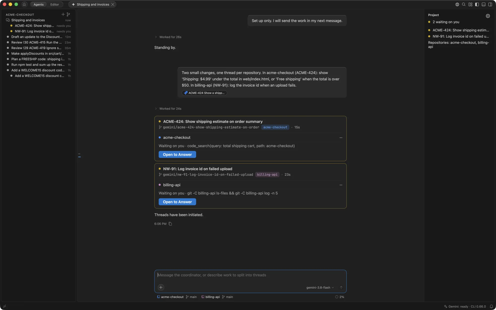
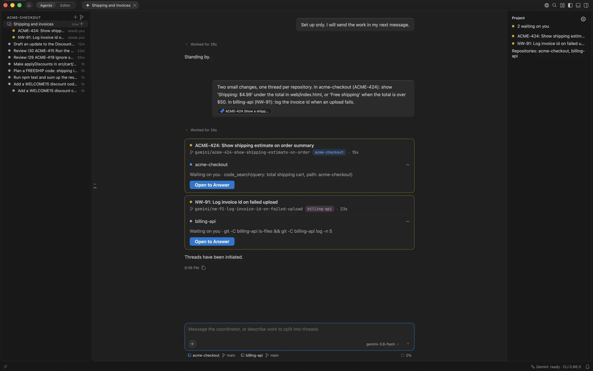
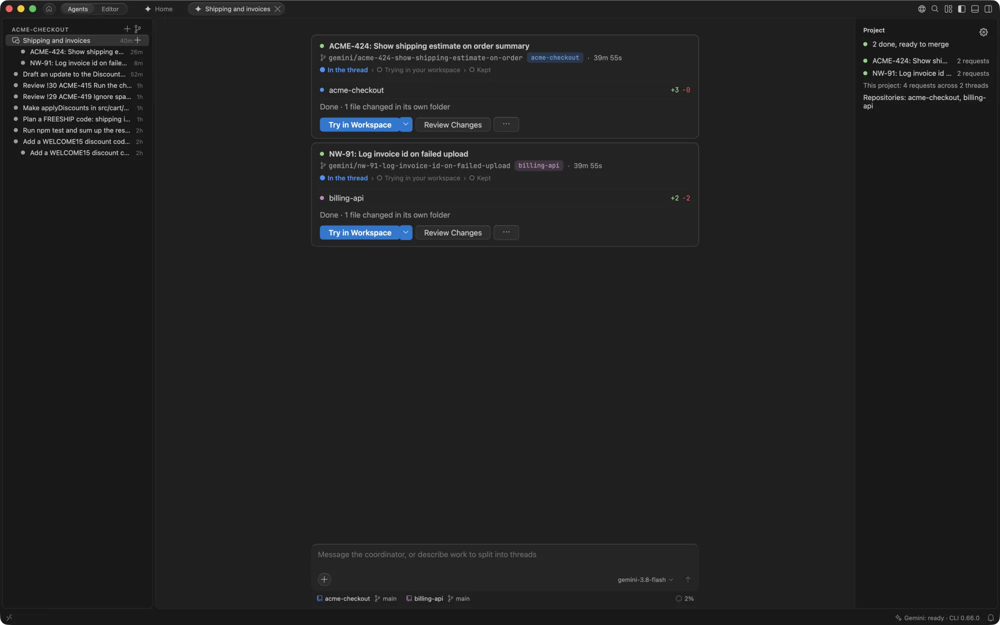
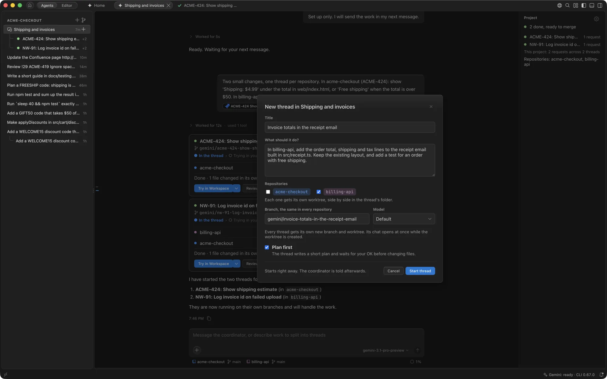
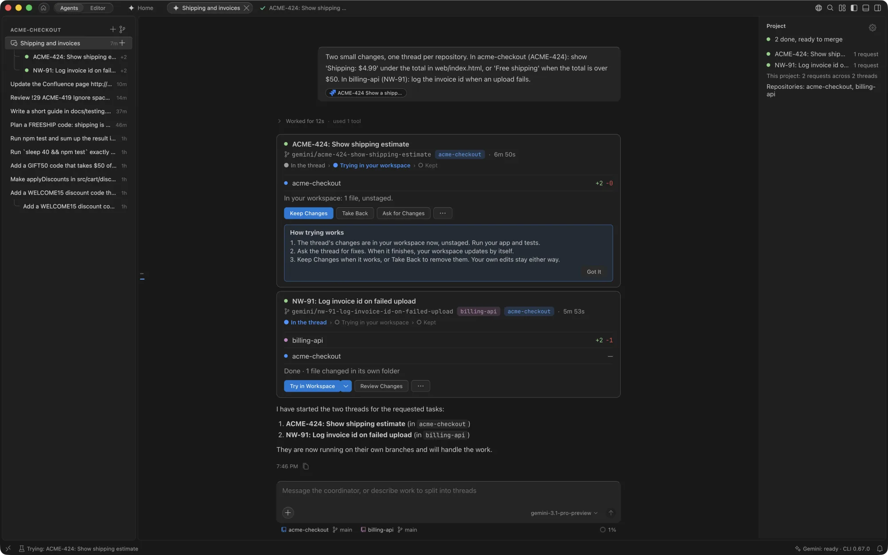
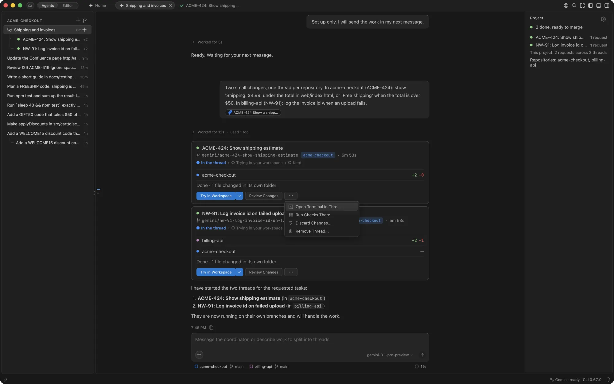
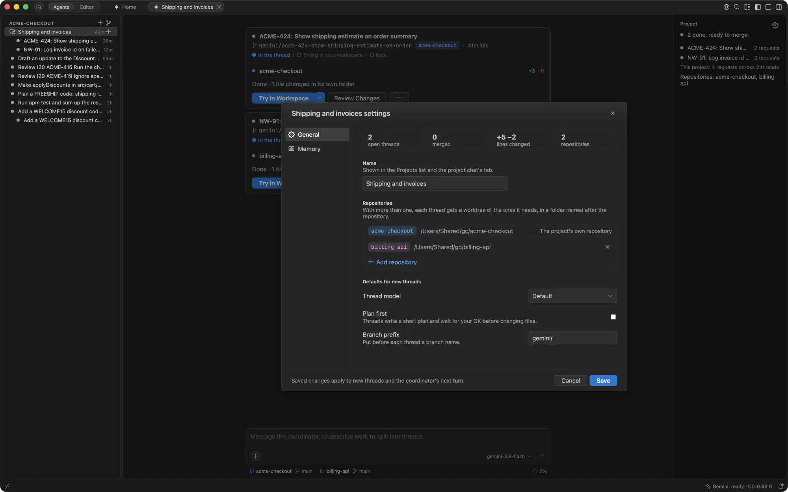
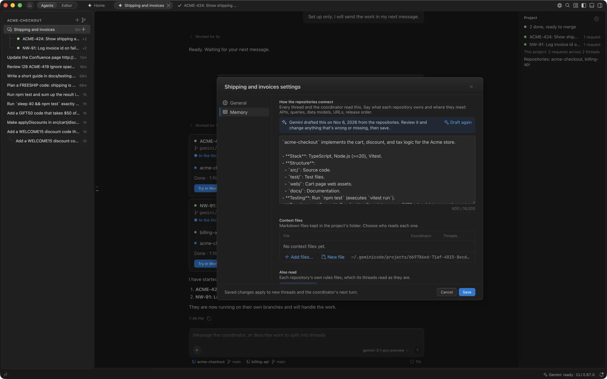

# Projects

A project hands a larger piece of work to a team of agents. You talk to a **coordinator**, which splits the work into **threads**. Each thread is an agent on its own branch, in one or more repositories, and you review and take each thread's work when it's right.

## Start a project

1. Choose **New Project** at the top of the Agents pane and pick a folder in a Git repository, either an open workspace or any other folder. You can also right-click a repository in the pane and choose **New Project**.
2. The project chat opens at once, named after the repository. Describe the work and press Return.

To start one from Home, open the chevron beside **On a branch**, pick **New Project in** your repository, describe the work and choose **Start Project**.

The coordinator plans the work and starts a thread for each part.

> [!NOTE]
> A project needs a repository the Gemini CLI trusts, since the CLI loads a project's tools only in trusted folders. The first time you pick a folder for agents, GeminiCode asks once (see [Folder trust](review.md#folder-trust)). Coordinators run in `~/.geminicode/projects`, which GeminiCode trusts itself. Threads check out their branches in `~/.geminicode/worktrees/<repository>`, which is trusted along with the repository.

## Talk to the coordinator

The coordinator plans, starts threads, passes your follow-ups to them and answers questions about their progress. It never edits files or reads the code itself. It runs in an empty folder of its own, on a Flash model unless you pick another in its chat, and reads the repository's context files, such as `GEMINI.md` and `AGENTS.md`. Once a repository's [index](agents.md#workspace-index-and-docs) is built, the coordinator also gets its outline (folders, languages and public definitions), so it points the threads it starts at the right parts of the code.

Only your messages wake the coordinator. When a thread finishes, asks something or fails, you take it up in that thread, and the coordinator sees what changed the next time you write to it. A follow-up about work a thread already has goes to that thread, whether it's working, waiting or done.

You can write while the coordinator works. Your message shows above the input as **Goes to the coordinator after this turn**, with **Edit** and **Remove**, and is sent as soon as the turn ends. Return and ⌘Return both wait, because the coordinator's turn is never interrupted for a message. If you stop the coordinator, your messages stay there until you choose **Send now**.

If a coordinator turn fails, for example on a quota or network error, the error offers **Retry**, which sends the coordinator what that turn was given again. Your next message carries it too, so nothing you wrote is lost.

**Compress** works in the project chat as in any chat: type `/compress`, use the **Compress** link in the usage popover, or use the card offered once the context passes 40%. The coordinator's summary lists its threads, and its next turn is given its role and the project memory again.

## Threads

Each thread has a card in the project chat that shows its state, branch, changed lines and time, and updates in place. Click its title, or **Open**, to open its chat in a tab of its own. A thread's questions and permission requests stay in its own chat; the card offers **Open to Answer**. A line of three steps on the card, **In the thread**, **Trying in your workspace** and **Kept**, shows where its work is.

Threads run in the repository's worktrees with all of its rules, and a thread's agent starts while its folder is being set up. If you quit during that setup, the thread keeps its brief: when the project opens again, the setup runs again and the thread gets its brief then. In the Agents pane, each project is a row under its folder, with its threads below it.

When the coordinator passes a note to a thread that is working, the note shows above the thread's input as **From coordinator: goes after this turn**. It is sent when the turn ends. **Send now** gives it to the thread after its current step, and **Remove** drops it. A note held while a thread is still being set up survives quitting, and is sent when the project opens again.

### How many threads run at once

At most four of a project's threads work at once (`gemini.projects.maxRunningThreads`). A thread started beyond that, by you or the coordinator, waits. The side panel lists it with **Starts when a running thread finishes** and how many are running, and it starts by itself when a running thread finishes its turn, is merged or is removed. Notes the coordinator sends it meanwhile wait with it. A thread that is waiting for plan approval or is done doesn't count as running.

When today's Gemini quota is over 90% used, as the usage meter in the status bar reads it, new threads wait too. A banner in the side panel says how many it is holding and when the quota resets. They start when it resets, or at once with **Start Anyway**. A sign-in with an API key has no quota to read, so nothing waits for it.

## Start a thread yourself

Choose **New thread** in the project chat's **+** menu, or **New Thread** on the project's row in the Agents pane. Give it a title, what it should do, a branch and a model, and choose **Start thread**. It starts at once, and the coordinator is told afterwards.

Tick **Plan first** to have the thread write a short plan and wait for **Approve Plan** before changing files.

## Fork a thread

**Fork Agent** works on a thread too: use the split-arrows icon on its row, the row's right-click menu, the **+** menu, `/fork`, or **Fork** at the end of any reply. The fork is a new thread in the same project, on a new branch made from the thread's branch with its uncommitted changes. It starts with the thread's conversation (whole, compacted, or the conversation only), gets a card in the project chat, and the coordinator hears about it with your next message. A thread that works in several repositories can't be forked.

## Try, keep or take back

When a thread finishes with changes, its card offers **Try in Workspace** and **Review Changes**. **Review Changes** opens the thread's changes as a diff and leaves your workspace alone.

**Try in Workspace** copies the thread's changes into your own checkout of the repository as unstaged files, so your local server and tests run with them. Nothing is committed, staged or merged, and your branch, its index and HEAD stay as they are. The card says how many files are in your workspace, and the status bar shows **Trying:** and the thread's name; click it for the same choices as the card. In Source Control, the tried files carry a **T**.

While you try a thread's work:

- **Ask for Changes** opens the thread's chat. When its turn ends, your workspace updates by itself, and the card counts the updates.
- Edit the files yourself. Your edits stay, and **Send My Edits to the Thread** copies them into the thread's folder, so its next turn builds on them.
- **Keep Changes** makes the changes yours and finishes the thread. They stay unstaged until you commit them. Committing the tried files yourself keeps them too.
- **Take Back** removes the thread's changes from your workspace. Edits you made yourself stay, and **Try in Workspace** brings the changes back.

When the thread and you changed the same lines of a file, the file gets conflict markers and updating pauses. **Open the Conflict** opens the file, and updating carries on once it's resolved. A file that can't be merged with yours (a binary file, a link, or one deleted on one side) is left as you have it, and the card names it. A file with unsaved edits updates when you save it. Only one agent's work is tried in a workspace at a time, so trying another offers **Take Back and Try**.

The card's **More** menu holds **How Trying Works**, **Open Terminal in Thread Folder**, **Run Checks There**, **Discard Changes…**, **Restore Discarded Work** and **Remove Thread…**.

- **Discard Changes…** puts the thread's folder back where it started and takes its changes out of your workspace. The work is saved in git, under `refs/geminicode/discarded/`, so **Restore Discarded Work** brings it back until you remove the thread.
- **Remove Thread…** deletes the thread with its folder and branch. While you're trying its work, it first asks whether to keep the changes or take them back.

A thread that finished without changes, such as an assessment, offers **Open** to read its answer. Once a thread is kept, the coordinator starts a new thread for further work, and reopens a finished one only when you ask.

### Merge commits instead

The chevron beside the card's **Try in Workspace** offers **Merge Back** and, with GitLab connected, **Open Merge Request**. It remembers your pick for the repository. **Merge Back** commits the thread's work on its branch and merges that branch into the branch your folder has checked out, which finishes the thread.

## Several repositories

A project can hold more than one repository, such as a content site and the app that reads it. Add one with **Add repository** in the project's settings.

- Each thread gets a worktree of each repository it needs, side by side in its folder, on the same branch name.
- The coordinator picks the repositories for each thread from what you asked, and asks you when it can't tell. A thread can also add another repository itself in the middle of a task.
- When you start a thread yourself, tick the repositories it works in.
- **Try in Workspace** tries each repository's work in your checkout of that repository. With Merge Back remembered for the repository, each repository has its own **Merge Back** on the card, and the thread stays open until every repository with changes is merged.

## Project settings and memory

Open the project's settings with the gear in the project chat's side panel, or with **Project Settings** in the **...** menu on the project's row in the Agents pane.

**General** shows the project's open threads, merged threads, lines changed and repositories, and holds:

- **Name**, shown in the Projects list and on the project chat's tab.
- **Repositories**, to add or remove one.
- **Defaults for new threads**: the thread model, **Plan first**, and a **Branch prefix** put before each thread's branch name.
- **Clean Up Folders...**, which removes the folders of threads whose work is all merged. A merged thread otherwise keeps its folder, with its dependencies and builds, so it can carry on. Each thread keeps its branch and chat, and its folder comes back when you open it.

**Memory** holds what every thread and the coordinator read:

- **How the repositories connect**: what each repository owns and where they meet, such as APIs, data models, URLs and release order.
- **Project instructions**: conventions and anything you'd otherwise repeat.
- **Context files**: Markdown files kept in the project's folder. For each one, choose whether the coordinator, the threads or both read it.

Under **Also read**, the page lists each repository's own rules files, which its threads read as they are, and estimates how many tokens the memory adds to each thread's first request.

For a new project, Gemini drafts the memory from the repositories for you to review, and **Draft with Gemini** drafts it again. Saved changes apply to new threads and to the coordinator's next turn.

## The side panel

When the project chat is at least 1000 px wide, a panel on its right shows the project at a glance:

- how many threads are in each state (waiting to start, working, waiting on you, with a plan to approve, done, merged back)
- each thread, with how many requests its chat has made; click one to open it
- the project's total requests, and its repositories when it has more than one
- the quota banner with **Start Anyway**, while new threads are held

A request is one prompt the thread was sent, with its answer; the Gemini CLI doesn't report how many model calls a turn made. Drag the panel's left edge to resize it, and double-click the edge to reset it. The gear at the top opens [Project settings](#project-settings-and-memory).

## Turn Projects off

Projects are on by default. To hide them, turn off `gemini.projects.enabled` in Settings. **Gemini: New Project** in the Command Palette then offers to turn them back on.
