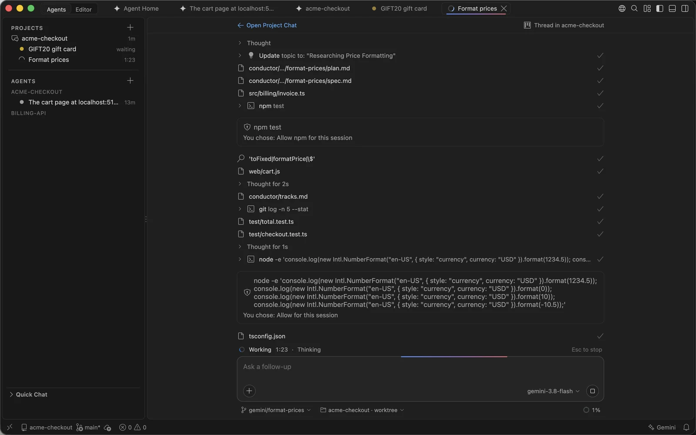
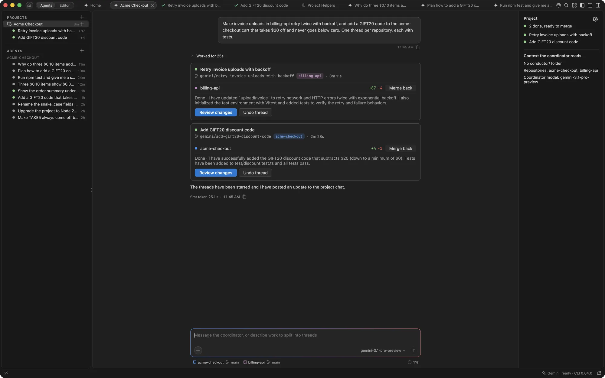
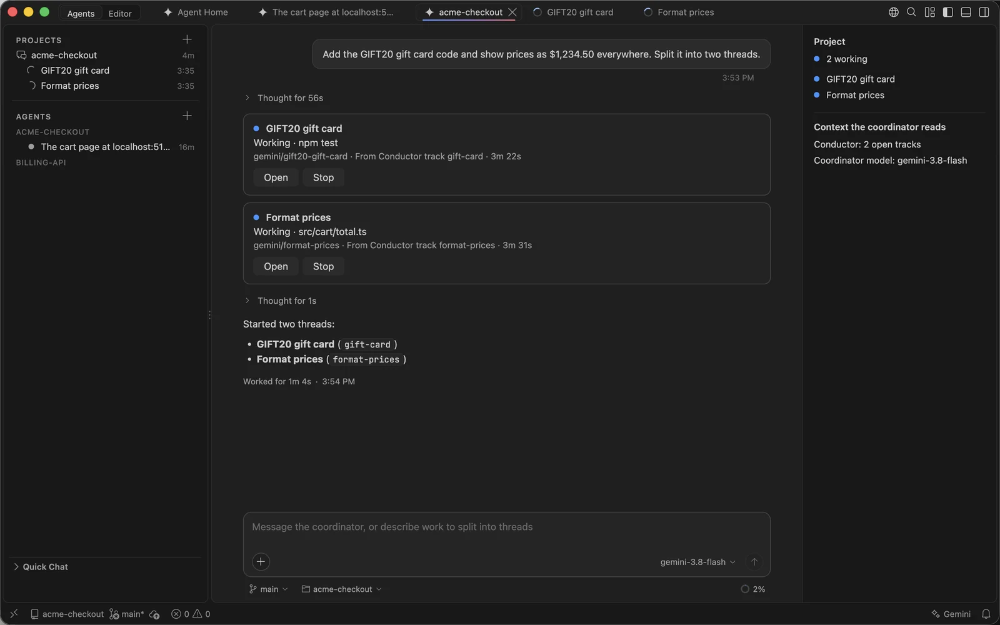
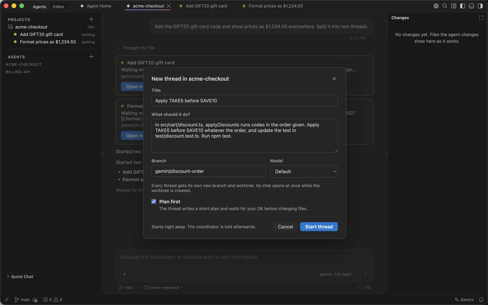
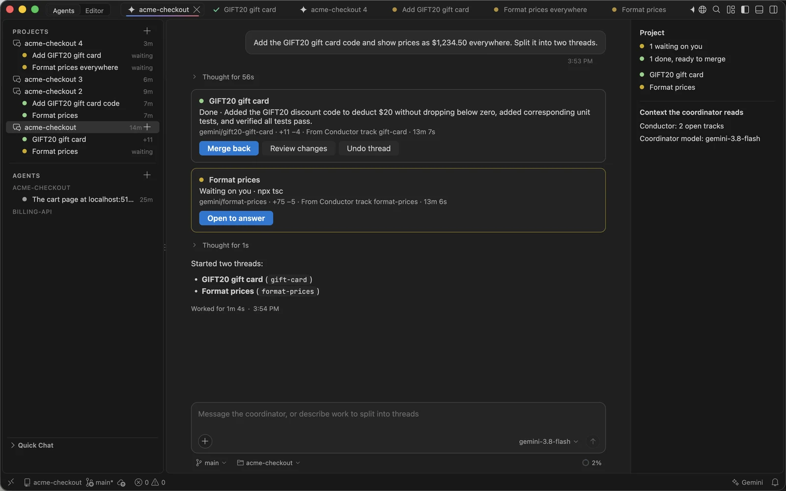
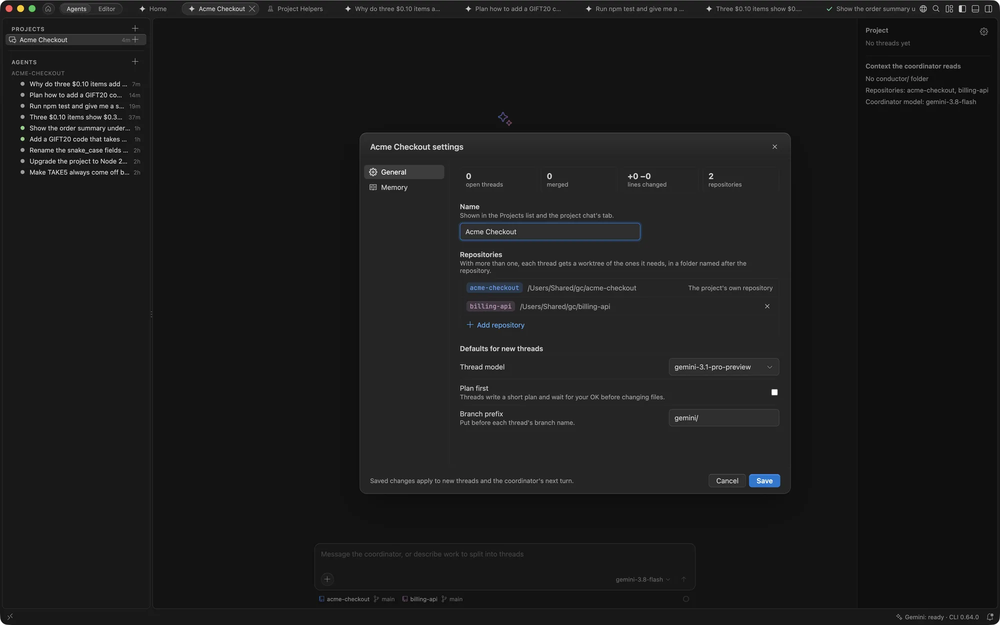
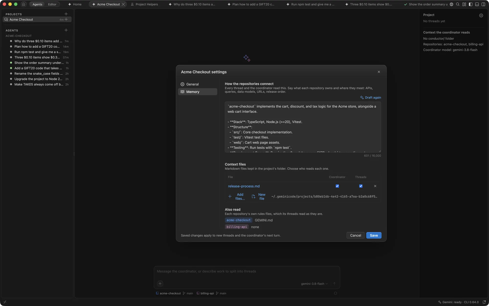

# Projects

A project hands a larger piece of work to a team of agents. You talk to a **coordinator**, which splits the work into **threads**: each an agent on its own branch, in one or more repositories. You review and merge each thread when it's right.

## Start a project

1. Choose **+** next to **Projects** in the agent list, or on Home.
2. Pick a folder in a Git repository: an open workspace or any other folder.
3. The project chat opens at once, named after the repository. Describe the work and press Return.

The coordinator plans the work and starts a thread for each part.

> [!NOTE]
> The first time, GeminiCode asks to trust the folders where coordinators run (`~/.geminicode/projects`) and where threads check out their branches (`~/.geminicode/worktrees/<repository>`). The Gemini CLI loads a project's tools only in trusted folders.

## Talk to the coordinator

The coordinator never edits files or reads the code itself. It plans, starts threads, passes your follow-ups to them and answers questions about their progress. It runs on a Flash model in an empty folder of its own, and reads the repository's context files, such as `GEMINI.md` and `AGENTS.md`.

Only your messages wake the coordinator. When a thread finishes, asks something or fails, you take it up in that thread; the coordinator sees what changed the next time you write to it. A follow-up on work a thread already has goes to that thread, whether it's working, waiting or done.

You can write while the coordinator works. Your message shows above the input as **Goes to the coordinator after this turn**, with **Edit** and **Remove**, and goes as soon as the turn ends. Return and ⌘Return both wait: the coordinator's turn is never stopped for a message. If you stop the coordinator, your messages stay there until you choose **Send now**.

If a coordinator turn fails, for example on a quota or network error, its error offers **Retry**, which sends the coordinator what that turn was given again. Your next message carries it too, so nothing you wrote is lost.

**Compact** works in the project chat as in any chat: type `/compact`, use the **Compact** link in the usage popover, or the card offered once the context passes 40%. The coordinator's summary lists its threads, and its next turn gets its role and the project memory again.

## Threads

Each thread shows as a card in the project chat with its state, branch, changed lines and time, and updates in place. Click its title, or **Open**, to open its chat in a tab of its own. A thread's questions and permission requests stay in its own chat (**Open to answer**).

Threads run in the repository's worktrees with all of its rules, and a thread's agent starts while its folder is set up. If you quit while a thread is still being set up, it keeps its brief: when the project opens again, the setup runs again and the thread gets its brief then. In the agent list, the **Projects** section lists each project with its threads below it.

When the coordinator passes a thread a note while the thread is working, the note shows above the thread's input as **From coordinator: goes after this turn**. It goes when the turn ends; **Send now** gives it to the thread after its current step instead, and **Remove** drops it. A note held while a thread is still being set up survives quitting, and goes when the project opens again.

## Start a thread yourself

Choose **New thread** in the project chat's **+** menu, or **New Thread** on the project's row in the agent list. Give it a title, what it should do, a branch and a model. It starts at once, and the coordinator hears about it afterwards.

Tick **Plan first** to have it write a short plan and wait for **Approve plan** before changing files.

## Fork a thread

**Fork Agent** works on a thread too: the split-arrows icon on its row, the row's right-click menu, the **+** menu, `/fork`, or **Fork** at the end of any reply. The fork is a new thread in the same project, on a new branch made from the thread's branch with its uncommitted changes, and starts with the thread's conversation (whole, compacted or the conversation only). It gets a card in the project chat, and the coordinator is told about it with your next message. A thread that works in several repositories can't be forked.

## Merge back, review or undo

When a thread finishes with changes, its card offers:

| Button | What it does |
| --- | --- |
| Merge back | Merges the thread's branch into the branch your folder has checked out. The thread is then resolved. |
| Review changes | Opens the thread's changes, to keep or undo each one. |
| Undo thread | Removes the thread's branch and folder. |

A thread that finished without changes, such as an assessment, offers **Open** to read its answer. Once a thread is merged, the coordinator starts a new thread for further work, and reopens a resolved one only when you ask.

## Several repositories

A project can hold more than one repository, such as a content site and the app that reads it. Add one with **Add repository** in the project's settings.

- Each thread gets a worktree of each repository it needs, side by side in its folder, on the same branch name.
- The coordinator picks the repositories for each thread from what you asked, and asks you when it can't tell. A thread can also add another repository itself mid-task.
- When you start a thread yourself, tick the repositories it works in.
- **Merge back** asks which repository's work to merge. The thread stays open until every repository with changes is merged or undone.

## Project settings and memory

Open the project's settings with the gear at the top of the project chat.

**General** shows the project's open threads, merged threads, lines changed and repositories, and holds:

- **Name**, shown in the Projects list and the project chat's tab.
- **Repositories**, to add or remove one.
- **Defaults for new threads**: the thread model, **Plan first**, and a **Branch prefix** put before each thread's branch name.
- **Clean Up Folders...**, which removes the folders of threads whose work is all merged. Each thread keeps its branch and chat, and its folder comes back when you open it.

**Memory** holds what every thread and the coordinator read:

- **How the repositories connect**: what each repository owns and where they meet, such as APIs, data models, URLs and release order.
- **Project instructions**: conventions and anything you'd otherwise repeat.
- **Context files**: Markdown files kept in the project's folder, each with who reads it, the coordinator, threads or both.

For a new project, Gemini drafts this from the repositories for you to review; **Draft with Gemini** drafts it again. Saved changes apply to new threads and the coordinator's next turn.

## The side panel

When the project chat is at least 1000 px wide, a panel on its right lists the threads by state (click one to open it), the Conductor tracks the coordinator reads from a `conductor/` folder, and the coordinator's model. Drag its left edge to resize it; double-click the edge to reset it.

## Turn Projects off

Projects are on by default. To hide them, turn off `gemini.projects.enabled` in Settings. **New Project** then offers to turn them back on.
