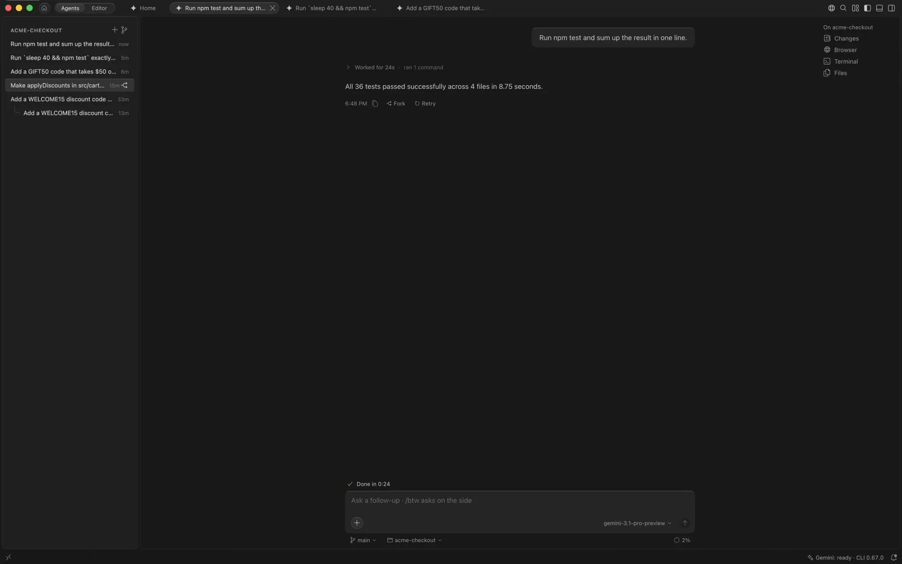
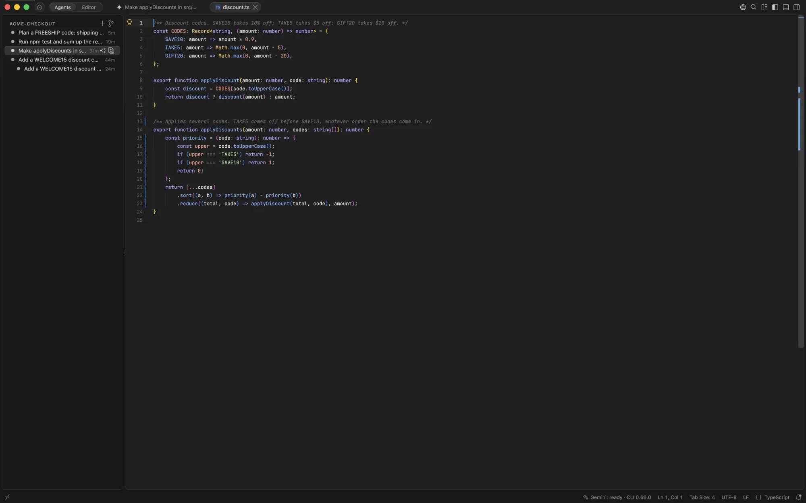

# Review and safety

An agent works in your code with your permissions, so GeminiCode puts you in the loop at two points: before it acts, when it asks to run a command or make an edit, and after, when you keep or undo what it changed. How often it asks is up to you, and every change it makes can be undone, one file, one reply or one message at a time.

> [!WARNING]
> The agent is not sandboxed. Its shell and search tools run with your permissions. **Default** mode asks before every change and command; use **Auto Edit** and **YOLO** only in folders you trust.

## Approval modes

The approval mode decides what an agent may do without asking. Pick one from the composer's **+** menu. In an agent's tab, <kbd>⇧Tab</kbd> or <kbd>⌘.</kbd> (**Gemini: Cycle Approval Mode**) steps through Default, Auto Edit and Plan, as <kbd>⇧Tab</kbd> does in the Gemini CLI. It never picks YOLO, and it skips Plan while a turn runs, since the running turn would carry on editing. <kbd>⌘Y</kbd> (**Gemini: Toggle YOLO**) switches YOLO on and off, like the CLI's <kbd>Ctrl+Y</kbd>.

The modes and their descriptions come from the Gemini CLI: Default "Prompts for approval", Auto Edit "Auto-approves edit tools", YOLO "Auto-approves all tools" and Plan "Read-only mode". Home and the New Agent dialog offer the same list, less any mode your settings turn off.

| Mode | What the agent does |
| --- | --- |
| Default | Asks before every edit and every command. A proposed edit opens as a diff first. |
| Auto Edit | Edits files without asking, but still asks before commands. Offered unless you turn off `gemini.approval.allowAutoEdit`. |
| Plan | Reads the code and proposes a plan, without changing anything. |
| YOLO | Runs everything without asking. Offered only when you turn on `gemini.approval.allowYolo`. |

New agents start in Default unless you set `gemini.agents.defaultMode`. Turning off `gemini.tools.allowShell` takes the shell tool away from agents altogether, in every mode.

When you allow an edit for the session while in YOLO, the Gemini CLI drops to Auto Edit by itself. GeminiCode puts YOLO back at once and says so in the chat.

## Permission requests

A permission card shows the Gemini CLI's own choices: **Allow once**, **Allow for this session** and **Reject**. You can answer the newest card without leaving the chat box: <kbd>⌥⌘↩</kbd> allows once, <kbd>⌥⌘S</kbd> allows for this session and <kbd>esc</kbd> rejects (Ctrl+Alt+Enter and Ctrl+Alt+S on Windows and Linux). The card lists these keys under its buttons. While a card waits, <kbd>⌥⌘S</kbd> in the chat box answers it rather than saving all files.

An agent that asks never takes over the chat you're typing in, and its tab isn't brought forward. If its chat is in view, the proposed edit opens as a diff. In the Agents pane its row shows a yellow dot and **Needs you**, and the Dock badge and a notification tell you it's waiting.

### Allow for this session

On a shell command, **Allow for this session** covers the command's prefix for the rest of that chat's session: the program, and for programs with subcommands, the subcommand too. The button names what it covers, for example **Allow `git status`, `grep` for this session**. GeminiCode keeps these prefixes and answers repeats itself, and tells the Gemini CLI "once", because the CLI's own session rule would cover the whole program. Allowing `git status` never covers `git push` or `git grep`, and allowing `npm run lint` never covers `npm run deploy`. A redirect is allowed only for the file it wrote.

Some commands ask every time, because allowing one would allow far more than you saw:

- a command that reaches the network (`curl`, `ssh`, `gh`, `gcloud` and the like, and `git push`, `git fetch`, `git pull`, `git clone` and `git remote add` or `set-url`), installs a package by name (`npm install left-pad`, `pip install requests`), or runs code it builds
- a redirect into a file outside the agent's folder
- a command that runs another program or code it is given, such as `env`, `xargs`, `sudo`, `python -c`, `npx`, `npm exec`, `yarn dlx`, `make -f`, `awk -f`, `sed -f`, `find -exec`, `git -c`, `git grep -O`, `git fetch --upload-pack`, `git config` that sets a value, `git rebase -x` or `rg --pre`
- `docker` and the like, since `docker inspect` shows a container's settings
- a script the agent could have written, by relative or absolute path, and a program named by a variable or a pattern, such as `$EDITOR`
- a command with a variable in an argument, such as `echo $GEMINI_API_KEY` or `cat "$FILE"`, since what it reads or prints is only known when it runs; `$HOME`, `$PWD`, `$?` and the locale variables are fine
- a command that writes a build file, a git hook, anything under `.git`, `.gemini/settings.json`, a `.gemini/policies/` file, a `.gemini/*.sh` script, or `.vscode/settings.json`, `tasks.json` or `launch.json`, whether through `>`, `tee`, `cp`, `mv` or `sed -i`

A few test and read-only commands can still be allowed for the session even though their programs otherwise always ask: `npx vitest`, `npx tsc --noEmit`, `npx eslint`, `python -m pytest` and `./gradlew test`.

An allowed command asks again once the agent changes what it would run. After the agent edits a build file, such as `package.json`, a `Makefile` or `build.gradle`, the task runners you allowed (`npm`, `make`, `gradle` and the like) and the git commands that run hooks (`git commit`, `git merge`) ask again. After it edits a git hook or a hook manager's settings (`.husky/`, `.pre-commit-config.yaml`, `.lintstagedrc`), every git command asks again.

In Auto Edit, an edit to a file that decides what runs next still shows a card first. These are git hooks and hook managers' settings, build files such as `package.json`, the worktree setup script (`.gemini/*.sh`), the Gemini CLI's project settings and policies (`.gemini/settings.json`, `.gemini/policies/`), the folder's `.vscode/settings.json`, `.vscode/tasks.json` and `.vscode/launch.json`, and the ignore files (`.gitignore`, `.geminiignore`), which decide what the agent may read. The commits GeminiCode makes for an agent (Try in Workspace, Merge Back, Open Merge Request) run none of the checkout's hooks.

**Gemini: Commands Allowed for This Session...** lists the prefixes the chat in front has allowed, and lets you forget any of them.

To also be offered the Gemini CLI's permanent allow, turn on **Allow for all future sessions** in [Settings](helpers.md#gemini-cli-settings). The card then shows it in the CLI's own words, **Allow this command for all future sessions**. The CLI saves that rule for the whole program (`npx`, not `npx vitest`) and for every folder, in `~/.gemini/policies/auto-saved.toml`.

## Folder trust

In a folder it trusts, the Gemini CLI loads the folder's own Gemini settings, hooks and MCP servers, which can run programs on your Mac, and allows Auto Edit and YOLO. Agents on their own branch, projects and Auto Edit all need a trusted folder.

GeminiCode asks once per repository, the first time you choose a folder for agents: on Home, for a new agent, a project or a team flow, on the Index page, or for a mode that needs trust. The question, **Let agents work in** the folder, offers:

- **Trust This Folder**, for the repository.
- **Trust Everything in** its parent folder, when that folder holds other repositories too.
- **Not Now**, which is remembered, so later starts don't ask again. Agents still work there **Here**, in Default and Plan mode; Auto Edit falls back to Default. Home says in place what needs trust, with **Trust...** to be asked again.

A trusted repository's agent branches, in `~/.geminicode/worktrees/<repository>`, are trusted with it. Merge request reviews check out in `~/.geminicode/reviews`, which is never trusted, so a merge request's own settings, hooks and MCP servers never run. Your choice is saved in `~/.gemini/trustedFolders.json`, so `gemini` in the terminal sees it too. [Settings](helpers.md#trusted-folders) lists every rule and lets you change them.

When trust changes elsewhere (in the terminal, in Settings or in another window), agents pick it up once they finish their current work. While some are working, a notice says so and offers **Restart Agents Now**.

## Review changes in place

The **Changes** panel lists the files the agent in front has edited. It opens by itself, without taking focus from the chat, the first time a turn of that agent changes a file. If you close it during a turn, it stays closed until the agent's next turn changes something. Click a file for its diff, or use **Open All Changes** to see them all in one multi-diff editor. Hover over a file to **Keep** or **Undo** its changes; **Keep All** accepts everything and **Undo All** puts the files back.

Open a file an agent changed and its changes show in place: added lines are tinted, a rule marks removed lines, and **Keep** and **Undo** sit above each change. The line at the top of the file counts the agent's changes and has **Keep All**, **Undo All** and **Next File**, which opens the agent's next changed file.

| Keys | What it does |
| --- | --- |
| <kbd>⌥⌘↩</kbd> / <kbd>⇧⌥⌘⌫</kbd> | Keep or undo the agent's changes to the file you're in |
| <kbd>⌥F5</kbd> / <kbd>⇧⌥F5</kbd> | Next or previous agent change in the file |

Only the agent's own changes show. What you type in the file afterwards isn't counted as the agent's, and Keep or Undo on a change leaves your edits alone. **Undo All** restores the file as it was before the agent, so when the file also has edits that aren't the agent's, it asks first, since those would go too. Undoing a file the agent created deletes it, after asking.

When two agents in one folder changed the same file, the changes of the one that edited it last show first. The other's show once those are kept or undone.

To stop two agents' edits mixing unnoticed, an agent's edit card warns when another live agent in the folder has changes to that file still waiting for Keep or Undo, for example **"Login fix" also has unreviewed changes in this file**. **Show Its Changes** opens the other agent's changes. In Auto Edit, where edits don't ask, the same warning is a line under the edit's row. To keep two agents fully apart, give one its own branch.

Changes you commit leave the list by themselves, however you commit: from the chat, Source Control, the terminal, or by asking the agent. Once a file matches the latest commit, its changes count as kept.

## Undo or retry a reply

Each reply that changed files ends with **Undo**, which puts back every file it changed. Undoing an earlier reply also undoes the replies after it; GeminiCode asks first when that happens, or when a file changed after Gemini wrote it. Your next message tells Gemini which files went back, so it reads them again. **Retry** under the latest reply sends the same message again.

You can undo each agent's last 100 replies, and they stay undoable after the window reloads or the agent sleeps. A reply that changed more than about 1 MB of text can't be undone.

## Rewind

**Rewind** goes back to before one of your messages, as the Gemini CLI's `/rewind` does. Click the clock icon under the message, type `/rewind`, or press <kbd>esc</kbd> twice in an empty message box, then pick a message. Each one shows when it was sent and how many files changed since.

Then choose, in the CLI's own words, **Rewind conversation and revert code changes**, **Rewind conversation**, or **Revert code changes**. The code choices appear only when code changed since that message.

- Rewinding the conversation removes the message and everything after it from the chat and from Gemini's context, so Gemini forgets them. The message goes back into the message box, ready to edit and send again.
- Reverting the code puts back what Gemini's edit tools changed since. As in the CLI, your own edits and what shell commands changed stay as they are.

A message that ran a team command or a skill isn't in the Gemini CLI's saved session, so its conversation can't be rewound. **Undo** on a reply is the quicker way to revert one turn's code.

The Gemini CLI has its own checkpointing (`general.checkpointing.enabled`, off by default), which keeps a shadow Git commit before each edit for its `/restore` command. GeminiCode's checkpoints are separate, per turn, and need nothing turned on. Turn the CLI's on only if you also use `/restore` from a terminal in the same folder.

## Commit the agent's work

The branch under a chat's composer switches to another branch or creates one. Next to it, the commit button commits the files that agent changed:

- On a branch other than the repository's default (origin's HEAD, else `main` or `master`), **Commit to** that branch opens a box with a message for you to edit. **Commit** (or <kbd>⌘↩</kbd>) commits only the files that agent changed. Its chevron offers **Create Branch and Commit…**.
- On the default branch, **Commit…** creates a branch, stages only the files that agent changed, and commits them.

Both warn first if other files are already staged. The commit message is written from the agent's diff, the same way the Source Control sparkle writes one. When it can't be (inline edit is turned off, or your sign-in can't make direct requests), the agent's name is used instead.

An agent on its own branch has **Try in Workspace** in place of the commit button. Its chevron also offers **Merge Back**, which commits the agent's remaining changes with a message written the same way. See [Agents on their own branch](agents.md#agents-on-their-own-branch).

In the Source Control view, the sparkle button (**Write Commit Message with Gemini**) writes a message for the staged changes, or for all changes when nothing is staged.

## Inline edit

Select some code (or put the cursor on a line), press <kbd>⌘I</kbd> and describe the change. Gemini rewrites those lines in a second or two, and the change shows in the file with **Keep** and **Undo**, like an agent's. The request box remembers your last request, so retrying is <kbd>⌘I</kbd> then Return. Inline edit doesn't save the file or start an agent. It's also on the editor's right-click menu as **Edit Selection with Gemini**.

Inline edit and commit messages use the newest Flash model your account can use, for speed. `gemini.inlineEdit.model` switches them to the chat's model (`sameAsChat`) or a model you name, and turning off `gemini.inlineEdit.enabled` turns them off. They work with Google sign-in or a Gemini API key, but not with Vertex AI.

## Review

**Review**, on Home and in the Command Palette (**Gemini: Review...**), asks what to review:

- **My Changes**: your uncommitted changes.
- **An Agent's Changes...**: the diff of an agent that changed files.
- **A Merge Request...**, with GitLab connected. See [Review a merge request](team-tools.md#review-a-merge-request).
- **Run Checks on a Branch...**, with Snyk or SonarQube connected.

**My Changes** is also **Review My Changes** in the Source Control title bar and in the Agents pane's **...** menu. It starts an agent in Plan mode with your uncommitted diff attached. The agent reads the code around the changes and replies with a summary and its findings, most serious first, without editing anything. Ask it to fix the ones you agree with.

## What agents can't reach

- Secret files, such as `.env` (but not `.env.example`), private keys, `.npmrc` and other credential files, cloud credentials (`gcloud`, `.aws`, service account keys) and cluster and registry configs (`.kube`, `.docker`), plus git-ignored files, including through a link or a symbolic link.
- Files outside the agent's folder, and other folders in a multi-folder window unless you turn on `gemini.agents.allWorkspaceFolders`.
- Sites other than local ones in the browser, until you allow each one. See [Browser](browser.md#which-sites-agents-can-open).
