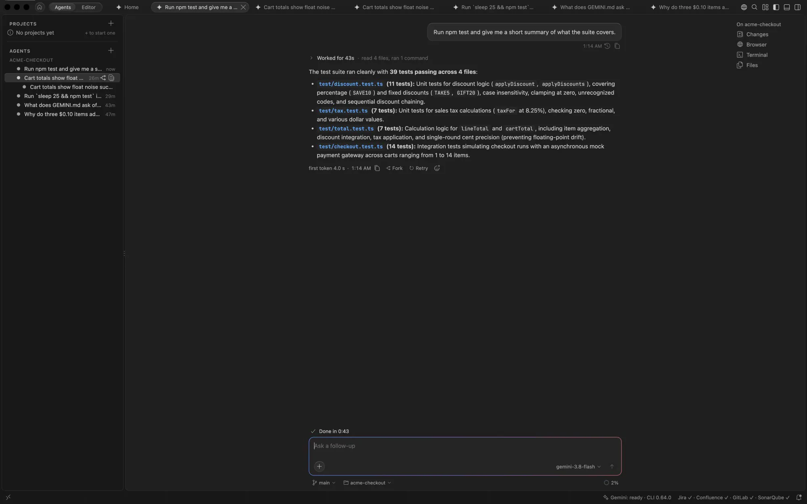
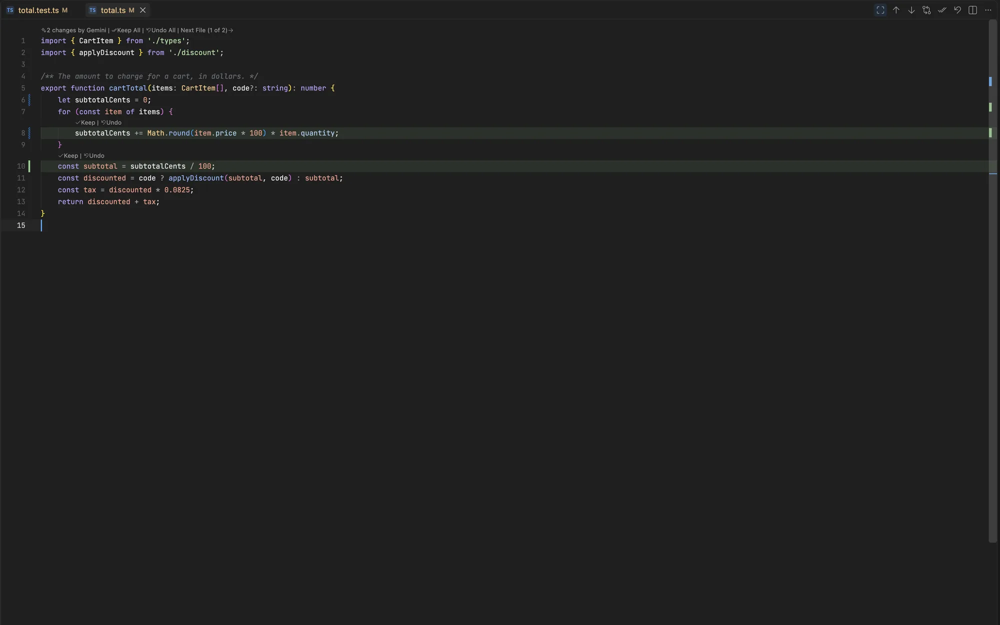

# Review and safety

Agents ask before they act, and every change they make can be kept, undone or rewound. This page covers approvals, reviewing changes, and what agents can't reach.

> [!WARNING]
> The agent is not sandboxed. Its shell and search tools run with your permissions. **Default** mode asks before every change and command; use **Auto Edit** and **YOLO** only in folders you trust.

## Approval modes

Pick a mode from the composer's **+** menu, or press <kbd>⌘.</kbd> in an agent's tab (**Gemini: Cycle Approval Mode**) to step through Default, Auto Edit and Plan as the CLI's <kbd>⇧Tab</kbd> does; it never picks YOLO. The list comes from the Gemini CLI, minus any mode your admin turned off.

| Mode | What the agent does |
| --- | --- |
| Default | Asks before every edit and every command. Proposed edits open as a diff first. |
| Auto Edit | Edits files without asking, but still asks before commands. |
| Plan | Reads and proposes a plan without making changes. |
| YOLO | Runs everything without asking. Off unless your admin enables it. |

## Permission requests

A permission card shows the CLI's own choices, such as **Allow**, **Allow for this session** and **Reject**; <kbd>esc</kbd> rejects. An agent that asks never takes over the chat you're typing in: its tab isn't brought forward. If its chat is in view, the proposed edit opens as a diff. In the Agents pane its row shows an amber dot and "waiting", and the Dock badge and a notification say it waits.

**Allow for this session** on a shell command covers the command prefixes it runs for the rest of that chat's session: the program, and for programs with subcommands the subcommand, as the button says (**Allow git status, grep for this session**). Allowing `git status` never covers `git push` or `git grep`, and allowing `npm run lint` never covers `npm run deploy`. A redirect is allowed for the file it wrote only. Some commands ask every time anyway, because allowing them once would allow far more than you saw:

- a command that reaches the network, installs a package by name (`npm install left-pad`, `pip install requests`), or runs code it builds
- a redirect into a file outside the agent's folder
- a command that runs another program or code it is given, such as `env`, `xargs`, `sudo`, `python -c`, `npx`, `npm exec`, `yarn dlx`, `make -f`, `awk -f`, `sed -f`, `find -exec`, `git -c`, `git grep -O`, `git fetch --upload-pack`, `git config` that sets a value, `git rebase -x` or `rg --pre`
- `docker` and the like, since `docker inspect` shows a container's settings
- a script the agent could have written, by relative or absolute path, and a program named by a variable or a pattern, such as `$EDITOR`
- a command that writes a build file, a git hook, anything under `.git`, `.gemini/settings.json`, a `.gemini/*.sh` script or `.vscode/settings.json` or `tasks.json`, through `>`, `tee`, `cp`, `mv` or `sed -i`, for example

A few test and read-only commands whose programs otherwise always ask can still be allowed for the session: `npx vitest`, `npx tsc --noEmit`, `npx eslint`, `python -m pytest` and `./gradlew test`.

When the agent edits a build file, such as `package.json`, a `Makefile` or `build.gradle`, the task runners you allowed (`npm`, `make`, `gradle` and the like) and the git commands that run hooks (`git commit`, `git push`) ask again, since their next run would run what the agent wrote. When it edits a git hook or a hook manager's settings (`.husky/`, `.pre-commit-config.yaml`, `.lintstagedrc`), every git command asks again.

In Auto Edit, an edit to a file that decides what runs next still shows a card first: the worktree setup script (`.gemini/*.sh`), the CLI's project settings (`.gemini/settings.json`), and the folder's `.vscode/settings.json` and `.vscode/tasks.json`.

**Gemini: Commands Allowed for This Session...** lists what the chat in front allowed, and lets you forget any of it. Turn on **Allow for all future sessions** in [Agent Setup](helpers.md#gemini-cli-settings) to also be offered a permanent allow.

## Folder trust

The Gemini CLI refuses Auto Edit and YOLO in a folder it doesn't trust; when you pick one there, GeminiCode asks whether to trust it. Trusting a folder also lets the CLI load that folder's own Gemini settings and MCP servers, which can run programs. The choice is saved in `~/.gemini/trustedFolders.json`, and the terminal's `gemini` sees it too.

## Review changes in place

The **Changes** panel lists the files the agent in front has edited. Click a file for a diff, or use **Open All Changes** for one multi-diff editor. Hover over a change to **Keep** or **Undo** it; **Keep All** accepts everything and **Undo All** puts the files back.

Open a file an agent changed and its changes show in place: added lines are tinted, a rule marks removed lines, and **Keep** and **Undo** sit above each change. The line at the top of the file keeps or undoes them all and moves to the agent's next file.

| Keys | What it does |
| --- | --- |
| <kbd>⌥⌘↩</kbd> / <kbd>⇧⌥⌘⌫</kbd> | Keep or undo the agent's changes to the file you're in |
| <kbd>⌥F5</kbd> / <kbd>⇧⌥F5</kbd> | Next or previous agent change in the file |

Only the agent's own changes show. What you type in the file afterwards isn't counted as the agent's, and Keep or Undo on a change leaves your edits alone. **Undo All** restores the file as it was before the agent, so when the file also has edits that aren't the agent's, it asks first: they would go too.

When two agents in one folder changed the same file, the changes of the one that edited it last show first; the other's show once those are kept or undone.

Changes you commit leave the list by themselves, however you commit: from the chat, Source Control, the terminal, or by asking the agent. Once a file is what the latest commit has, its changes count as kept.

## Undo or retry a reply

Each reply that changed files ends with **Undo**, which puts back every file it changed. Undoing an earlier reply also undoes the replies after it, and GeminiCode asks first when that happens or when a file changed after Gemini wrote it. The next message tells Gemini which files went back, so it reads them again. **Retry** under the latest reply sends the same message again.

The last 100 replies of each agent can be undone, and they stay undoable after the window reloads or the agent sleeps.

## Rewind

**Rewind** goes back to before one of your messages, as the CLI's `/rewind` does. Click the clock icon under the message, or press <kbd>esc</kbd> twice in an empty message box and pick one.

That message and everything after it go from the chat and from Gemini's context, so Gemini forgets them, and the files Gemini changed since go back to how they were. The message returns to the message box, to edit and send again.

## Commit the agent's work

The branch under a chat's composer switches to another branch or creates one. **Create Branch & Commit** creates a branch, stages only the files that agent changed, and commits them; it warns first if other files are already staged. The commit message is written from the agent's diff, as the Source Control sparkle writes one, for you to edit; the agent's name is used when it can't be (inline edit turned off, or a sign-in that can't make direct requests). An agent on its own branch has **Merge Back** instead, which commits its leftovers with a message written the same way.

In the Source Control view, the sparkle button writes a commit message for the staged changes (or, with nothing staged, all changes).

## Inline edit

Select some code (or put the cursor on a line), press <kbd>⌘I</kbd> and say what to change. Gemini rewrites just those lines in a second or two, and the change shows in the file with **Keep** and **Undo**, like an agent's. The request box remembers your last request, so a retry is <kbd>⌘I</kbd> and Return. Inline edit doesn't save the file or start an agent.

Inline edit and commit messages use the newest Flash model for speed. `gemini.inlineEdit.model` can switch them to the chat's model or one you name, and `gemini.inlineEdit.enabled` turns them off. They work with Google sign-in or a Gemini API key, but not with Vertex AI.

## Review My Changes

**Review My Changes**, in the Source Control title bar and the Agents pane's **...** menu, starts an agent in Plan mode with your uncommitted diff attached. It reads the code around the changes and replies with a summary and its findings, most serious first, without editing anything. Ask it to fix one when you agree.

## What agents can't reach

- Secret files, such as `.env`, private keys, cloud credentials (`gcloud`, service account keys) and cluster and registry configs (`.kube`, `.docker`), and git-ignored files, including through a link or a symbolic link.
- Other folders in a multi-folder window, unless you turn on `gemini.agents.allWorkspaceFolders`.
- Sites other than local ones in the browser, until you allow each one. See [Browser](browser.md#which-sites-agents-can-open).
