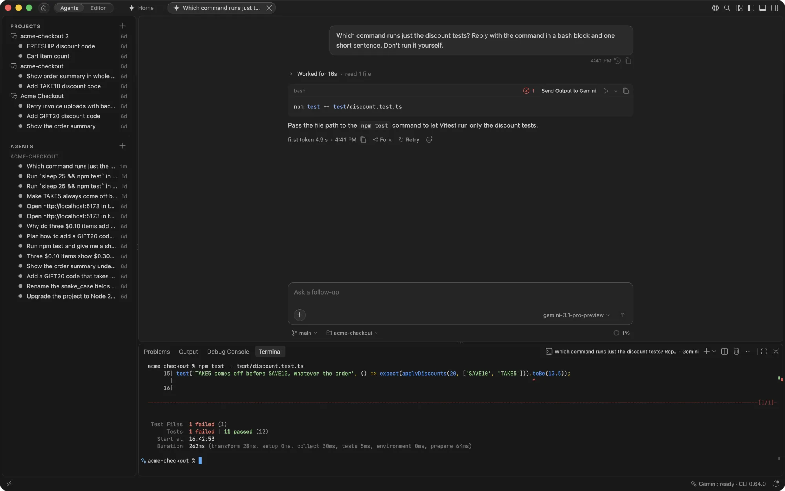

# Terminal

Every agent has a terminal of its own. Commands Gemini suggests in a reply run there with one click, and anything a terminal prints can go back to Gemini when you want its help.

## The agent's terminal

An agent's terminal is named after it, such as "fix-login · Gemini", and opens in the folder the agent works in. For an agent on its own branch, that is the branch's folder. A thread that works in several repositories gets one terminal per repository.

Open it with **Terminal** in the column beside the agent's chat, or with **Open Terminal**: in the composer's **+** menu, in the agent's tab's right-click menu, and under **More** in the agent's right-click menu in the Agents pane. It opens as a tab in the agent's group beside the chat, so it hides and comes back with the agent, as its files do. Removing the agent closes its terminals. They aren't restored when the window reloads: **Open Terminal** starts a new one.

These terminals are yours. The agent runs its own commands through the Gemini CLI, after asking you, and they don't appear here.

## Run a command from a reply

A shell code block in a reply (`bash`, `sh`, `zsh`, `fish`, `console` or PowerShell) has a ▷ button, **Run in Terminal**, beside **Copy**. It sends the command to the agent's terminal and shows the terminal, while the chat stays where it is. In a `console` block, only the lines after a `$` prompt run.

When the command finishes, the block shows how it went: ✓ for success, or ✗ with the exit code and **Send Output to Gemini**. That button attaches the command and the last 200 lines of its output to the composer, for you to add a note and send.

The ⌄ beside it, **More Ways to Run**, has more choices:

- **Insert Without Running** types the command into the terminal and leaves it for you to edit or run with Return.
- **Run in New Terminal** runs it in a fresh terminal instead of the agent's.
- **Run in** followed by a repository's name, in a thread or project with several repositories. A command that names one of the repositories runs there; otherwise the block asks which one.

While a reply is still being written, its Run waits until the block is complete.

### Commands that ask first

Run asks in the block, before anything runs, when a command:

- deletes files or branches, such as `rm -r` or `git clean`
- throws away uncommitted work, such as `git reset --hard` or `git checkout -- .`
- force-pushes
- runs as root
- runs a downloaded script, such as `curl … | sh`
- writes to a disk device
- writes outside the agent's folder
- has a quote that is never closed, so what it runs can't be read

A block with several commands asks too, and Run in a project's coordinator chat always asks, because it runs in your own checkout.

The check reads the command line only. A script the command runs can still write anywhere, so read what you run.

`gemini.chat.runCommands` sets how Run behaves: `askWhenRisky` (the default), `alwaysAsk`, or `off`, which leaves only Copy.

## Send terminal output to Gemini

Right-click in any terminal:

- **Send to Gemini** attaches the selected text.
- **Send Last Command to Gemini** attaches the last command, its exit code and the last 200 lines of its output.

From an agent's terminal, both go to that agent's chat. From any other terminal they go to the chat in front. Nothing is sent until you press Send.

When a command fails, its lightbulb also offers **Ask Gemini About This Failure**, which does the same as Send Last Command.

The last command comes from the shell's integration, which VS Code turns on by default for zsh, bash, fish and PowerShell. In a shell without it, select the output and use Send to Gemini instead. Run still works there, typing the command in after a few seconds, but the block can't tell how the command ended.

## Ask for a command

Press <kbd>⌘I</kbd> in a terminal and describe what you want to do, such as "find the five largest files in this folder". Gemini answers with one command, and nothing runs until you choose:

- **Run** to run it.
- **Insert Without Running** to edit it first.

A risky command says why, and offers **Run Anyway** instead of Run. The request goes to the same fast model as inline edit, so it is off when `gemini.inlineEdit.enabled` is off.

GeminiCode Dark and Light colour the terminal's text, command marks and find results to match the rest of the app.
